# Khí quyển ngoại hành tinh, các tuyên bố "có sự sống" và những phương pháp của tương lai

Tài liệu đi theo 3 câu hỏi:

1. **Phổ khí quyển** của hành tinh ngoài Hệ Mặt Trời đo bằng cách nào, và với 4 hệ Kepler trong repo thì đo được gì?
2. Gần đây có hành tinh nào **"giống Trái Đất" được phát hiện qua phổ** không? Độ tin cậy thật sự là bao nhiêu, báo chí đưa tin ra sao, và những hệ nào từng bị tranh cãi hoặc bị bác bỏ (mục 3.5)?
3. Tương lai: dùng **Mặt Trời làm thấu kính hấp dẫn** để chụp ảnh hành tinh, và **tàu buồm đẩy bằng laser** bay tới sao khác.

Thông tin cập nhật tới **tháng 11/2026**. Mỗi khẳng định đều có link nguồn ở cuối mục tương ứng. Hình có 2 loại: **ảnh từ internet** (Wikimedia Commons, giấy phép tự do, thư mục `img/web/`) và **sơ đồ tự vẽ** (thư mục `img/gen/`, tạo bằng `img/make_illustrations.py`).

## Mục lục

1. [Phổ khí quyển: nguyên lý](#1-phổ-khí-quyển-nguyên-lý)
2. [Với 4 hệ Kepler trong repo: đo được gì?](#2-với-4-hệ-kepler-trong-repo-đo-được-gì)
3. [Có hành tinh "giống Trái Đất" nào được phát hiện qua phổ chưa?](#3-có-hành-tinh-giống-trái-đất-nào-được-phát-hiện-qua-phổ-chưa)
4. [Độ tin cậy: σ nghĩa là gì](#4-độ-tin-cậy-σ-nghĩa-là-gì)
5. [Báo chí đã giật tít thế nào](#5-báo-chí-đã-giật-tít-thế-nào)
6. [Tương lai 1: Mặt Trời làm thấu kính hấp dẫn](#6-tương-lai-1-mặt-trời-làm-thấu-kính-hấp-dẫn)
7. [Tương lai 2: tàu buồm đẩy bằng laser](#7-tương-lai-2-tàu-buồm-đẩy-bằng-laser)
8. [So sánh các hướng đi](#8-so-sánh-các-hướng-đi)
9. [Nguồn ảnh internet](#9-nguồn-ảnh-internet)

---

## 1. Phổ khí quyển: nguyên lý

Có 2 cách chính, đều **không cần chụp ảnh tách riêng hành tinh**: chỉ đo độ sáng tổng của cả hệ ở nhiều bước sóng khác nhau.

### 1.1. Phổ truyền qua (transmission spectrum): lúc transit

Lúc hành tinh đi qua trước sao, một phần nhỏ ánh sáng sao **xuyên qua rìa khí quyển** của hành tinh. Ở bước sóng mà phân tử trong khí quyển hấp thụ mạnh (H₂O, CH₄, CO₂…), khí quyển "đục" hơn nên hành tinh **trông to hơn**, transit **sâu hơn**. Đo độ sâu transit theo bước sóng là ra phổ.

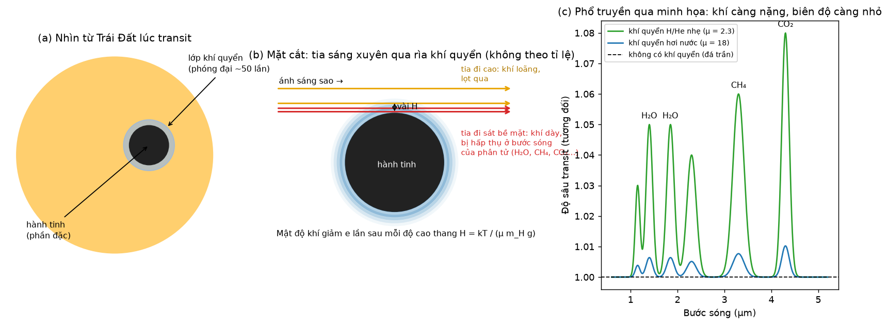

*Tự vẽ. (a) lớp khí quyển là vành mỏng quanh hành tinh; (b) tia sáng đi sát bề mặt bị hấp thụ, tia đi cao lọt qua; (c) khí quyển nhẹ (H/He) cho đặc trưng phổ lớn gấp ~8 lần khí quyển hơi nước.*

**Độ cao thang** (scale height): khoảng cách mà mật độ khí giảm e ≈ 2,7 lần:

$$H = \frac{k_B T}{\mu\, m_H\, g}, \qquad g = \frac{G M_p}{R_p^2}$$

với μ là khối lượng phân tử trung bình (H/He: 2,3; hơi nước: 18; CO₂: 44; không khí Trái Đất: 29).

**Biên độ đặc trưng phổ**: khí quyển che thêm một vành dày cỡ N độ cao thang (N ≈ 2 là quy ước thô), nên độ sâu transit thay đổi

$$\Delta D \approx \frac{2 N H R_p}{R_s^2}$$

Ví dụ Trái Đất transit trước Mặt Trời: H ≈ 8,5 km, ΔD ≈ 2·2·8,5·6.371 / 696.000² ≈ **0,45 ppm**. Hot Jupiter khí H/He như Kepler-6b: ~180 ppm. Đây là lý do **hành tinh giống Trái Đất cực khó đo phổ**: khí quyển nặng (μ lớn), trọng lực mạnh, nhiệt độ thấp, đều làm H nhỏ.

Ảnh internet minh họa dữ liệu thật: transit của WASP-39b ở nhiều bước sóng (JWST NIRSpec). Ở bước sóng CO₂ hấp thụ, transit sâu hơn rõ rệt.

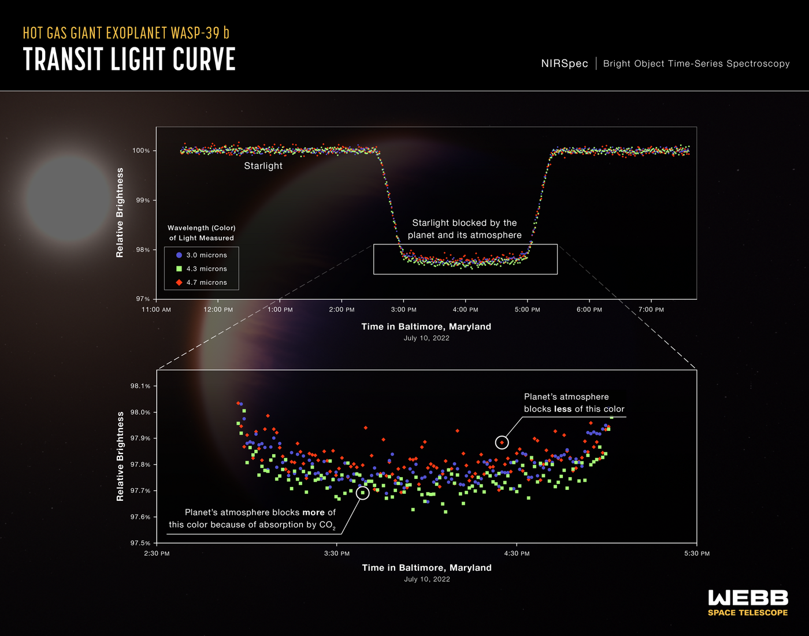

*Nguồn: NASA's James Webb Space Telescope, CC BY 2.0 (chi tiết mục 9).*

### 1.2. Phổ phát xạ (emission spectrum): lúc nhật thực phụ

Nửa vòng quỹ đạo sau transit, hành tinh **khuất sau sao** (nhật thực phụ, secondary eclipse). Độ sáng tổng giảm đúng bằng phần ánh sáng của hành tinh: phản xạ (ánh sáng khả kiến) và phát nhiệt (hồng ngoại).

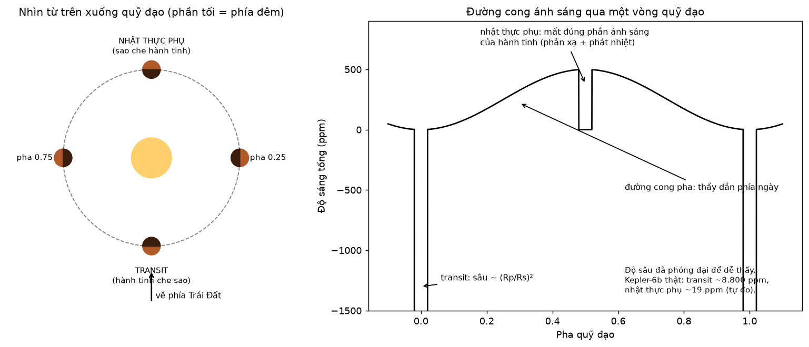

*Tự vẽ. Trái: nhìn từ trên xuống quỹ đạo. Phải: độ sáng tổng qua một vòng (độ sâu đã phóng đại).*

Độ sâu nhật thực phụ ở bước sóng λ:

$$\delta_{ecl}(\lambda) = \underbrace{A_g \left(\frac{R_p}{a}\right)^2}_{\text{phản xạ}} + \underbrace{\left(\frac{R_p}{R_s}\right)^2 \frac{B_\lambda(T_p)}{B_\lambda(T_*)}}_{\text{phát nhiệt}}$$

với $A_g$ là **albedo hình học** (0 = đen tuyền, Trái Đất ~0,37 trong ánh sáng khả kiến), $B_\lambda$ là hàm Planck. Đo $\delta_{ecl}$ ở hồng ngoại rồi giải ngược ra $T_p$ gọi là **nhiệt độ độ sáng** (brightness temperature).

**Nhiệt độ phía ngày** phụ thuộc nhiệt có lan sang phía đêm hay không (Cowan & Agol 2011):
- Nhiệt chia đều cả hành tinh: $T = T_* \sqrt{R_s/a}\,(1/4)^{1/4}$ (đây cũng là $T_{eq}$ với albedo 0).
- Không lan sang phía đêm chút nào: nóng hơn $(8/3)^{1/4} \approx 1{,}28$ lần.

### 1.3. Chỉ số TSM và ESM: hành tinh có đáng để JWST chụp phổ không?

Kempton et al. (2018) đề xuất 2 chỉ số tỉ lệ với **SNR dự kiến** khi chụp bằng JWST trong 10 giờ:

$$\text{TSM} = s \cdot \frac{R_p^3\, T_{eq}}{M_p\, R_s^2} \cdot 10^{-m_J/5}$$

(Rp, Mp theo Trái Đất; Rs theo Mặt Trời; m_J là cấp sao dải J; s = 0,190 khi Rp < 1,5 R⊕; 1,26 khi 1,5–2,75; 1,28 khi 2,75–4; 1,15 khi 4–10.)

$$\text{ESM} = 4{,}29\times10^6 \cdot \frac{B_{7,5\,\mu m}(1{,}1\,T_{eq})}{B_{7,5\,\mu m}(T_*)} \left(\frac{R_p}{R_s}\right)^2 10^{-m_K/5}$$

Ngưỡng đáng ưu tiên: **TSM > 10** với hành tinh đá (< 1,5 R⊕), **TSM > 90** với hành tinh lớn hơn; **ESM > 7,5**.

### 1.4. Cái bẫy lớn nhất: chính ngôi sao

Sao lùn M (loại sao có nhiều hành tinh cỡ Trái Đất dễ đo nhất, như TRAPPIST-1) có nhiều **vết đen và vết sáng**. Khi hành tinh đi qua vùng sao không đồng đều, độ sâu transit đổi theo bước sóng y như có khí quyển (*hiệu ứng nguồn sáng transit*, TLS). Các quan sát đầu tiên của TRAPPIST-1e bằng JWST bị nhiễm bẩn mạnh bởi hiệu ứng này (Espinoza, Glidden và cộng sự, 2025).

---

## 2. Với 4 hệ Kepler trong repo: đo được gì?

Kepler chỉ có **một dải màu** (0,42–0,9 μm), nên tự nó không đo được phổ. Script `scripts/05_atmosphere.py` làm 4 việc (công thức mục 1, chi tiết code ở [`kien-thuc-exoplanet.md`](kien-thuc-exoplanet.md) mục 9.6):

1. **Tự đo nhật thực phụ** trong dữ liệu Kepler (gấp pha ở pha 0,5) → albedo hình học.
2. **Lấy phổ đã công bố** từ NASA Exoplanet Archive (bảng `transitspec`, `emissionspec`, `spectra`).
3. **Độ cao thang và biên độ phổ dự kiến** cho khí quyển H/He, hơi nước, CO₂.
4. **TSM, ESM**.

**Tình hình phổ đã công bố của 4 hệ** (truy vấn ngày 16/11/2026): **không hệ nào có phổ HST hay JWST**. Chỉ có Spitzer:

| Hành tinh | Dữ liệu đã công bố | Nguồn |
|---|---|---|
| Kepler-6 b | Nhật thực phụ ở 3,6 μm (690 ± 270 ppm) và 4,5 μm (1.510 ± 190 ppm) | Désert et al. 2011; Deming et al. 2023 |
| Kepler-10 c | Độ sâu transit ở 4,5 μm (~320 ± 80 ppm) so với dải Kepler (497 ppm) | Désert et al. 2015 |
| Kepler-10 b, Kepler-186 b–f, Kepler-452 b | Không có | |

Kết quả chi tiết từng hệ nằm trong `outputs/<hệ>_atmosphere.md` và tài liệu từng hệ ([`kepler-6.md`](kepler-6.md), [`kepler-10.md`](kepler-10.md), [`kepler-186.md`](kepler-186.md), [`kepler-452.md`](kepler-452.md)). Nổi bật:

- **Kepler-6b**: tự đo được nhật thực phụ trong dải Kepler **19,0 ± 4,5 ppm (4,2σ)** → albedo Ag ≈ 0,13: hành tinh khá tối (Désert et al. 2011 đo được 22 ± 7 ppm). Nhiệt độ độ sáng từ Spitzer (~1.500–1.900 K, tự tính coi sao là vật đen) cao hơn nhiệt độ cân bằng 1.449 K: nhiệt **không kịp lan sang phía đêm**.
- **Kepler-10c**: khí quyển H/He sẽ tạo đặc trưng phổ chỉ vài ppm, trong khi sai số điểm Spitzer ~80 ppm: **dữ liệu hiện có không phân biệt được** có khí quyển hay không.
- **Kepler-186f, Kepler-452b**: sao quá mờ (cấp sao J ~12,3–12,5), hành tinh nhỏ: TSM thấp, không phải mục tiêu khả thi của JWST.

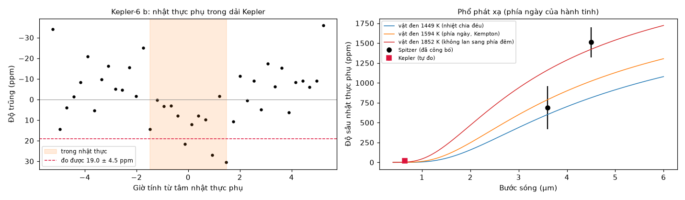

---

## 3. Có hành tinh "giống Trái Đất" nào được phát hiện qua phổ chưa?

**Trả lời ngắn (11/2026): chưa.** Chưa có hành tinh đá cỡ Trái Đất nào được xác nhận có khí quyển giống Trái Đất, càng chưa có dấu hiệu sự sống được xác nhận. Có 3 trường hợp nổi bật thường bị gọi là "giống Trái Đất" hoặc "có dấu hiệu sự sống".

### 3.1. K2-18b: câu chuyện ồn ào nhất

**Hành tinh này KHÔNG giống Trái Đất**: bán kính ~2,6 R⊕, khối lượng ~8,6 M⊕, là **sub-Neptune**, quay quanh sao lùn M cách 124 năm ánh sáng, nằm trong vùng có thể sống. Giả thuyết của nhóm Madhusudhan (Cambridge): **thế giới "Hycean"**, đại dương nước lỏng bên dưới lớp khí giàu hydro.

| Thời điểm | Tuyên bố | Độ tin cậy |
|---|---|---|
| 2019 | HST thấy hơi nước | Báo chí: "nước trên hành tinh có thể sống". Sau đó có ý kiến cho rằng tín hiệu có thể là CH₄ |
| 9/2023 | JWST (NIRISS, NIRSpec): **CH₄ và CO₂**; DMS (dimethyl sulfide) "tạm thời" | CH₄ ~5σ, CO₂ ~3σ, DMS yếu (~1σ) |
| 4/2025 | JWST MIRI (6–12 μm): DMS và/hoặc DMDS | ~3σ. Thông cáo Cambridge: "**gợi ý mạnh nhất từ trước tới nay** về hoạt động sinh học ngoài Hệ Mặt Trời" |
| 4–8/2025 | Phân tích lại độc lập (Taylor; Welbanks et al.; Schmidt et al.; nhóm A&A dùng 3 pipeline × 2 code) | **Không đủ bằng chứng** cho DMS/DMDS. CH₄ vững; CO₂ tùy cách xử lý. "Ưu thế" của DMS đến từ việc **giới hạn số mô hình được so sánh** |
| 8/2025 | Bài "K2-18b không đạt chuẩn bằng chứng về sự sống" (arXiv 2508.05961) | |
| 6/2026 | Phân tích lại dữ liệu gần hồng ngoại (A&A) | CH₄ và CO₂ vững; DMS **chỉ ở mức mấp mé**; mô hình quang hóa cho thấy có thể sinh ra DMS **không cần sự sống** |
| 2026 | Nhóm Renyu Hu (NASA JPL), thêm 4 lần quan sát JWST | DMS chỉ **mấp mé và phụ thuộc mô hình**. Một bài 2026 (arXiv 2605.16674) cho rằng K2-18b có thể chỉ là "mục tiêu đầu tiên" không điển hình, giống vai trò của 51 Pegasi b trong lịch sử tìm hành tinh |

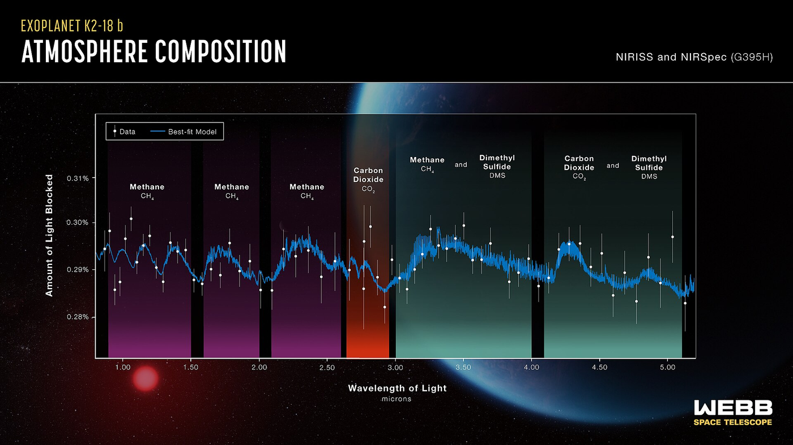

*Nguồn: NASA, CSA, ESA, J. Olmsted (STScI), N. Madhusudhan (Cambridge), CC BY 4.0. Các cột màu đánh dấu vị trí CH₄, CO₂ và DMS. Chú ý thanh sai số lớn so với biên độ các đặc trưng.*

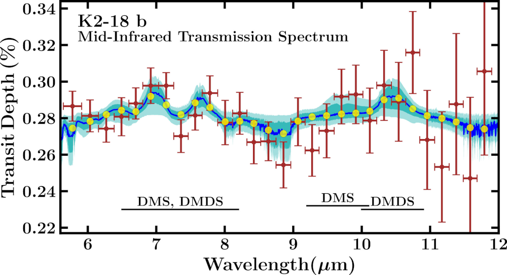

*Nguồn: Madhusudhan et al. 2025, CC BY 4.0. Thanh sai số đỏ cỡ ±0,02% so với biên độ đặc trưng ~0,01–0,02%: tín hiệu chỉ nhỉnh hơn nhiễu một chút.*

**Vì sao DMS gây tranh cãi:**
- Trên Trái Đất DMS gần như chỉ do sinh vật biển tạo ra. Nhưng DMS đã được tìm thấy **ở nơi không có sự sống**: trong sao chổi 67P (tàu Rosetta) và môi trường giữa các vì sao.
- Đặc trưng phổ DMS **chồng lên** đặc trưng của các phân tử khác (CH₄, C₂H₆…) trong cùng dải bước sóng.
- Kết quả phụ thuộc mạnh vào cách xử lý dữ liệu (pipeline) và **danh sách phân tử được đưa vào mô hình**.

### 3.2. TRAPPIST-1e: ứng viên "giống Trái Đất" thật sự

Cỡ Trái Đất (~0,92 R⊕), trong vùng có thể sống của sao lùn M siêu lạnh TRAPPIST-1, cách 40 năm ánh sáng.

- **9/2025** (Espinoza et al.; Glidden et al., 4 transit JWST NIRSpec): **loại** khí quyển giàu hydro nguyên thủy; khí quyển giàu CO₂ kiểu Sao Kim/Sao Hỏa **khó xảy ra**. Khí quyển giàu nitơ như Trái Đất **hoặc** đá trần đều vẫn khớp dữ liệu. Có gợi ý yếu về CH₄, nhưng dữ liệu bị **nhiễm bẩn mạnh bởi vết trên sao** (mục 1.4).
- **12/2025** (arXiv 2512.07695): mô tả chương trình JWST thêm **15 transit** của TRAPPIST-1e, mỗi lần chọn lúc TRAPPIST-1b (hành tinh không khí quyển) transit sát ngay trước/sau, để đo trực tiếp nhiễu do vết trên sao rồi trừ đi mà **không phụ thuộc mô hình sao**. Mô phỏng cho thấy 15 transit đủ phát hiện khí quyển kiểu Trái Đất có CO₂ (Δln Z ≥ 5), *nếu* trừ được nhiễu sao.
- **Cập nhật 11/2026:** tra cứu chưa thấy bài công bố kết quả 15 transit. Tức là tới nay **vẫn chưa biết TRAPPIST-1e có khí quyển hay không**.
- Hành tinh láng giềng **TRAPPIST-1f** (cũng trong vùng có thể sống), **8/2026** (Lim, Doyon et al., arXiv 2608.17207, 5 transit JWST NIRISS): **không thấy** nhiễu do vết trên sao như ở các hành tinh phía trong; **loại** khí quyển giàu H₂/He có áp suất bề mặt > ~20 mbar (độ tin 95%). Khí quyển nặng (N₂, CO₂) chưa loại được, chưa kết luận được.

### 3.3. LHS 1140 b: "siêu Trái Đất" có thể có nitơ

~1,7 R⊕, ~5,6 M⊕, trong vùng có thể sống, cách 48 năm ánh sáng.

- **7/2024** (Cadieux et al.): JWST **loại** khí quyển dày giàu hydro (nên không phải mini-Neptune), có **gợi ý tạm thời** về khí quyển giàu N₂. Nhóm tác giả tự ghi rõ cần quan sát thêm để xác nhận; ước tính cần thêm 1 năm để khẳng định có khí quyển, 2–3 năm để thấy CO₂.

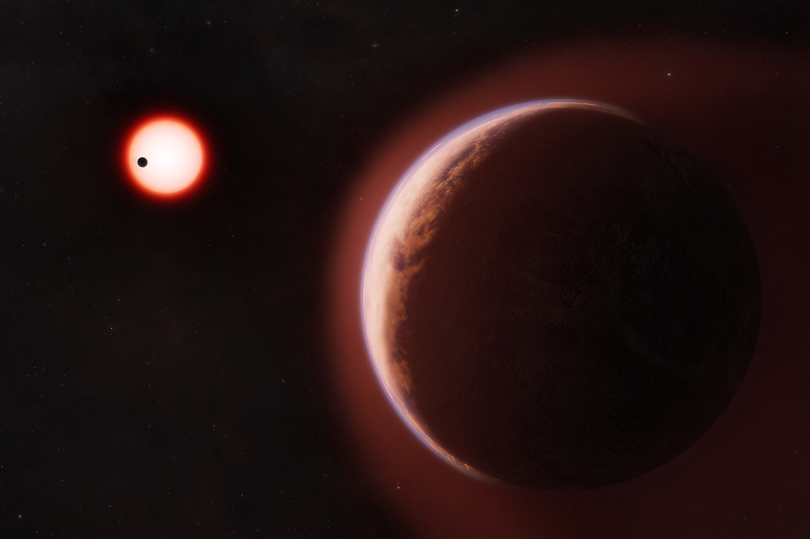

*Nguồn: Melissa Weiss/CfA, CC0. Đây là **tranh minh họa của họa sĩ**, không phải ảnh chụp: chưa kính nào chụp được bề mặt một hành tinh ngoài Hệ Mặt Trời.*

### 3.4. Tóm tắt

| Hành tinh | Có thật sự "giống Trái Đất"? | Đã thấy gì chắc chắn | Tuyên bố gây tranh cãi |
|---|---|---|---|
| K2-18b | **Không** (sub-Neptune 8,6 M⊕) | CH₄ (và có thể CO₂) | DMS/DMDS "dấu hiệu sự sống" |
| TRAPPIST-1e | Cỡ Trái Đất | Không có khí quyển H₂ dày; không giàu CO₂ | Gợi ý CH₄ (bị nhiễu sao) |
| LHS 1140 b | Siêu Trái Đất, nhiều nước | Không có khí quyển H₂ dày | Gợi ý N₂ (tới 11/2026 chưa có xác nhận mới) |
| TRAPPIST-1f | Cỡ Trái Đất | Không có khí quyển H₂/He > ~20 mbar | Không có |

### 3.5. Các hệ khác từng (hoặc đang) bị tranh cãi

K2-18b không phải trường hợp đầu tiên. Lịch sử ngành có nhiều tuyên bố được công bố ầm ĩ rồi bị bác, hoặc vẫn đang treo. Chia làm 4 nhóm.

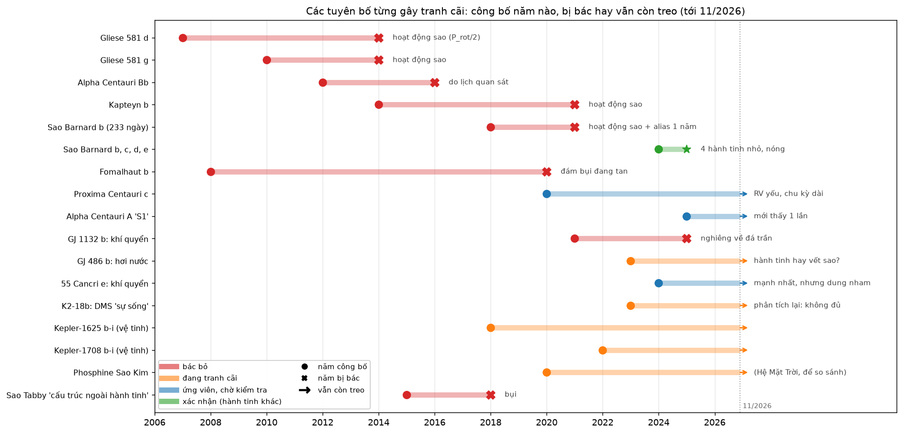

*Tự vẽ. Mỗi dòng là một tuyên bố: chấm tròn = năm công bố, dấu X = năm bị bác, mũi tên = tới 11/2026 vẫn còn treo. Màu theo tình trạng hiện nay.*

**a) Hành tinh có tồn tại không? (tín hiệu vận tốc xuyên tâm hoặc ảnh giả)**

Phương pháp **vận tốc xuyên tâm** (RV) đo sao bị hành tinh kéo lắc qua lại. Nhưng **vết trên sao quay theo sao** cũng làm vạch phổ dịch đi y như vậy. Lấy mẫu thưa (chỉ quan sát được ban đêm, theo mùa) còn sinh ra chu kỳ **"ma"** (alias). Đây chính là 2 bẫy mà repo này đã gặp với TTV: Kepler-10b (lỗi lấy mẫu) và Kepler-186 (sao tự quay ~35 ngày).

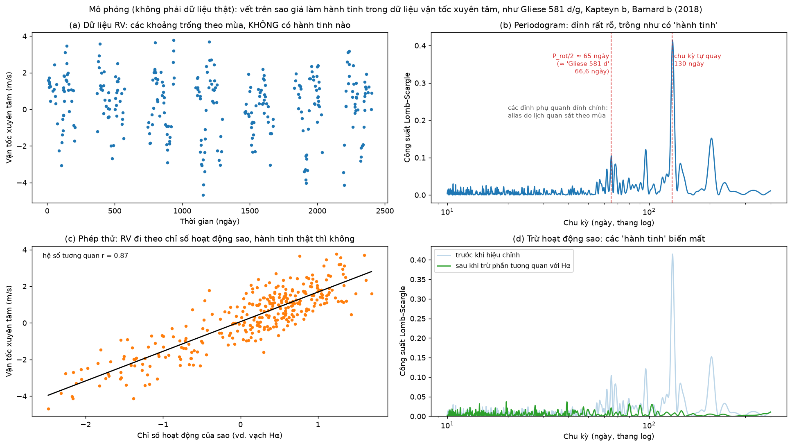

*Tự vẽ, **mô phỏng**: sao tự quay 130 ngày như Gliese 581, không có hành tinh nào. (a) dữ liệu RV với các khoảng trống theo mùa; (b) periodogram vẫn cho đỉnh rất rõ ở chu kỳ tự quay và ở P_rot/2 ≈ 65 ngày (gần đúng chu kỳ của "Gliese 581 d"), cộng các đỉnh alias; (c) phép thử của Robertson et al.: RV tương quan chặt với chỉ số hoạt động Hα, hành tinh thật thì không; (d) trừ phần tương quan đi thì các đỉnh biến mất.*

| Hệ | Tuyên bố | Bị phản bác thế nào | Hiện nay |
|---|---|---|---|
| **Gliese 581 g** (và d) | 2010 (Vogt et al.): hành tinh **trong vùng có thể sống**, báo chí gọi là "Zarmina", có người nói "xác suất có sự sống 100%" | 2014 (Robertson et al., *Science*): tín hiệu d và g do **hoạt động của sao** (sao tự quay 130 ngày), không phải hành tinh. 2015 Anglada-Escudé & Tuomi phản biện riêng cho d | Phần lớn coi g và d **không tồn tại**; b, c, e vẫn thật |
| **Alpha Centauri Bb** | 2012 (Dumusque et al., *Nature*): hành tinh cỡ Trái Đất quanh sao gần nhất giống Mặt Trời, chu kỳ 3,24 ngày | 2016 (Rajpaul et al.): tín hiệu sinh ra từ **lịch quan sát** (window function), dữ liệu nhiễu thuần cũng cho ra "hành tinh" tương tự | **Không tồn tại** |
| **Kapteyn b** | 2014 (Anglada-Escudé et al.): siêu Trái Đất trong vùng có thể sống, sao rất già | 2015 (Robertson et al.) và 2021 (Bortle et al.): do **hoạt động của sao** | **Không tồn tại** |
| **Sao Barnard b** (2018) | 2018 (Ribas et al., *Nature*): siêu Trái Đất lạnh, chu kỳ 233 ngày | 2021 (Lubin et al.): **hoạt động của sao** trùng với **alias 1 năm** | Bị bác. Nhưng **2024–2025** (González Hernández et al.; Basant et al., MAROON-X + ESPRESSO): xác nhận **4 hành tinh khác**, rất nhỏ (0,19–0,34 M⊕, chu kỳ 2,3–6,7 ngày, quá nóng để sống). Đây là một ví dụ tốt về cách khoa học tự sửa sai |
| **Proxima Centauri c** | 2020 (Damasso et al.): hành tinh xa, chu kỳ ~5 năm | Tín hiệu RV yếu, chu kỳ dài gần bằng thời gian quan sát; chưa được nhóm độc lập xác nhận | **Ứng viên**. (Proxima b và d thì chắc chắn) |
| **Fomalhaut b** | 2008 (Kalas et al.): một trong những **ảnh chụp trực tiếp** đầu tiên của hành tinh (HST) | 2020 (Gáspár & Rieke, *PNAS*): chấm sáng **nở to và mờ dần** qua các năm, nghĩa là đám bụi từ 2 vật thể đâm nhau | **Không phải hành tinh** |
| **Alpha Centauri A "S1"** | 8/2025 (Sanghi, Beichman et al.): JWST MIRI thấy một **chấm sáng** có thể là hành tinh khí khổng lồ trong vùng có thể sống | Chỉ thấy **1 lần** (8/2024); 2 lần chụp lại (2/2025, 4/2025) **không thấy**. Nhóm tác giả giải thích là do hành tinh đã chạy khuất | **Ứng viên**. Lần chụp kiểm tra dự kiến 8/2026; tới 11/2026 chưa tìm thấy kết quả công bố |

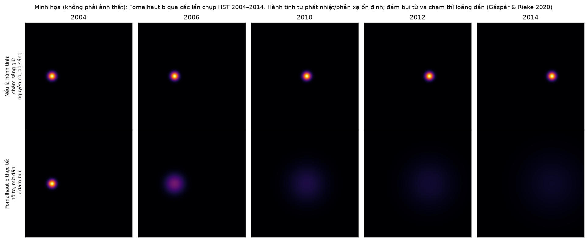

*Tự vẽ, **minh họa** (không phải ảnh HST thật): hành tinh giữ nguyên độ sáng và kích thước qua các năm; Fomalhaut b thực tế nở to và mờ dần, đúng như một đám bụi sinh ra từ va chạm đang tan ra.*

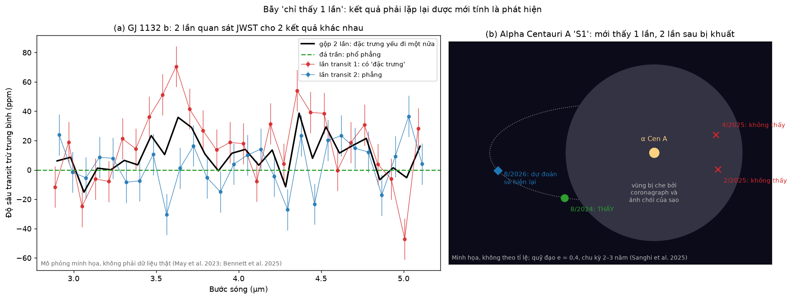

*Tự vẽ, **minh họa**. (a) GJ 1132 b: lần transit 1 có "đặc trưng khí quyển", lần 2 phẳng; gộp lại thì đặc trưng yếu hẳn. (b) Alpha Cen A "S1": thấy ở 8/2024; các lần chụp 2/2025 và 4/2025 có thể rơi vào lúc hành tinh nằm trong vùng bị che sát sao; nếu là thật thì phải hiện lại ở vị trí dự đoán. Quỹ đạo không theo tỉ lệ.*

**b) Hành tinh đá có khí quyển không?**

| Hệ | Tuyên bố | Phản bác / kiểm tra lại | Hiện nay |
|---|---|---|---|
| **GJ 1132 b** | 2021 (Swain et al., HST): khí quyển "thứ cấp" sinh ra từ núi lửa, có HCN, CH₄ | Cùng năm, nhóm khác phân tích lại cùng dữ liệu ra **phổ phẳng**. 2023 (May et al., JWST "Double Trouble"): **2 lần transit cho 2 kết quả khác nhau**. 2025 (Bennett et al., thêm 2 transit): gộp lại **khớp với đường phẳng**; "khí quyển hơi nước mỏng" chỉ xuất hiện nếu tính lần transit đầu | Nhiều khả năng là **đá trần** |
| **GJ 486 b** | 2023 (Moran et al., JWST): có tín hiệu hơi nước | Chính nhóm tác giả nêu: tín hiệu có thể đến từ **vết lạnh trên sao** (hơi nước trong vết đen sao), không phải từ hành tinh | Chưa ngã ngũ |
| **55 Cancri e** | 2024 (Hu et al., *Nature*): JWST thấy dấu hiệu **khí quyển thứ cấp** (CO₂, CO, N₂) trên một hành tinh đá | Bằng chứng mạnh nhất cho tới nay về khí quyển của hành tinh đá, nhưng độ sâu nhật thực phụ **thay đổi giữa các lần đo**, và tác giả ghi rõ chưa kết luận được chắc chắn | Ứng viên mạnh. Lưu ý: bề mặt **dung nham ~2.000 °C**, hoàn toàn không thể có sự sống |
| TRAPPIST-1e, LHS 1140 b | Xem mục 3.2, 3.3 | | Chưa biết |

**c) Vệ tinh ngoài Hệ Mặt Trời (exomoon)**

| Hệ | Tuyên bố | Phản bác | Hiện nay |
|---|---|---|---|
| **Kepler-1625 b-i** | 2018 (Teachey & Kipping): vệ tinh cỡ Sao Hải Vương, từ dữ liệu Kepler + HST | 2019 (Kreidberg et al.): xử lý dữ liệu HST theo cách khác thì tín hiệu yếu đi nhiều. 2024 (Heller & Hippke, *Nature Astronomy*): bằng chứng chủ yếu đến từ dữ liệu HST và bị ảnh hưởng bởi **hoạt động của sao** | Đang tranh cãi |
| **Kepler-1708 b-i** | 2022 (Kipping et al.): vệ tinh cỡ ~2,6 R⊕ | 2024 (Heller & Hippke): bằng chứng **yếu hơn nhiều** so với công bố. Kipping & Teachey phản hồi (arXiv 2401.10333) rằng cả 2 ứng viên "vẫn khả thi, cần quan sát thêm" | Đang tranh cãi |

**Tự kiểm tra bằng pipeline của repo.** Đây là 2 hệ bị tranh cãi duy nhất trong danh sách có dữ liệu Kepler, nên đã chạy đủ 5 bước (báo cáo: `outputs/Kepler1625_report.md`, `outputs/Kepler1625_moons.md`, `outputs/Kepler1708_report.md`, `outputs/Kepler1708_moons.md`):

| | Kepler-1625 b | Kepler-1708 b |
|---|---|---|
| Transit trong dữ liệu Kepler | 3 (một lần rơi vào khoảng trống dữ liệu) | **2** |
| BLS tự tìm ra? | Không: transit dài 19 giờ, vượt lưới thời lượng BLS (tối đa 14 giờ) | Không: dưới 3 transit. NASA còn **thiếu T0/T14**, nên tự đo trong light curve: BKJD 772,21 và 1509,31, cách nhau 737,10 ngày (Kipping: 737,11) |
| SNR khi gấp pha / báo động giả | 62 / 0,00% | 121 / 0,00% |
| Bán kính hành tinh (R⊕), tự đo (NASA) | 5,45 (6,06). Phụ thuộc mạnh bán kính sao: KIC 0,84 R☉, Teachey & Kipping dùng ~1,8 R☉ nên ra cỡ Sao Mộc | 8,82 (9,96) |
| O − C (TTV) | rms 8,5 phút, χ²_red = 5,5: lệch nhiều hơn sai số, nhưng 3 điểm thì không kiểm định được chu kỳ | Không đo được: 2 transit luôn nằm đúng trên một đường thẳng |
| Giới hạn bán kính vệ tinh (OSE) | < 1,9 R⊕ với sao 0,84 R☉; tỉ lệ thuận với Rs nên **~4 R⊕ nếu sao 1,8 R☉**, đúng cỡ vệ tinh "cỡ Sao Hải Vương" được tuyên bố | < 2,7 R⊕, nhưng vùng vai có **nhiễu đỏ ±400 ppm** nên giới hạn thật kém hơn; vệ tinh được tuyên bố ~2,6 R⊕ |
| Kết luận | **Không xác nhận, không bác bỏ được** | **Không xác nhận, không bác bỏ được** |

Đúng như tranh cãi giữa các nhóm: tín hiệu (nếu có) nằm sát ngưỡng nhiễu của dữ liệu Kepler. Phương pháp OSE và TTV đơn giản của repo yếu hơn mô hình quang động lực (photodynamical) mà các nhóm Kipping hay Heller dùng, và Kepler-1625 b-i còn dựa vào **1 lần transit HST năm 2017** nằm ngoài dữ liệu Kepler. Muốn phân xử phải có thêm transit mới (Kepler-1708 b lần tới khoảng đầu tháng 4/2027 theo chu kỳ tự đo, Kepler-1625 b mỗi ~287 ngày), bằng HST hoặc JWST.

Các hệ bị tranh cãi còn lại không chạy được bằng bước 1–5: dữ liệu của chúng là vận tốc xuyên tâm (Gliese 581, Kapteyn, Barnard, Proxima, Alpha Cen B), ảnh chụp trực tiếp (Fomalhaut, Alpha Cen A), phổ JWST/HST (GJ 1132 b, GJ 486 b, 55 Cnc e), hoặc dữ liệu K2/TESS (K2-18, TRAPPIST-1, LHS 1140).

**Sơ đồ từng hệ (bước 7, `scripts/07_disputed_systems.py`).** Mỗi hệ ở trên có một sơ đồ cùng kiểu với các hệ Kepler: hành tinh đã xác nhận (NASA), hành tinh **bị bác** (xám, chấm chấm, ✗) và **ứng viên** (gạch chấm, ?) đặt đúng quỹ đạo đã từng công bố, cạnh vùng có thể sống. Tất cả trong `outputs/disputed/disputed_systems.md`. Ví dụ Gliese 581: 2 "hành tinh" bị bác d và g nằm đúng trong vùng có thể sống, chính là 2 hành tinh từng khiến báo chí nói "có thể có sự sống"; 3 hành tinh thật b, c, e đều nằm phía trong, quá nóng.

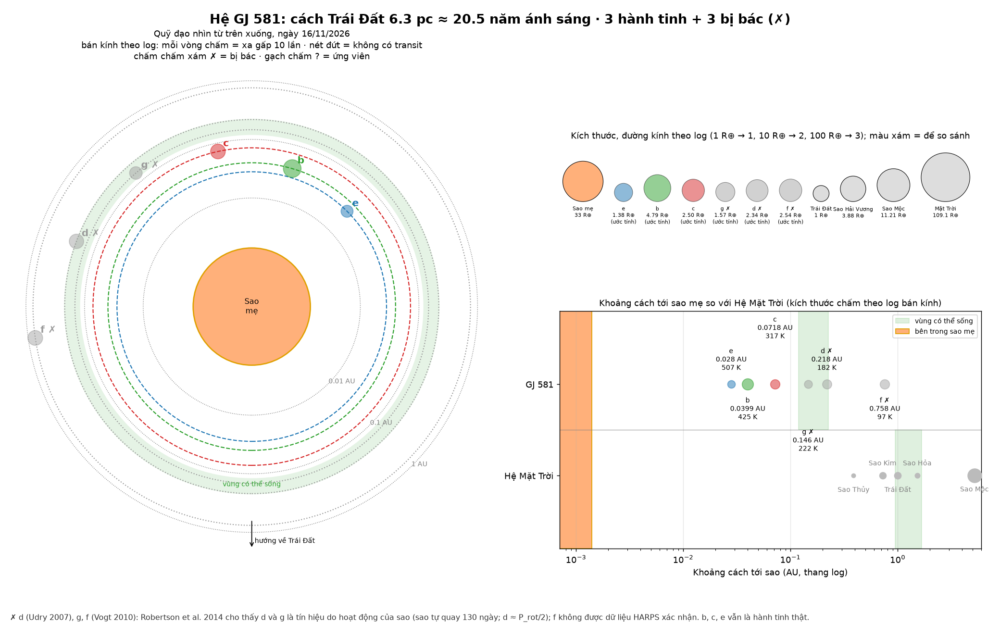

**Tự kiểm tra phổ JWST / HST (bước 6, `scripts/06_disputed_spectra.py`).** Với các hành tinh có phổ, bước 6 tải thẳng điểm phổ đã công bố từ NASA Exoplanet Archive rồi làm 2 phép thử: phổ khác một **đường phẳng** bao nhiêu σ (đá trần hoặc mây dày cho phổ phẳng), và các **nhóm / pipeline khác nhau** có ra cùng kết quả không. Báo cáo đầy đủ: `outputs/disputed/disputed_spectra.md`.

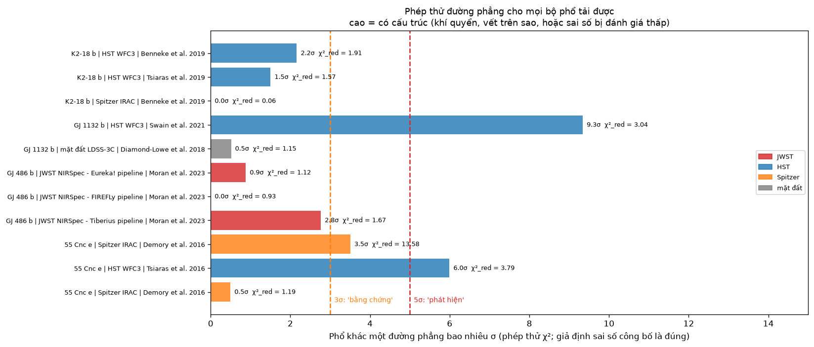

*Tạo bởi bước 6 từ số liệu công bố. Thanh càng dài thì phổ càng khác đường phẳng; nhưng "khác phẳng" có thể do khí quyển, do vết trên sao, hoặc do sai số công bố bị đánh giá thấp.*

| Hành tinh | Bộ phổ | Kết quả tự kiểm tra | Khớp với tranh cãi thế nào |
|---|---|---|---|
| **GJ 1132 b** | HST WFC3, Swain et al. 2021 (94 điểm) | Khác phẳng **9,3σ**, nhưng χ²_red = 3,0: phân tán gấp ~1,7 lần sai số công bố | Mugnai et al. 2021 xử lý lại **cùng dữ liệu HST** ra phổ phẳng; JWST 2023–2025 nghiêng về đá trần. 9,3σ ở đây nhiều khả năng do sai số bị đánh giá thấp hoặc lỗi hệ thống, không phải khí quyển |
| GJ 1132 b | Mặt đất LDSS-3C, Diamond-Lowe 2018 | Phẳng (0,5σ), đủ nhạy để **loại khí quyển H/He** trong không mây | Nhất quán với "đá trần" |
| **GJ 486 b** | JWST NIRSpec, cùng dữ liệu xử lý bằng 3 pipeline (Eureka!, FIREFLy, Tiberius) | 0,0σ đến 2,8σ, **cả 3 dưới 3σ**; 3 pipeline **khớp nhau** trong sai số. Đủ nhạy để **loại khí quyển H/He** | Tín hiệu "hơi nước" của Moran et al. nằm dưới ngưỡng 3σ của phép thử đơn giản này: đúng với kết luận "chưa ngã ngũ, có thể do vết lạnh trên sao" |
| **K2-18 b** | HST WFC3, Benneke 2019 và Tsiaras 2019 (cùng dữ liệu, 2 nhóm) | 2,2σ và 1,5σ; 2 nhóm **khớp nhau** (0,4σ). Có thể thấy bằng mắt một bướu ~60 ppm ở 1,4 μm (dải H₂O) | "Hơi nước" HST 2019 chỉ là gợi ý yếu; về sau JWST cho thấy tín hiệu có thể là CH₄. Phổ JWST 2023/2025 (CH₄, CO₂, DMS) **không tải được qua TAP** nên chưa kiểm tra |
| **55 Cnc e** | HST WFC3, Tsiaras 2016 | Khác phẳng **6,0σ** (χ²_red = 3,8) | Tsiaras tuyên bố khí quyển nhẹ giàu H/HCN; về sau không được xác nhận, và hành tinh nóng ~2.000 K khó giữ hydro |
| 55 Cnc e | Spitzer, nhật thực phụ 4,5 μm, Demory 2016 (2 lần đo) | 2 lần đo **lệch nhau 3,5σ** (47 và 176 ppm) | Đúng hiện tượng nổi tiếng: độ sâu nhật thực của 55 Cnc e **thay đổi giữa các lần đo** (núi lửa? mây? khí quyển thay đổi?) |
| TRAPPIST-1 e, f; LHS 1140 b | (chỉ có trong bảng `spectra`) | Không có điểm phổ tải được qua TAP | Chưa kiểm tra; hình `outputs/disputed/<hành tinh>_coverage.png` cho thấy JWST/HST đã đo những dải bước sóng nào |

**Bài học từ chính kết quả tự kiểm tra:** phổ khác phẳng *nhiều σ nhất* (GJ 1132 b HST, 55 Cnc e HST) lại chính là 2 tuyên bố **về sau không đứng vững**, vì σ cao đến từ việc sai số công bố nhỏ hơn độ phân tán thật (χ²_red ≫ 1). Còn phổ JWST của GJ 486 b có sai số khớp với độ phân tán (χ²_red ≈ 1), lại gần phẳng, và 3 pipeline đồng ý với nhau.

**d) "Sự sống" ngoài ngành hành tinh ngoài hệ (để so sánh)**

| Trường hợp | Tuyên bố | Hiện nay |
|---|---|---|
| **Phosphine trên Sao Kim** | 2020 (Greaves et al.): khí PH₃ trong mây Sao Kim, "có thể do sinh vật" | Phân tích lại cho thấy tín hiệu yếu hơn nhiều, có thể do lỗi xử lý dữ liệu hoặc nhầm với SO₂. Vẫn tranh cãi |
| **Sao Tabby (KIC 8462852)** | 2015: độ sáng tụt bất thường tới 22%, báo chí: "cấu trúc khổng lồ của người ngoài hành tinh" | 2018: độ tụt sáng **phụ thuộc bước sóng**, nghĩa là do **bụi**, không phải vật rắn nhân tạo |

**Bài học chung:**

1. **Tín hiệu đầu tiên thường mạnh hơn thực tế** (khi có thêm dữ liệu, tín hiệu thường yếu đi). Các tuyên bố gần ngưỡng phát hiện đều phải được **nhóm độc lập, dữ liệu mới** kiểm tra lại.
2. **Ngôi sao là nguồn nhiễu số 1**: vết đen, sao tự quay, bùng sáng giả được cả RV, phổ truyền qua lẫn TTV.
3. **Lịch quan sát tạo chu kỳ "ma"**: alias 1 năm, 1 ngày, hoặc lỗi lấy mẫu 29,4 phút như Kepler-10b trong repo này.
4. **Chỉ thấy 1 lần thì chưa phải phát hiện** (Alpha Cen A S1, GJ 1132 b lần transit đầu).
5. **Kết quả đổi theo cách xử lý dữ liệu** (pipeline, danh sách phân tử, mô hình sao): K2-18b, Kepler-1625 b-i, GJ 1132 b.

Nguồn mục 3.5:
[Robertson et al. 2014, Gliese 581 (arXiv 1407.1049)](https://arxiv.org/abs/1407.1049) ·
[Anglada-Escudé & Tuomi 2015, phản biện (arXiv 1503.01976)](https://arxiv.org/abs/1503.01976) ·
[Space.com: Whatever happened to Gliese 581g?](https://www.space.com/23821-gliese-581g.html) ·
[NASA Astrobiology: Not a planet after all](https://astrobiology.nasa.gov/news/not-a-planet-after-all/) ·
[AAS Nova 3/2025: Barnard's Star hosts four tiny planets](https://aasnova.org/2025/03/11/confirmed-at-last-barnards-star-hosts-four-tiny-planets/) ·
[Space.com: 4 rocky exoplanets around Barnard's Star](https://www.space.com/the-universe/exoplanets/4-rocky-exoplanets-found-around-barnards-star-one-of-the-suns-nearest-neighbors) ·
[Sanghi et al. 2025, α Cen A candidate (ApJL)](https://iopscience.iop.org/article/10.3847/2041-8213/adf53f) ·
[AAS Nova 8/2025: Potential discovery of a world next door](https://aasnova.org/2025/08/11/potential-discovery-of-a-world-next-door/) ·
[Science News: A giant planet may orbit our closest sunlike neighbor](https://www.sciencenews.org/article/planet-orbit-close-star-sun-centauri) ·
[Universe Today: GJ 1132 b doesn't have an atmosphere](https://www.universetoday.com/articles/gj-1132-b-doesnt-have-an-atmosphere-according-to-new-jwst-data) ·
[GJ 1132b thermal emission, JWST (arXiv 2408.13340)](https://arxiv.org/abs/2408.13340) ·
[Hu et al. 2024, 55 Cancri e (arXiv 2405.04744)](https://arxiv.org/abs/2405.04744) ·
[Heller & Hippke 2024, Nature Astronomy](https://www.nature.com/articles/s41550-023-02148-w) ·
[Kipping & Teachey, phản hồi (arXiv 2401.10333)](https://arxiv.org/abs/2401.10333) ·
[Astrobiology.com: Giant doubts about giant exomoons](https://astrobiology.com/2024/02/06/giant-doubts-about-giant-exomoons/)

Nguồn mục 3:
[Cambridge: Strongest hints yet of biological activity](https://www.cam.ac.uk/stories/strongest-hints-of-biological-activity) ·
[Phys.org 4/2025](https://phys.org/news/2025-04-astronomers-strongest-life-planet.html) ·
[Schmidt et al. 2025, AJ (arXiv 2501.18477)](https://arxiv.org/abs/2501.18477) ·
[Insufficient evidence for DMS and DMDS, A&A 2025](https://www.aanda.org/articles/aa/full_html/2025/08/aa55580-25/aa55580-25.html) ·
[K2-18b Does Not Meet The Standards of Evidence For Life (arXiv 2508.05961)](https://arxiv.org/pdf/2508.05961) ·
[The atmospheric composition of the sub-Neptune K2-18b, A&A 6/2026](https://www.aanda.org/articles/aa/full_html/2026/06/aa57718-25/aa57718-25.html) ·
[Planetary Society: A possible sign of life on K2-18b?](https://www.planetary.org/articles/possible-sign-of-life-k2-18-b) ·
[Astronomy.com: But is it a sign of life?](https://www.astronomy.com/science/k2-18-b-could-have-dimethyl-sulfide-in-its-air-but-is-it-a-sign-of-life/) ·
[Phys.org 9/2025: TRAPPIST-1e unlikely to have a Venus- or Mars-like atmosphere](https://phys.org/news/2025-09-exoplanet-trappist-1e-venus-mars.html) ·
[JWST-TST DREAMS, TRAPPIST-1e (arXiv 2509.05407)](https://arxiv.org/pdf/2509.05407) ·
[JWST TRAPPIST-1 e/b Program (arXiv 2512.07695)](https://arxiv.org/pdf/2512.07695) ·
[Scientific American: hints of an atmosphere on TRAPPIST-1e](https://www.scientificamerican.com/article/jwst-sees-hints-of-an-atmosphere-on-a-potentially-habitable-exoplanet/) ·
[Sky & Telescope: Titan-like atmosphere?](https://skyandtelescope.org/astronomy-news/webbs-first-look-at-trappist-1e-hints-at-a-titan-like-atmosphere/) ·
[EarthSky: LHS 1140 b](https://earthsky.org/space/ocean-world-lhs-1140-b-exoplanets-astrobiology/) ·
[Sky at Night: LHS 1140 b](https://www.skyatnightmagazine.com/news/lhs-1140-b-exoplanet) ·
[Phys.org 12/2025: The solution to finding an atmosphere on TRAPPIST-1 e](https://phys.org/news/2025-12-solution-atmosphere-trappist.html) ·
[TRAPPIST-1 f, JWST NIRISS SOSS (arXiv 2608.17207)](https://arxiv.org/abs/2608.17207) ·
[Big Think: The evidence for biosignatures on K2-18b is flimsy](https://bigthink.com/starts-with-a-bang/evidence-biosignatures-k2-18b-flimsy/) ·
[The First Remotely Detected Biosignature May Not Be the Most Common (arXiv 2605.16674)](https://arxiv.org/pdf/2605.16674)

---

## 4. Độ tin cậy: σ nghĩa là gì

Trong vật lý, độ tin cậy thường được nói bằng "**bao nhiêu sigma (σ)**": nếu thật ra **không có gì**, chỉ có nhiễu ngẫu nhiên phân bố chuẩn, thì xác suất nhiễu tự tạo ra tín hiệu mạnh cỡ đó là bao nhiêu.

| Mức | Xác suất nhiễu vượt ngưỡng (một phía) | Tức là | Thường được gọi |
|---|---|---|---|
| 1σ | 15,9% | 1 lần trong 6 | không có gì |
| 2σ | 2,3% | 1 lần trong 44 | gợi ý rất yếu |
| 3σ | 0,135% | **1 lần trong ~740** | "bằng chứng" (evidence) |
| 5σ | 0,000029% | **1 lần trong ~3,5 triệu** | **"phát hiện"** (detection), chuẩn của vật lý hạt, sóng hấp dẫn |

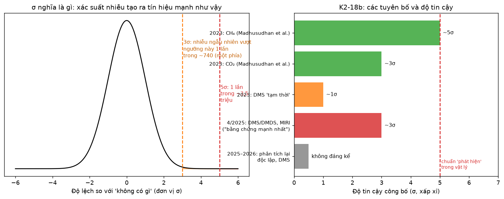

*Tự vẽ. Trái: phân bố chuẩn với ngưỡng 3σ, 5σ. Phải: độ tin cậy công bố (xấp xỉ) của các tuyên bố về K2-18b.*

**Vì sao 3σ chưa đủ:**
1. **Thử nhiều chỗ** (look-elsewhere effect): kiểm tra hàng chục phân tử ở hàng trăm bước sóng thì việc *một* tín hiệu đạt 3σ do may rủi là chuyện bình thường. Đây cũng chính là lý do script `02_analyze.py` làm phép thử báo động giả với 3.000 cặp (P, T0) ngẫu nhiên (xem [`kepler-452.md`](kepler-452.md)).
2. **σ trong phổ khí quyển không phải là đo trực tiếp**: được quy đổi từ **tỉ số Bayes** giữa mô hình "có DMS" và "không DMS". Nếu mô hình "không DMS" thiếu những phân tử khác có thể giải thích tín hiệu, thì mô hình "có DMS" thắng một cách giả tạo (đúng kết luận của nhóm A&A 2025).
3. **Sai số hệ thống** (pipeline xử lý, vết trên sao) không nằm trong phân bố chuẩn, nên σ danh nghĩa đánh giá quá cao độ tin cậy.
4. "Tuyên bố phi thường cần bằng chứng phi thường": sự sống ngoài Trái Đất là tuyên bố lớn nhất của khoa học, nên cần **nhiều phân tử độc lập**, **nhiều nhóm độc lập**, **loại trừ mọi cách tạo ra không cần sự sống**.

---

## 5. Báo chí đã giật tít thế nào

### 5.1. Các tít thật về K2-18b (4/2025)

| Nguồn | Tít | Nhận xét |
|---|---|---|
| Thông cáo Đại học Cambridge | "Strongest hints yet of biological activity outside the solar system" | Dùng "hints" (gợi ý), nhưng "strongest yet" dễ bị hiểu nhầm |
| Reuters, đăng lại trên CBC, Dawn, ABS-CBN, Times Live… | "Scientists find **strongest evidence yet of life** on an alien planet" | "hints" thành "**evidence**", "biological activity" thành "**life**" |
| Times of Israel | "Astronomers say they've found strongest ever 'hints' of life beyond our solar system" | Giữ dấu ngoặc ở "hints" |
| BBC | Thận trọng hơn: "bằng chứng mới nhưng tạm thời" | |
| Hackaday | "Life on K2-18b? Don't get your hopes up just yet" | Nêu ngay phản biện |
| National Geographic, IFLScience, Planetary Society | Giải thích bối cảnh, đưa ý kiến các nhóm khác | |

Chính trưởng nhóm, Nikku Madhusudhan, nói: đây là "những gợi ý đầu tiên về một thế giới **có thể** có sự sống". Chỉ 6 ngày sau (22/4/2025) đã có bài phân tích lại độc lập cho thấy không có bằng chứng mạnh; nhưng tin phản biện **ít được đưa hơn nhiều** so với tin ban đầu.

### 5.2. Những kiểu "biến hình" thường gặp

| Bài báo khoa học nói | Tít báo thành |
|---|---|
| "gợi ý" (hint), "tạm thời" (tentative), 3σ | "bằng chứng" (evidence), "phát hiện" (discovery) |
| "khí có thể do sinh vật tạo ra" (possible biosignature) | "dấu hiệu sự sống" (signs of life) |
| "trong vùng có thể sống" (habitable zone) | "hành tinh có thể sống được", "Trái Đất thứ hai" |
| sub-Neptune 8,6 M⊕ | "giống Trái Đất" |
| "chưa loại trừ được" (not ruled out) | "có thể có" |
| tranh minh họa của họa sĩ | đặt cạnh tít như thể ảnh chụp |

### 5.3. Đọc tin về "sự sống ngoài hành tinh" thế nào

1. **Bao nhiêu σ?** Dưới 5σ thì chưa phải "phát hiện".
2. **Nhóm khác đã kiểm tra lại chưa?** Một nhóm, một bộ dữ liệu, một pipeline thì chưa đủ.
3. **Có cách tạo ra phân tử đó mà không cần sự sống không?**
4. **Hành tinh to cỡ nào?** "Trong vùng có thể sống" khác xa "giống Trái Đất".
5. **Ảnh là ảnh chụp hay tranh vẽ?** Tới nay chưa có ảnh chụp bề mặt hành tinh ngoài Hệ Mặt Trời nào; ảnh "chụp được" nhiều nhất chỉ là vài điểm ảnh của hành tinh khí khổng lồ trẻ, nóng.
6. **Bài báo khoa học đã qua bình duyệt chưa**, hay chỉ là thông cáo báo chí, bản thảo arXiv?

Nguồn mục 5:
[AllSides: tổng hợp tít các báo](https://www.allsides.com/story/science-scientists-find-strongest-evidence-yet-life-distant-planet-k2-18b) ·
[CBC (Reuters)](https://www.cbc.ca/lite/story/1.7512703) ·
[Dawn (Reuters)](https://www.dawn.com/news/1904855) ·
[Times of Israel](https://www.timesofisrael.com/astronomers-say-theyve-found-strongest-ever-hints-of-life-beyond-our-solar-system/) ·
[Hackaday](https://hackaday.com/2025/04/28/life-on-k2-18b-dont-get-your-hopes-up-just-yet) ·
[National Geographic](https://www.nationalgeographic.com/science/article/alien-planet-signs-life-biosignature-exoplanet) ·
[IFLScience](https://www.iflscience.com/an-exoplanet-discovered-with-hints-of-biology-this-is-what-you-need-to-know-78853) ·
[Cambridge](https://www.cam.ac.uk/stories/strongest-hints-of-biological-activity)

---

## 6. Tương lai 1: Mặt Trời làm thấu kính hấp dẫn

### 6.1. Ý tưởng

Theo thuyết tương đối rộng, khối lượng làm cong đường đi của ánh sáng. Mặt Trời là một **thấu kính khổng lồ** đường kính 1,4 triệu km. Ánh sáng từ một hành tinh xa, đi sượt qua mép Mặt Trời, bị bẻ cong và hội tụ ở phía bên kia, **xa hơn 548 AU** (gấp ~14 lần khoảng cách tới Sao Diêm Vương). Đặt kính thiên văn ở đó sẽ được **khuếch đại hàng trăm tỉ lần** và **độ phân giải đủ để chụp ảnh bề mặt** hành tinh ngoài Hệ Mặt Trời.

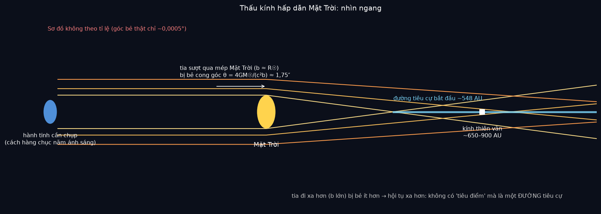

*Tự vẽ, không theo tỉ lệ. Tia sượt mép Mặt Trời bị bẻ nhiều nhất và hội tụ gần nhất (548 AU); tia đi xa hơn hội tụ xa hơn, tạo thành một **đường tiêu cự** kéo dài vô hạn chứ không phải một điểm.*

### 6.2. Công thức

**Góc lệch** của tia sáng đi cách tâm Mặt Trời một khoảng b (Einstein 1915):

$$\theta = \frac{4 G M_\odot}{c^2 b} = \frac{2 r_g}{b}, \qquad r_g = \frac{2GM_\odot}{c^2} \approx 2{,}95\ \text{km}$$

Với b = R☉: θ ≈ 8,5 × 10⁻⁶ rad = **1,75″** (đã đo được lần đầu trong nhật thực 1919).

**Khoảng cách hội tụ** (tia đi cách tâm b gặp trục ở):

$$z = \frac{b}{\theta} = \frac{b^2}{2 r_g} \approx 548 \left(\frac{b}{R_\odot}\right)^2\ \text{AU}$$

**Hệ số khuếch đại** trên trục (Turyshev & Toth 2022):

$$\mu_0 = \frac{4\pi^2 r_g}{\lambda} \approx 1{,}17 \times 10^{11} \left(\frac{1\ \mu m}{\lambda}\right)$$

**Độ phân giải góc**: δθ ≈ 0,38 λ/b ≈ **10⁻¹⁰ giây cung** ở 1 μm. Để so sánh: JWST ~0,1″, tức kém hơn **1 tỉ lần**.

**Kích thước ảnh của hành tinh** trên "mặt phẳng ảnh" ở khoảng cách z̄ từ Mặt Trời, khi hành tinh bán kính R⊕ cách z₀:

$$D_{ảnh} = 2 R_\oplus \frac{\bar z}{z_0} \approx 1{,}34\ \text{km} \left(\frac{\bar z}{650\ \text{AU}}\right)\left(\frac{30\ \text{pc}}{z_0}\right)$$

Ví dụ tự tính: hành tinh cỡ Trái Đất quanh Proxima Centauri (1,3 pc) → ảnh rộng ~31 km; Kepler-186f (178 pc) → ảnh chỉ ~0,23 km.

### 6.3. Nhìn từ con tàu: vòng Einstein

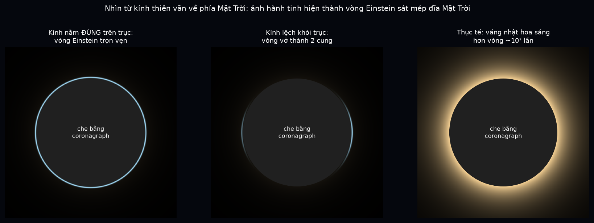

*Tự vẽ. Ảnh hành tinh hiện thành một vòng sáng mảnh sát mép Mặt Trời (vòng Einstein). Kính nằm đúng trên trục: vòng trọn vẹn; lệch trục: vòng vỡ thành 2 cung. Khó khăn lớn nhất: vầng nhật hoa của Mặt Trời sáng hơn vòng Einstein hàng chục triệu lần, phải che bằng coronagraph với độ tương phản ~10⁻⁷.*

Ví dụ vòng Einstein thật do một thiên hà làm thấu kính cho thiên hà phía sau (cùng cơ chế, quy mô khác):

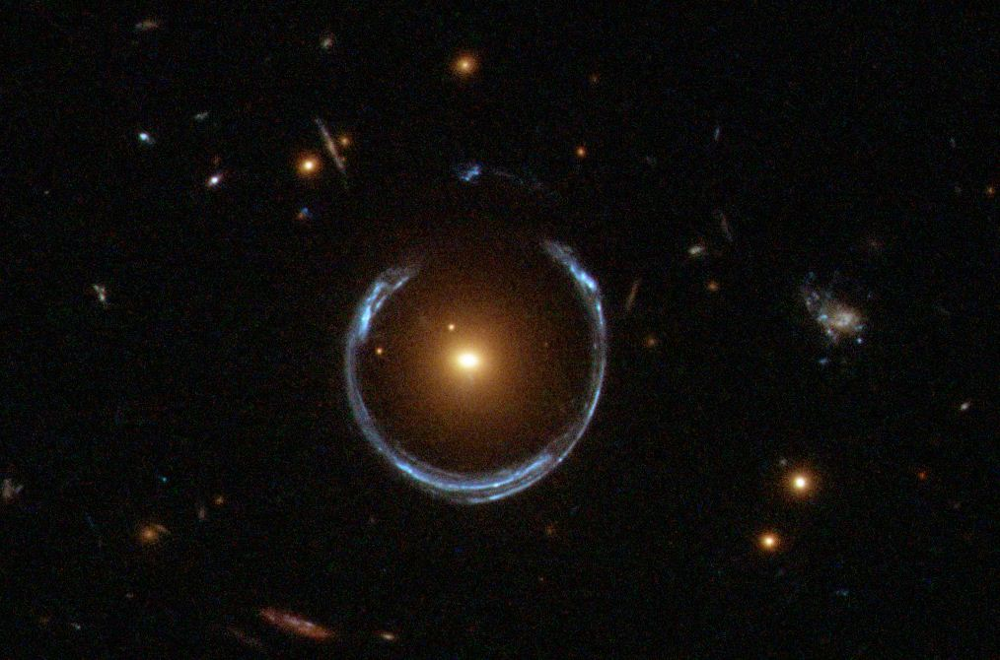

*Nguồn: ESA/Hubble & NASA, phạm vi công cộng.*

### 6.4. Ghép ảnh từng điểm một

Kính thiên văn (~1 m) nhỏ hơn rất nhiều so với ảnh rộng 1,3 km, nên mỗi vị trí chỉ đo được **một điểm ảnh** (độ sáng tổng của vòng Einstein). Tàu phải **di chuyển quét** khắp mặt phẳng ảnh, rồi dùng thuật toán giải chập (deconvolution) để dựng lại ảnh.

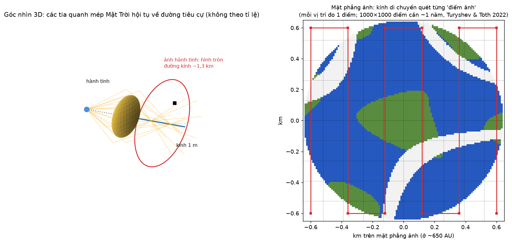

*Tự vẽ. Trái: các tia quanh mép Mặt Trời hội tụ về đường tiêu cự; vòng đỏ là vùng ảnh của hành tinh (~1,3 km). Phải: kính quét qua mặt phẳng ảnh, mỗi vị trí cho 1 điểm ảnh.*

Theo Turyshev & Toth (2022): ảnh **1000 × 1000 điểm** của một hành tinh cỡ Trái Đất quanh Proxima Centauri đạt SNR ≫ 10 với **khoảng 14 tháng** tích lũy. Ở 30 pc, ảnh 128 × 128 điểm cần ~0,85 năm.

### 6.5. Đường tới 650 AU

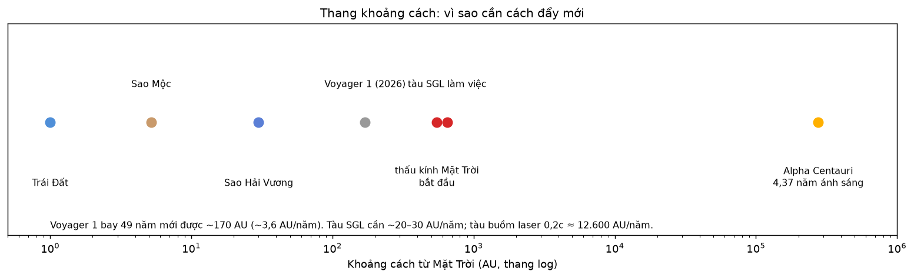

*Tự vẽ. Voyager 1, tàu xa nhất hiện nay, sau 49 năm mới tới ~170 AU.*

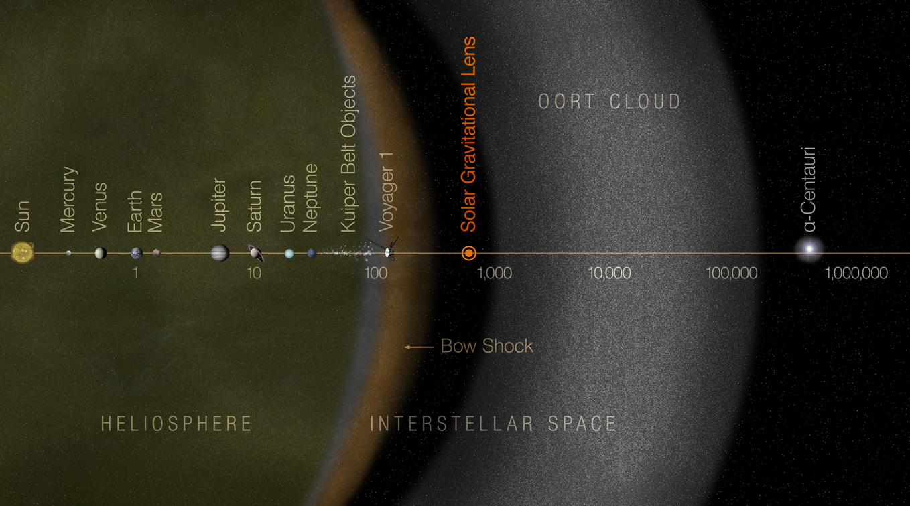

*Nguồn: NASA, phạm vi công cộng.*

Bay tới 650 AU trong 20 năm cần vận tốc trung bình **32,5 AU/năm = 154 km/s**, nhanh gấp ~9 lần Voyager 1. Turyshev (2026) so sánh các cách đẩy:

| Cách đẩy | Kết quả |
|---|---|
| Buồm Mặt Trời bay sát Mặt Trời (0,05 AU) | Cần khối lượng/diện tích chỉ 2,3–4,9 g/m² để đạt 105–155 km/s |
| Động cơ điện hạt nhân (20 tấn, Isp 9.000 s) | 27–33 năm tới 650 AU |
| Kết hợp (tầng đẩy đầu 50–70 km/s) | Gần 20 năm |

Mục tiêu phóng trong giai đoạn **2035–2040**. Hạn chế lớn: **một tàu chỉ chụp được một mục tiêu** (đường tiêu cự của mỗi ngôi sao nằm ở một hướng khác nhau), nên phải chọn trước hành tinh đáng chụp nhất.

Nguồn mục 6:
[Turyshev & Toth 2022, MNRAS: Resolved imaging of exoplanets with the SGL](https://arxiv.org/abs/2204.04866) ·
[Turyshev et al. 2018, NIAC Phase I](https://arxiv.org/abs/1802.08421) ·
[NASA NIAC: Direct multipixel imaging and spectroscopy with a SGL mission](https://www.nasa.gov/general/direct-multipixel-imaging-and-spectroscopy-of-an-exoplanet-with-a-solar-gravity-lens-mission-2/) ·
[Turyshev 2026: Propulsion Trades for a 2035–2040 SGL Mission](https://arxiv.org/abs/2602.04198) ·
[Mission architecture to the SGL focal region (AIAA)](https://arc.aiaa.org/doi/10.2514/1.A35493)

---

## 7. Tương lai 2: tàu buồm đẩy bằng laser

### 7.1. Ý tưởng (Breakthrough Starshot, 2016)

Tên lửa hóa học không bao giờ đủ nhanh để tới sao khác trong một đời người: Voyager 1 mất ~75.000 năm để đi 4 năm ánh sáng. Ý tưởng: **để động cơ ở lại mặt đất**. Một mảng laser khổng lồ chiếu vào một **cánh buồm siêu mỏng** gắn một **con chip vài gam** chứa camera, đẩy nó tới **20% tốc độ ánh sáng trong vài phút**, rồi bay tự do ~20 năm tới Alpha Centauri.

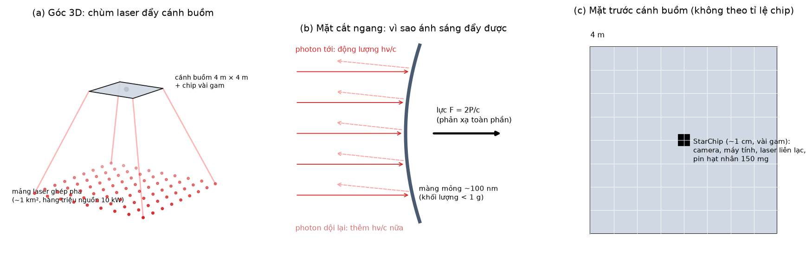

*Tự vẽ. (a) Góc 3D: mảng laser ghép pha trên mặt đất chiếu lên cánh buồm. (b) Mặt cắt: mỗi photon dội lại truyền gấp đôi động lượng. (c) Mặt trước: cánh buồm 4 m với StarChip ở giữa.*

Thông số thiết kế (Wikipedia, theo các công bố của Breakthrough):

| Thông số | Giá trị |
|---|---|
| Công suất mảng laser | tới **100 GW** (mảng ~1 km² gồm các nguồn 10 kW, ghép pha) |
| Cánh buồm | ≤ 4 m × 4 m, khối lượng cỡ gam, vật liệu có thể là graphene composite |
| StarChip | vài gam, cỡ cm; pin hạt nhân 150 mg; ~1.000 chiếc |
| Tốc độ | 15–20% tốc độ ánh sáng |
| Gia tốc | ~10 phút, trung bình ~10.000 g (100 km/s²) |
| Thời gian bay | 20–30 năm; tín hiệu báo về mất thêm ~4 năm |
| Chi phí | 100 triệu USD giai đoạn nghiên cứu; 5–10 tỉ USD cho nhiệm vụ |

### 7.2. Công thức

**Lực đẩy của ánh sáng.** Photon năng lượng E mang động lượng E/c. Phản xạ toàn phần thì động lượng đổi chiều, truyền gấp đôi:

$$F = \frac{2P}{c} \qquad (\text{phản xạ một phần } R:\ F = \frac{(1+R)P}{c})$$

100 GW → F ≈ 667 N. Với tổng khối lượng m = 2 g: $a = F/m \approx 3{,}3 \times 10^5$ m/s² ≈ **34.000 g**.

**Hiệu ứng Doppler** (tàu chạy ra xa, ánh sáng tới bị dịch đỏ, lực giảm):

$$F = \frac{2P}{c} \cdot \frac{1-\beta}{1+\beta}, \qquad \beta = v/c$$

Ở β = 0,2, lực chỉ còn 67%.

**Giới hạn nhiễu xạ:** chùm laser từ mảng đường kính D_mảng tỏa ra thành vết đường kính

$$d_{vết}(L) \approx \frac{2{,}44\,\lambda L}{D_{mảng}}$$

Khi vết to hơn cánh buồm, phần lớn ánh sáng trượt ra ngoài. Quãng tăng tốc hiệu quả:

$$L_c = \frac{D_{buồm}\, D_{mảng}}{2{,}44\,\lambda}$$

Với D_buồm = 4 m, D_mảng = 3 km, λ = 1,064 μm: L_c ≈ 4,6 triệu km ≈ 0,03 AU. Ước lượng cổ điển $v \approx \sqrt{2 a L_c} \approx 0{,}18c$.

**Năng lượng:** động năng 2 g ở 0,2c là $(\gamma - 1) m c^2 \approx 3{,}7$ TJ; laser 100 GW chạy 5 phút phát 30 TJ, tức hiệu suất chỉ ~12%.

**Thời gian bay** tới Proxima Centauri (4,24 năm ánh sáng) ở 0,2c: **21 năm**, cộng 4,24 năm để ảnh truyền về.

### 7.3. Tự tính số: tàu tăng tốc thế nào

Đồ thị dưới là **tích phân số** các công thức trên (lực tương đối tính có Doppler, cắt giảm khi vết chùm to hơn cánh buồm), với P = 100 GW, λ = 1,064 μm, cánh 4 m, tổng 2 g:

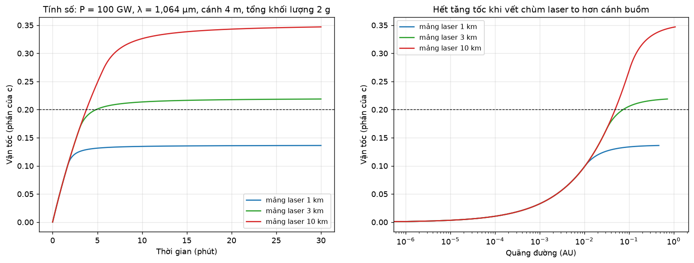

*Tự tính bằng `img/make_illustrations.py` (hàm `lightsail_acceleration`). Mảng laser 1 km chỉ đẩy được tới ~0,14c; cần mảng **~3 km** mới đạt 0,2c trong ~5 phút, khớp con số "đường kính khoảng 3 km" của Starshot. Mảng 10 km cho ~0,35c.*

Ảnh từ một nghiên cứu gần đây (Norder et al.) tối ưu cánh buồm tinh thể quang tử cho nhiệm vụ này:

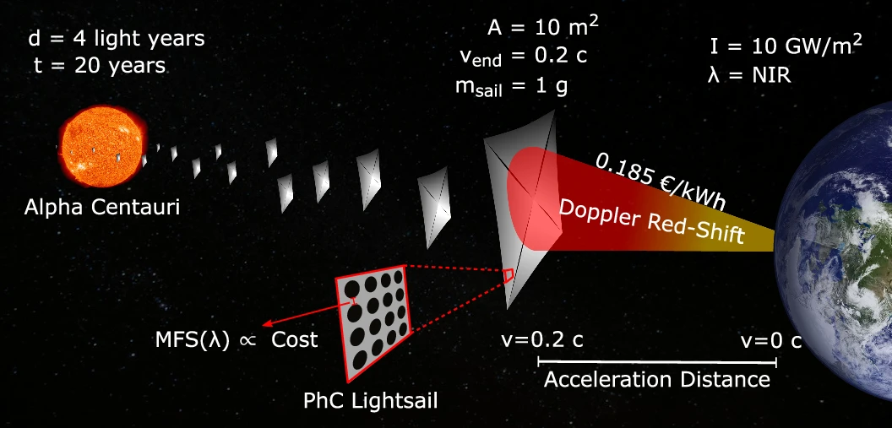

*Nguồn: Norder, Yin, de Jong, Stallone… (nghiên cứu cánh buồm tinh thể quang tử), CC BY 4.0. Cường độ 10 GW/m², cánh 10 m², 1 g, đạt 0,2c.*

### 7.4. Những thách thức

| Thách thức | Vì sao khó |
|---|---|
| Cánh buồm không bị cháy | Hấp thụ chỉ một phần rất nhỏ của 100 GW cũng đủ làm bốc hơi; cần vật liệu phản xạ > 99,99% và tỏa nhiệt tốt |
| Ổn định | Cánh buồm phải tự quay về giữa chùm laser, nếu không sẽ trượt ra và lật |
| Laser ghép pha | Hàng triệu nguồn phải đồng pha qua bầu khí quyển nhiễu loạn |
| Bụi giữa các vì sao | Ở 0,2c, hạt bụi 0,1 μm va chạm với năng lượng như một viên đạn nhỏ; mỗi cm² mặt trước gặp ~1.000 hạt như vậy trên đường đi |
| Liên lạc về Trái Đất | Laser công suất ~1 W cách 4 năm ánh sáng; tốc độ chỉ vài bit/giây cho mỗi watt, cần kính thu 30 m |
| Không phanh được | Tàu chỉ bay vụt qua hệ sao trong vài giờ, phải chụp nhanh |

### 7.5. Tình trạng hiện nay

- 2017–2019: phóng thử các "Sprite" (chip 4 gam) lên quỹ đạo Trái Đất.
- **9/2025**: Scientific American đưa tin dự án **tạm dừng vô thời hạn**; mới chi khoảng **4,5 triệu** trong số 100 triệu USD dự kiến. Trưởng nhóm cánh buồm Jim Benford phản bác rằng dự án chưa thất bại hay bị hủy (giai đoạn 1 tốn ~25 triệu USD), nhưng báo cáo cuối giai đoạn 1 chưa được công bố.

Nguồn mục 7:
[Wikipedia: Breakthrough Starshot](https://en.wikipedia.org/wiki/Breakthrough_Starshot) ·
[Scientific American: The Quiet Demise of Breakthrough Starshot](https://www.scientificamerican.com/article/the-quiet-demise-of-breakthrough-starshot-a-billionaires-interstellar/) ·
[Centauri Dreams: Starshot Is a Success (Part I)](https://www.centauri-dreams.org/2026/03/03/starshot-is-a-success-part-i/) và [Part II](https://www.centauri-dreams.org/2026/03/10/starshot-is-a-success-part-ii/) ·
[Interesting Engineering](https://interestingengineering.com/innovation/mark-zuckerbergs-100m-interstellar-space)

---

## 8. So sánh các hướng đi

| Phương pháp | Cho biết gì | Hành tinh cỡ Trái Đất? | Khi nào |
|---|---|---|---|
| Transit (Kepler, TESS) | Bán kính, chu kỳ, quỹ đạo | Có (đo kích thước) | Đang dùng |
| Phổ truyền qua / phát xạ (HST, JWST) | Thành phần khí quyển | Rất khó: tín hiệu < 1 ppm với Trái Đất thật; khả thi với hành tinh đá quanh sao lùn M | Đang dùng |
| Chụp trực tiếp bằng kính thế hệ mới (ELT, Habitable Worlds Observatory) | Phổ ánh sáng phản xạ, 1 điểm ảnh | Mục tiêu chính của HWO | 2030–2040+ |
| **Thấu kính hấp dẫn Mặt Trời** | **Ảnh bề mặt** 1000 × 1000 điểm, phổ | Có, 1 mục tiêu mỗi tàu | Phóng 2035–2040, tới nơi sau ~20–30 năm |
| **Tàu buồm laser** | Ảnh cận cảnh khi bay qua | Có, nhưng chỉ hệ gần nhất (Alpha Centauri) | Chưa có kế hoạch cụ thể; dự án đang tạm dừng |

---

## 9. Nguồn ảnh internet

Mọi ảnh trong `img/web/` tải từ Wikimedia Commons, đã thu nhỏ và chuyển sang PNG.

| File | Tác giả | Giấy phép | Trang gốc |
|---|---|---|---|
| `k2-18b_spectrum_2023.png` | NASA, CSA, ESA, J. Olmsted (STScI), N. Madhusudhan (Cambridge) | CC BY 4.0 | [Spectra of exoplanet K2-18 b (weic2321b)](https://commons.wikimedia.org/wiki/File:Spectra_of_exoplanet_K2-18_b_(weic2321b).jpg) |
| `k2-18b_miri_2025.png` | Nikku Madhusudhan et al. 2025 | CC BY 4.0 | [K2-18 b Mid-Infrared Transmission Spectrum](https://commons.wikimedia.org/wiki/File:K2-18_b_Mid-Infrared_Transmission_Spectrum.png) |
| `lhs1140b_atmosphere.png` | Melissa Weiss/CfA | CC0 | [First atmosphere detected on a habitable-zone rocky world (LHS 1140 b)](https://commons.wikimedia.org/wiki/File:First_atmosphere_detected_on_a_habitable-zone_rocky_world_(LHS_1140_b).jpg) |
| `wasp39b_transit_lightcurves.png` | NASA's James Webb Space Telescope | CC BY 2.0 | [Hot Gas Giant Exoplanet WASP-39 b (NIRSpec Transit Light Curves)](https://commons.wikimedia.org/wiki/File:Hot_Gas_Giant_Exoplanet_WASP-39_b_(NIRSpec_Transit_Light_Curves).png) |
| `einstein_ring_horseshoe.png` | ESA/Hubble & NASA | Phạm vi công cộng | [A Horseshoe Einstein Ring from Hubble](https://commons.wikimedia.org/wiki/File:A_Horseshoe_Einstein_Ring_from_Hubble.JPG) |
| `solar_gravitational_lens_point.png` | NASA | Phạm vi công cộng | [Solar gravitational lense point](https://commons.wikimedia.org/wiki/File:Solar_gravitational_lense_point.jpg) |
| `lightsail_mission_parameters.png` | Lucas Norder, Shunyu Yin, Matthijs H. J. de Jong, Francesco Stallone… | CC BY 4.0 | [Mission parameters for lightsail mission to Alpha Centauri](https://commons.wikimedia.org/wiki/File:Mission_parameters_for_lightsail_mission_to_Alpha_Centauri.webp) |

Ảnh trong `img/gen/` do repo tự vẽ (`img/make_illustrations.py`), dùng tự do cùng giấy phép với repo.
