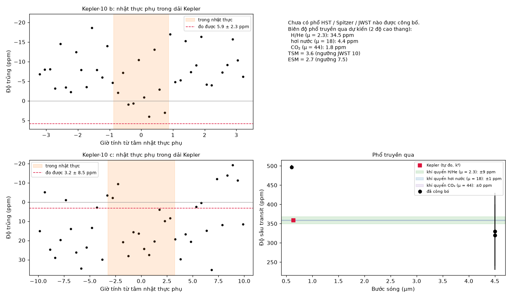

# Khí quyển các hành tinh của Kepler-10

Sao mẹ: Teff = 5627 K, Rs = 1.056 R☉, cấp sao J = 9.889, K = 9.496. Kepler chỉ có 1 dải màu nên **không tự đo được phổ**; phổ theo bước sóng lấy từ các bài báo đã công bố (NASA Exoplanet Archive, bảng `transitspec`, `emissionspec`, `spectra`).

| Thông số | Kepler-10 b | Kepler-10 c |
|---|---|---|
| Bán kính / khối lượng dùng | 1.43 R⊕ / 3.2 M⊕ | 2.18 R⊕ / 11.3 M⊕ |
| Nhiệt độ cân bằng (albedo 0) / phía ngày (K) | 2154 / 2370 | 570 / 627 |
| Trọng lực bề mặt (m/s²) | 15.2 | 23.3 |
| Độ cao thang H, H/He (μ = 2.3) (km) | 509 | 88 |
| Độ cao thang H, hơi nước (μ = 18) (km) | 65 | 11 |
| Độ cao thang H, CO₂ (μ = 44) (km) | 27 | 5 |
| Biên độ phổ truyền qua, H/He (μ = 2.3) (ppm) | 34.5 | 9.0 |
| Biên độ phổ truyền qua, hơi nước (μ = 18) (ppm) | 4.4 | 1.2 |
| Biên độ phổ truyền qua, CO₂ (μ = 44) (ppm) | 1.8 | 0.5 |
| **TSM** (JWST, phổ truyền qua) | 3.6 (ngưỡng 10) ❌ | 6.2 (ngưỡng 90) ❌ |
| **ESM** (JWST, phổ phát xạ 7.5 μm) | 2.7 (ngưỡng 7.5) ❌ | 0.4 (ngưỡng 7.5) ❌ |
| Nhật thực phụ Kepler (ppm) | 5.9 ± 2.3 (2.5σ) | 3.2 ± 8.5 (0.4σ) |
| Phần phát nhiệt dự kiến trong dải Kepler (ppm) | 0.63 | 0.00 |
| Albedo hình học Ag (cả độ sâu / trừ phần nhiệt) | 0.47 ± 0.19 / 0.42 | 22.37 ± 59.83 / 22.37 |
| Phổ đã công bố trên NASA | chưa có | 2 bộ |

## Kepler-10 b

Chưa có phổ HST, Spitzer hay JWST nào được công bố cho hành tinh này.

**Nhật thực phụ Kepler**: 5.9 ± 2.3 ppm (2.5σ, 4430 điểm trong, 9691 điểm ngoài). Chưa phát hiện (dưới 3σ): albedo hình học Ag < 1.04 (giới hạn 3σ).

## Kepler-10 c

**Phổ đã công bố** (bảng `spectra`):

| Loại | Kính / thiết bị | Bước sóng (μm) | Số điểm | Tác giả | bibcode |
|---|---|---|---|---|---|
| Transmission | The Kepler Mission / Kepler CCD Array | 0.6–0.6 | 1 | Désert et al. 2015 | 2015ApJ...804...59D |
| Transmission | Spitzer Space Telescope satellite / Infrared Array Camera (IRAC) | 4.5–4.5 | 2 | Désert et al. 2015 | 2015ApJ...804...59D |

**Phổ truyền qua** (so độ sâu transit đã công bố với k² tự đo trong dải Kepler):

| Bước sóng (μm) | Chênh độ sâu so với Kepler (ppm) | Khí quyển H/He (μ = 2.3): biên độ / sai số | Khí quyển hơi nước (μ = 18): biên độ / sai số | Khí quyển CO₂ (μ = 44): biên độ / sai số | Nguồn |
|---|---|---|---|---|---|
| 4.5 | -39 ± 80 | 9 ppm / 0.11σ | 1 ppm / 0.01σ | 0 ppm / 0.01σ | [Désert et al. 2015](https://ui.adsabs.harvard.edu/abs/2015ApJ...804...59D/abstract) |
| 4.5 | -29 ± 100 | 9 ppm / 0.09σ | 1 ppm / 0.01σ | 0 ppm / 0.00σ | [Désert et al. 2015](https://ui.adsabs.harvard.edu/abs/2015ApJ...804...59D/abstract) |

Biên độ khí quyển H/He chỉ bằng 0.11 lần sai số đo: **dữ liệu hiện có không phân biệt được** có khí quyển hay không. Cần độ chính xác cỡ vài ppm, chỉ JWST mới đạt.

**Nhật thực phụ Kepler**: 3.2 ± 8.5 ppm (0.4σ, 218 điểm trong, 429 điểm ngoài). Chưa phát hiện (dưới 3σ): albedo hình học Ag < 201.85 (giới hạn 3σ).

Ghi chú:
- **TSM / ESM** (Kempton et al. 2018): tín hiệu dự kiến khi chụp bằng JWST NIRISS (truyền qua) và MIRI 7.5 μm (phát xạ) trong 10 giờ. Ngưỡng đáng ưu tiên: TSM > 10 với hành tinh < 1.5 R⊕, > 90 với hành tinh lớn hơn; ESM > 7.5.
- Biên độ phổ truyền qua tính bằng 2 độ cao thang, khí quyển trong suốt không mây. Mây hoặc sương mù làm phổ phẳng đi.
- Nhật thực phụ giả định quỹ đạo tròn (pha 0.5). Quỹ đạo lệch tâm làm nhật thực lệch khỏi pha 0.5.
- Bước làm phẳng light curve (cửa sổ ~18 ngày) không ảnh hưởng nhật thực dài vài giờ, nhưng xóa mất biến thiên theo pha quỹ đạo (phase curve).
