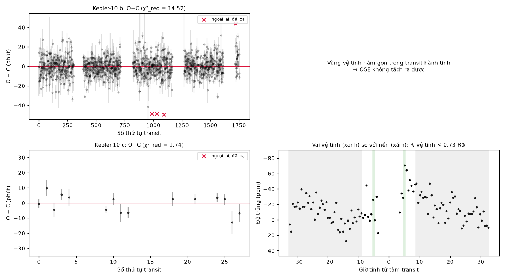

# Tìm vệ tinh quanh các hành tinh của Kepler-10

Light curve Kepler chỉ đặt được **giới hạn trên**: vệ tinh lớn/nặng hơn mức này đã bị loại. Giả định vệ tinh đá (mật độ 3 g/cm³), quỹ đạo tròn, cùng chiều; giới hạn tính cho vệ tinh ở xa nhất có thể (0.49 bán kính Hill), nơi tín hiệu lớn nhất.

| Thông số | Kepler-10 b | Kepler-10 c |
|---|---|---|
| Khối lượng hành tinh dùng (M⊕) | 3.2 | 11.3 |
| Bán kính Hill (km) | 38,284 | 835,810 |
| Quỹ đạo vệ tinh xa nhất bền vững, 0.49 R_Hill (km) | 18,740 | 409,129 |
| Giới hạn Roche (km) | 28,014 | 42,765 |
| **Vệ tinh có thể tồn tại?** | ❌ không (vùng bền nằm trong giới hạn Roche) | ✅ có |
| Chu kỳ vệ tinh dài nhất (ngày) | 0.17 | 8.96 |
| Vệ tinh lệch trước/sau hành tinh tối đa (giờ) | 0.02 | 1.98 |
| Số transit định thời được | 1230 (loại 7 ngoại lai) | 15 (loại 1 ngoại lai) |
| Sai số thời điểm mỗi transit (phút) | 6.6 | 4.6 |
| O−C rms (phút) | 9.1 | 5.8 |
| χ²_red của O−C (≈ 1 nếu sai số đúng) | 14.52 | 1.74 |
| Periodogram O−C: chu kỳ mạnh nhất (vòng) / FAP | 8.4 / 4.1e-39 | 3.4 / 0.61 |
| O−C phụ thuộc vị trí trong lưới đo 29.4 phút? (p) | 0.28 | — |
| Chu kỳ O−C lặp lại ở cả 2 nửa dữ liệu? | không | — |
| Kết luận TTV | O−C có chu kỳ ~8.4 vòng (FAP = 4.1e-39) nhưng trùng họa âm bậc 8 của chu kỳ phách giữa chu kỳ hành tinh và nhịp đo 29.4 phút → **lỗi đo, không phải TTV** | Không thấy TTV có chu kỳ (FAP = 0.61) |
| Giới hạn TTV rms = O−C rms (phút) | 9.1 | 5.8 |
| **Khối lượng vệ tinh tối đa (từ TTV)** | 28.5 M⊕ = 2.32e+03 lần Mặt Trăng | 0.788 M⊕ = 64.1 lần Mặt Trăng |
| Vai trũng OSE (ppm) | — | -13.0 ± 12.8 |
| **Bán kính vệ tinh tối đa (từ OSE)** | — | 0.73 R⊕: đã loại vật cỡ Trái Đất trở lên; chưa loại được vật cỡ Sao Hỏa |

Ghi chú:
- **TTV** ở đây là độ lệch thời điểm so với chu kỳ đều. TTV đáng kể có thể do hành tinh khác kéo, vết đen trên sao, nhiễu đỏ... chứ không nhất thiết là vệ tinh.
- Vệ tinh gần hành tinh hơn a_max thì TTV nhỏ hơn (tỉ lệ với khoảng cách), nên giới hạn khối lượng yếu đi tương ứng.
- **OSE** giả định nhiễu trắng; nhiễu đỏ làm giới hạn thực tế kém hơn. Một tín hiệu "vai" dương cũng có thể là do bước làm phẳng light curve.
- Hành tinh quá gần sao: bán kính Hill nhỏ, vệ tinh còn bị thủy triều kéo dần vào hành tinh hoặc văng ra trong thời gian ngắn hơn tuổi hệ (Barnes & O'Brien 2002), nên khó tồn tại kể cả khi nằm trong vùng bền.
