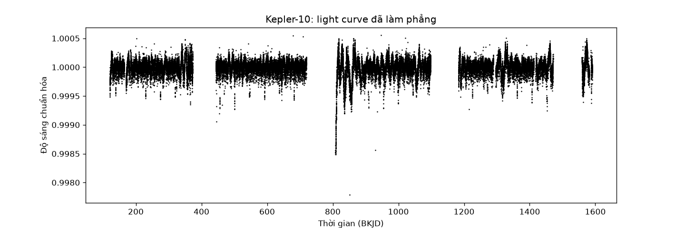
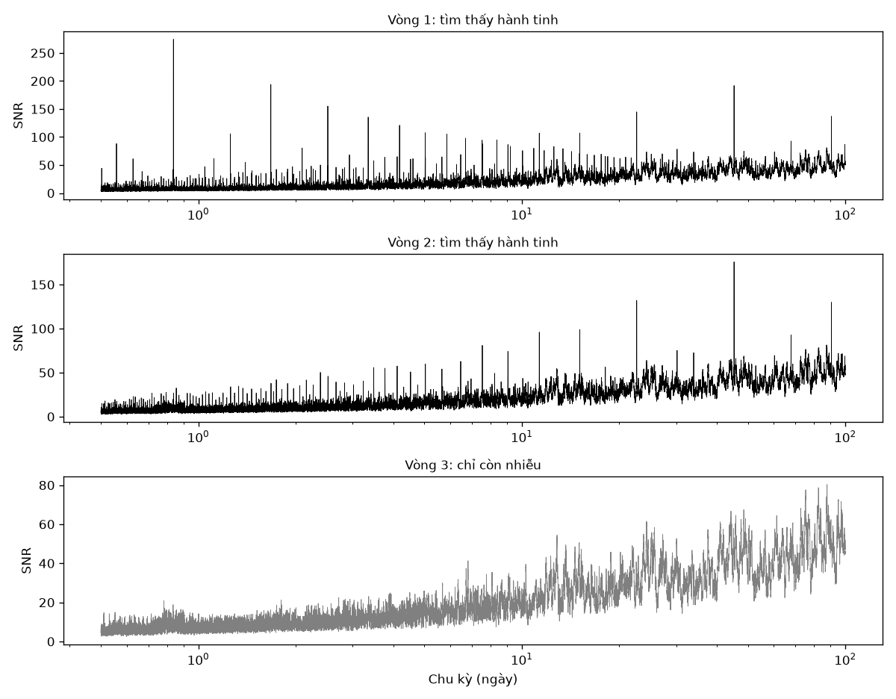
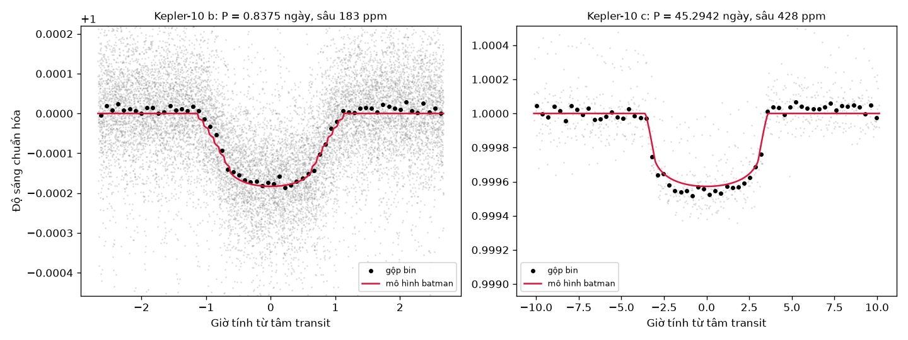

# Hệ hành tinh Kepler-10

Dữ liệu: 51960 điểm Kepler long cadence, dài 1470 ngày. **Tổng cộng 3 hành tinh**: 2 tự tìm thấy bằng transit, 1 bổ sung từ NASA Exoplanet Archive (không có transit).

## Sao mẹ

| Thông số | Giá trị | NASA |
|---|---|---|
| Nhiệt độ bề mặt Teff (KIC) | 5627 K | 5708.0 |
| Loại phổ (suy từ Teff) | G |  |
| Bán kính Rs (KIC) | 1.056 R☉ | 1.065 |
| Khối lượng từ logg (KIC) | 0.894 M☉ | 0.91 |
| Khối lượng dùng cho tính toán | 0.894 M☉ (từ logg) | 0.91 |
| Độ sáng L | 1.01 L☉ |  |
| Hệ số tối rìa (u1, u2) dùng khi khớp | KOI DR25 (0.3928, 0.2676), tính cho Teff = 5676 K, logg = 4.35, [Fe/H] = -0.12 |  |
| Độ kim loại [Fe/H] (KIC) | -0.15 dex (kim loại gấp ~0.7 lần Mặt Trời) | -0.15 |
| Tuổi | 10.6 tỷ năm (NASA) |  |

## Khoảng cách từ Trái Đất

- **Thị sai Gaia DR3** (sao 2132155017099178624; lấy từ Gaia DR3 (file đệm, máy chủ Gaia không phản hồi)): 5.3698 ± 0.0103 mas, RUWE = 0.90 (< 1.4 là đáng tin) → **186.2 ± 0.4 pc ≈ 607 năm ánh sáng**
- Ước tính bằng độ sáng (M = 4.73, Kp = 10.96): ~176 pc (thô, không tính bụi)
- NASA Exoplanet Archive: 186 pc
- Khoảng cách tới từng hành tinh = khoảng cách tới sao ± a. Quỹ đạo rộng nhất (0.535 AU) chỉ bằng 1.4e-08 lần khoảng cách nên coi như **bằng nhau**.

## Thông số các hành tinh

| Thông số | Kepler-10 b | Kepler-10 c | Kepler-10 d |
|---|---|---|---|
| *Số trong ngoặc: giá trị NASA* | | | |
| Phát hiện bằng | Transit (tự tìm) | Transit (tự tìm) | Radial Velocity |
| Chu kỳ P (ngày) | 0.83749 (0.83749) | 45.29422 (45.29430) | 151.06000 (151.06000) |
| SNR / số transit thấy được | 274 / 1283 | 176 / 26 | — |
| Độ sâu transit (ppm) | 183 | 428 | — |
| Thời lượng T14 (giờ) | 1.78 (1.81) | 6.76 (6.87) | — |
| Rp / Rs | 0.0124 (0.0127) | 0.0189 (0.0204) | — |
| Tham số va chạm b | 0.29 (0.34) | 0.28 (0.32) | — |
| a / Rs | 3.54 ± 2.23 (3.65) | 50.23 ± 52.67 (48.75) | — |
| Khối lượng sao suy từ transit (M☉) | 1.00 ± 1.88 | 0.98 ± 3.07 | — |
| Độ nghiêng i (độ) | 85.25 (84.80) | 89.68 (89.62) | — |
| Bán kính (R⊕) | 1.43 (1.47) | 2.18 (2.35) | ~3.7 (ước tính) (3.49) |
| Bán kính (R♃) | 0.128 (0.131) | 0.195 (0.210) | 0.326 (0.312) |
| Khối lượng (M⊕) | 3.2 (3.2) | 11.3 (11.3) | 13.0 (12.0) |
| Khối lượng (M♃) | 0.0100 | 0.0356 | 0.0409 |
| Nguồn khối lượng | RV (K = 2.32 m/s đã công bố, Ms và i tự tính) | RV (K = 2.19 m/s đã công bố, Ms và i tự tính) | Khối lượng TỐI THIỂU Mp·sin i từ RV (K = 1.68 m/s) |
| Mật độ (g/cm³) | 5.94 | 6.00 | — |
| Trọng lực bề mặt (× Trái Đất) | 1.55 | 2.38 | — |
| Bán trục lớn a (AU) | 0.0167 (0.0169) | 0.2395 (0.2410) | 0.5347 (0.5379) |
| Độ lệch tâm e | giả định 0 (0.00) | giả định 0 (0.14) | giả định 0 (0.19) |
| Vận tốc quỹ đạo (km/s) | 218 | 58 | 39 |
| Nhiệt độ cân bằng Teq (K) | 1971 (2188) | 521 (579) | 349 (387) |
| Bức xạ nhận được (× Trái Đất) | 3590 (3742) | 18 (18) | 4 (4) |
| Xác suất có transit Rs/a (%) | 29.3 | 2.1 | 0.9 |
| Loại theo bán kính | Hành tinh đá | Sub-Neptune | Sub-Neptune |
| **Thành phần** | Đá + sắt, lõi sắt ~10% | Đá + nhiều nước/băng HOẶC khí mỏng | Không xác định |

## Thành phần từng hành tinh

- **Kepler-10 b**: Mật độ 5.94 g/cm³, nằm giữa đường 'sắt nguyên chất' (1.18 R⊕) và 'đá nguyên chất' (1.46 R⊕). Lõi sắt chiếm ~10% khối lượng (Trái Đất: 32.5%). Không có khí quyển dày.
- **Kepler-10 c**: Mật độ 6.00 g/cm³: quá nhẹ để là đá thuần (2.06 R⊕) nhưng chưa vượt đường '50% nước' (2.39 R⊕). Hai khả năng không phân biệt được: (a) thế giới nước, nước/băng chiếm tới ~50% khối lượng; (b) lõi đá + lớp khí H/He mỏng ~0.5% khối lượng.
- **Kepler-10 d**: Không có bán kính đo được (không transit) nên không suy ra được mật độ và thành phần. Phát hiện bằng Radial Velocity, không có transit trong dữ liệu Kepler → không đo được bán kính, độ nghiêng; bán kính bên dưới chỉ là ước tính từ khối lượng.

Thành phần ở đây là **suy đoán từ mật độ** (khối lượng / thể tích) so với mô hình lý thuyết. Muốn biết thành phần khí quyển thật (H₂O, CO₂, CH₄...) phải chụp phổ truyền qua bằng JWST/HST.

## Đối chiếu với danh sách ứng viên Kepler (KOI DR25)

| KOI | Tên | Kết luận | Chu kỳ (ngày) | Bán kính (R⊕) | Script tìm thấy? |
|---|---|---|---|---|---|
| K00072.01 | Kepler-10 b | CONFIRMED | 0.8375 | 1.43 | ✅ |
| K00072.02 | Kepler-10 c | CONFIRMED | 45.2942 | 2.26 | ✅ |

## Hình ảnh

### Light curve đã làm phẳng (mọi quý)

### Periodogram BLS từng vòng tìm kiếm

### Transit gấp pha và mô hình batman của từng hành tinh

### Sơ đồ hệ (bước 3, `03_diagram.py`)

### Tìm vệ tinh: O − C và vùng vai OSE (bước 4, `04_moons.py`, chi tiết trong `Kepler10_moons.md`)

### Khí quyển: nhật thực phụ Kepler và phổ đã công bố (bước 5, `05_atmosphere.py`, chi tiết trong `Kepler10_atmosphere.md`)

