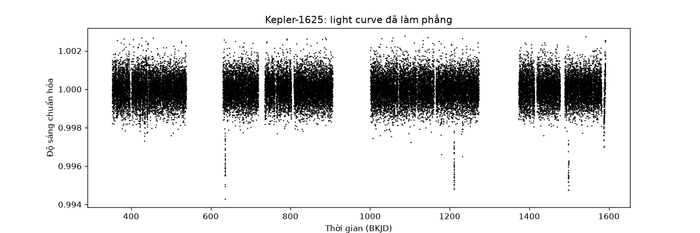
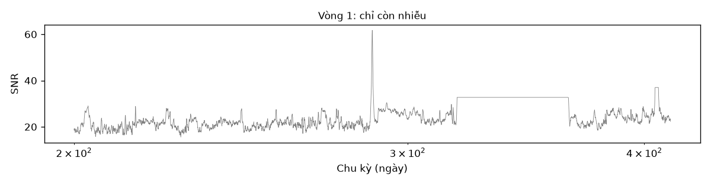
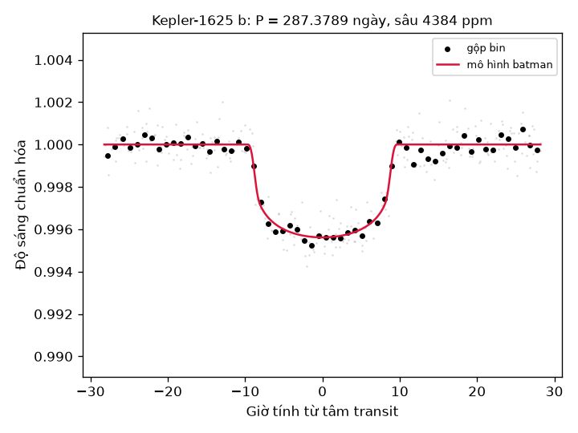
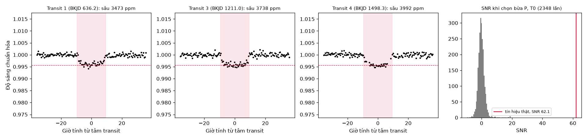

# Hệ hành tinh Kepler-1625

Dữ liệu: 41932 điểm Kepler long cadence, dài 1239 ngày. **Tổng cộng 1 hành tinh**: 0 tự tìm thấy bằng transit, 1 BLS không tự tìm ra, kiểm chứng bằng P, T0 của NASA.

⚠️ BLS không tự tìm ra **Kepler-1625 b**: transit dài 19 giờ, vượt thời lượng dài nhất BLS thử (14 giờ). Khi gấp pha đúng P, T0 (đã công bố): SNR = 62.1, 3 transit. Phép thử báo động giả: **0.00%** trong 2348 lần chọn bừa P, T0 cũng cho SNR cao bằng. Xem `Kepler1625_Kepler1625b_transits.png`.

## Sao mẹ

| Thông số | Giá trị | NASA |
|---|---|---|
| Nhiệt độ bề mặt Teff (KIC) | 5645 K | 5677.0 |
| Loại phổ (suy từ Teff) | G |  |
| Bán kính Rs (KIC) | 0.838 R☉ | 0.94 |
| Khối lượng từ logg (KIC) | 0.860 M☉ | 0.96 |
| Khối lượng dùng cho tính toán | 0.860 M☉ (từ logg) | 0.96 |
| Độ sáng L | 0.64 L☉ |  |
| Hệ số tối rìa (u1, u2) dùng khi khớp | KOI DR25 (0.4554, 0.2329), tính cho Teff = 5548 K, logg = 3.96, [Fe/H] = +0.12 |  |
| Độ kim loại [Fe/H] (KIC) | -0.26 dex (kim loại gấp ~0.5 lần Mặt Trời) | 0.01 |
| Tuổi | 4.37 tỷ năm (NASA) |  |

## Khoảng cách từ Trái Đất

- **Thị sai Gaia DR3** (sao ?; lấy từ thị sai lưu trên NASA Exoplanet Archive (sy_plx), máy chủ Gaia không phản hồi): 0.4064 ± 0.0358 mas → **2460.3 ± 216.7 pc ≈ 8025 năm ánh sáng**
- Ước tính bằng độ sáng (M = 5.22, Kp = 15.76): ~1280 pc (thô, không tính bụi)
- NASA Exoplanet Archive: 2310 pc
- Khoảng cách tới từng hành tinh = khoảng cách tới sao ± a. Quỹ đạo rộng nhất (0.810 AU) chỉ bằng 1.6e-09 lần khoảng cách nên coi như **bằng nhau**.

## Thông số các hành tinh

| Thông số | Kepler-1625 b |
|---|---|
| *Số trong ngoặc: giá trị NASA* | |
| Phát hiện bằng | Transit (kiểm chứng theo P, T0 NASA) |
| Chu kỳ P (ngày) | 287.37895 (287.37895) |
| SNR / số transit thấy được | 62 / 3 |
| Độ sâu transit (ppm) | 4384 |
| Thời lượng T14 (giờ) | 18.81 (18.89) |
| Rp / Rs | 0.0596 (0.0590) |
| Tham số va chạm b | 0.00 (0.04) |
| a / Rs | 123.69 ± 26.86 (123.03) |
| Khối lượng sao suy từ transit (M☉) | 0.18 ± 0.12 |
| Độ nghiêng i (độ) | 90.00 (89.99) |
| Bán kính (R⊕) | 5.45 (6.06) |
| Bán kính (R♃) | 0.486 (0.541) |
| Khối lượng (M⊕) | — (30.6) |
| Khối lượng (M♃) | — |
| Nguồn khối lượng | Chưa đo; ước tính từ bán kính ~25.6 M⊕ |
| Mật độ (g/cm³) | — |
| Trọng lực bề mặt (× Trái Đất) | — |
| Bán trục lớn a (AU) | 0.8104 (0.8776) |
| Độ lệch tâm e | giả định 0 (0.00) |
| Vận tốc quỹ đạo (km/s) | 31 |
| Nhiệt độ cân bằng Teq (K) | 253 (350) |
| Bức xạ nhận được (× Trái Đất) | 1 (3) |
| Xác suất có transit Rs/a (%) | 0.5 |
| Loại theo bán kính | Giống Sao Hải Vương |
| **Thành phần** | Giống Sao Hải Vương (chỉ theo bán kính) |

## Thành phần từng hành tinh

- **Kepler-1625 b**: Chưa có khối lượng nên chỉ phân loại được theo bán kính.

Thành phần ở đây là **suy đoán từ mật độ** (khối lượng / thể tích) so với mô hình lý thuyết. Muốn biết thành phần khí quyển thật (H₂O, CO₂, CH₄...) phải chụp phổ truyền qua bằng JWST/HST.

## Đối chiếu với danh sách ứng viên Kepler (KOI DR25)

| KOI | Tên | Kết luận | Chu kỳ (ngày) | Bán kính (R⊕) | Script tìm thấy? |
|---|---|---|---|---|---|
| K05084.01 | Kepler-1625 b | CONFIRMED | 287.3773 | 11.67 | 🔍 chỉ kiểm chứng |

## Hình ảnh

### Light curve đã làm phẳng (mọi quý)

### Periodogram BLS từng vòng tìm kiếm

### Transit gấp pha và mô hình batman của từng hành tinh

### Kepler-1625 b: từng transit riêng lẻ và phép thử báo động giả

### Sơ đồ hệ (bước 3, `03_diagram.py`)

### Tìm vệ tinh: O − C và vùng vai OSE (bước 4, `04_moons.py`, chi tiết trong `Kepler1625_moons.md`)

### Khí quyển: nhật thực phụ Kepler và phổ đã công bố (bước 5, `05_atmosphere.py`, chi tiết trong `Kepler1625_atmosphere.md`)

