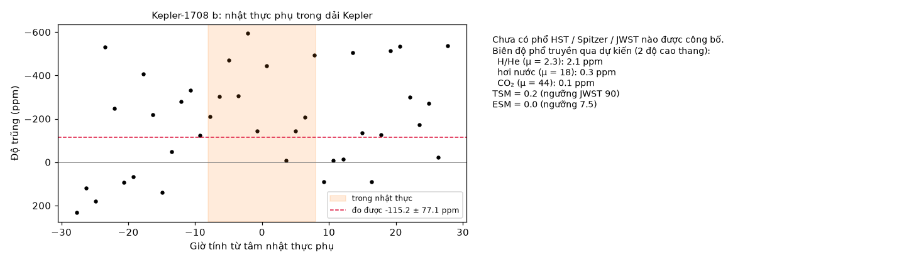

# Khí quyển các hành tinh của Kepler-1708

Sao mẹ: Teff = 6032 K, Rs = 0.973 R☉, cấp sao J = 14.429, K = 14.089. Kepler chỉ có 1 dải màu nên **không tự đo được phổ**; phổ theo bước sóng lấy từ các bài báo đã công bố (NASA Exoplanet Archive, bảng `transitspec`, `emissionspec`, `spectra`).

| Thông số | Kepler-1708 b |
|---|---|
| Bán kính / khối lượng dùng | 8.82 R⊕ / 1462.0 M⊕ |
| Nhiệt độ cân bằng (albedo 0) / phía ngày (K) | 225 / 248 |
| Trọng lực bề mặt (m/s²) | 184.4 |
| Độ cao thang H, H/He (μ = 2.3) (km) | 4 |
| Độ cao thang H, hơi nước (μ = 18) (km) | 1 |
| Độ cao thang H, CO₂ (μ = 44) (km) | 0 |
| Biên độ phổ truyền qua, H/He (μ = 2.3) (ppm) | 2.1 |
| Biên độ phổ truyền qua, hơi nước (μ = 18) (ppm) | 0.3 |
| Biên độ phổ truyền qua, CO₂ (μ = 44) (ppm) | 0.1 |
| **TSM** (JWST, phổ truyền qua) | 0.2 (ngưỡng 90) ❌ |
| **ESM** (JWST, phổ phát xạ 7.5 μm) | 0.0 (ngưỡng 7.5) ❌ |
| Nhật thực phụ Kepler (ppm) | -115.2 ± 77.1 (-1.5σ) |
| Phần phát nhiệt dự kiến trong dải Kepler (ppm) | 0.00 |
| Albedo hình học Ag (cả độ sâu / trừ phần nhiệt) | -1680.66 ± 1125.21 / -1680.66 |
| Phổ đã công bố trên NASA | chưa có |

## Kepler-1708 b

Chưa có phổ HST, Spitzer hay JWST nào được công bố cho hành tinh này.

**Nhật thực phụ Kepler**: -115.2 ± 77.1 ppm (-1.5σ, 65 điểm trong, 148 điểm ngoài). Chưa phát hiện (dưới 3σ): albedo hình học Ag < 3375.63 (giới hạn 3σ).

Ghi chú:
- **TSM / ESM** (Kempton et al. 2018): tín hiệu dự kiến khi chụp bằng JWST NIRISS (truyền qua) và MIRI 7.5 μm (phát xạ) trong 10 giờ. Ngưỡng đáng ưu tiên: TSM > 10 với hành tinh < 1.5 R⊕, > 90 với hành tinh lớn hơn; ESM > 7.5.
- Biên độ phổ truyền qua tính bằng 2 độ cao thang, khí quyển trong suốt không mây. Mây hoặc sương mù làm phổ phẳng đi.
- Nhật thực phụ giả định quỹ đạo tròn (pha 0.5). Quỹ đạo lệch tâm làm nhật thực lệch khỏi pha 0.5.
- Bước làm phẳng light curve (cửa sổ ~18 ngày) không ảnh hưởng nhật thực dài vài giờ, nhưng xóa mất biến thiên theo pha quỹ đạo (phase curve).
