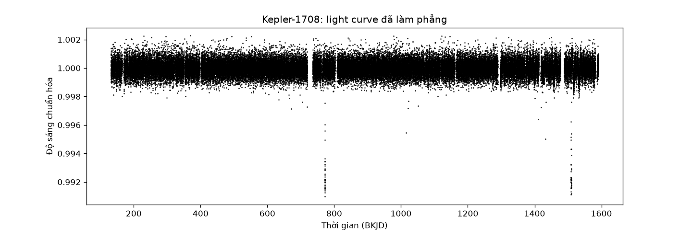
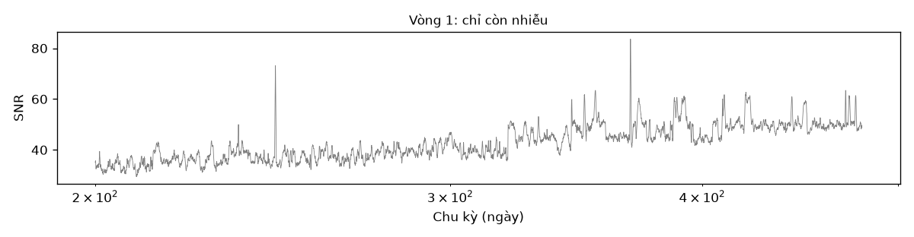
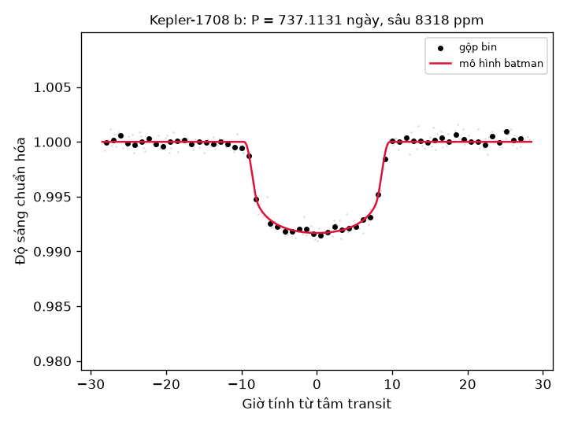
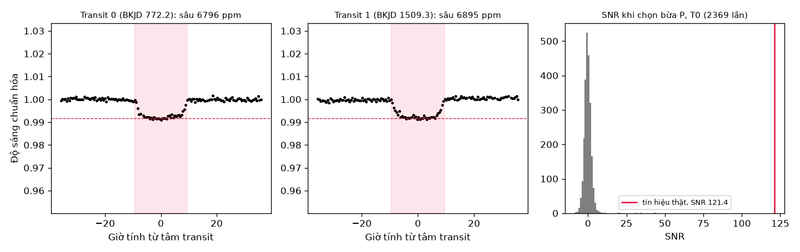

# Hệ hành tinh Kepler-1708

Dữ liệu: 64728 điểm Kepler long cadence, dài 1459 ngày. **Tổng cộng 1 hành tinh**: 0 tự tìm thấy bằng transit, 1 BLS không tự tìm ra, kiểm chứng bằng P, T0 của NASA.

⚠️ BLS không tự tìm ra **Kepler-1708 b**: chỉ có 2 transit trong dữ liệu, ít hơn 3 lần BLS yêu cầu. Khi gấp pha đúng P, T0 (tự đo trong light curve (NASA thiếu T0/T14)): SNR = 121.4, 2 transit. Phép thử báo động giả: **0.00%** trong 2369 lần chọn bừa P, T0 cũng cho SNR cao bằng. Xem `Kepler1708_Kepler1708b_transits.png`.

## Sao mẹ

| Thông số | Giá trị | NASA |
|---|---|---|
| Nhiệt độ bề mặt Teff (KIC) | 6032 K | 6157.0 |
| Loại phổ (suy từ Teff) | F |  |
| Bán kính Rs (KIC) | 0.973 R☉ | 1.117 |
| Khối lượng từ logg (KIC) | 1.055 M☉ | 1.088 |
| Khối lượng dùng cho tính toán | 1.055 M☉ (từ logg) | 1.088 |
| Độ sáng L | 1.13 L☉ |  |
| Hệ số tối rìa (u1, u2) dùng khi khớp | mặc định cho sao loại G (0.40, 0.26) |  |
| Độ kim loại [Fe/H] (KIC) | -0.06 dex (kim loại gấp ~0.9 lần Mặt Trời) | 0.0 |
| Tuổi | 3.16 tỷ năm (NASA) |  |

## Khoảng cách từ Trái Đất

- **Thị sai Gaia DR3** (sao ?; lấy từ thị sai lưu trên NASA Exoplanet Archive (sy_plx), máy chủ Gaia không phản hồi): 0.5730 ± 0.0340 mas → **1745.3 ± 103.4 pc ≈ 5693 năm ánh sáng**
- Ước tính bằng độ sáng (M = 4.61, Kp = 15.72): ~1668 pc (thô, không tính bụi)
- NASA Exoplanet Archive: 1667 pc
- Khoảng cách tới từng hành tinh = khoảng cách tới sao ± a. Quỹ đạo rộng nhất (1.626 AU) chỉ bằng 4.5e-09 lần khoảng cách nên coi như **bằng nhau**.

## Thông số các hành tinh

| Thông số | Kepler-1708 b |
|---|---|
| *Số trong ngoặc: giá trị NASA* | |
| Phát hiện bằng | Transit (kiểm chứng theo P, T0 NASA) |
| Chu kỳ P (ngày) | 737.11310 (737.11310) |
| SNR / số transit thấy được | 121 / 2 |
| Độ sâu transit (ppm) | 8318 |
| Thời lượng T14 (giờ) | 18.98 (19.00) |
| Rp / Rs | 0.0830 (0.0818) |
| Tham số va chạm b | 0.17 (0.37) |
| a / Rs | 317.24 ± 26.21 (317.90) |
| Khối lượng sao suy từ transit (M☉) | 0.73 ± 0.18 |
| Độ nghiêng i (độ) | 89.97 |
| Bán kính (R⊕) | 8.82 (9.96) |
| Bán kính (R♃) | 0.786 (0.889) |
| Khối lượng (M⊕) | 1462.0 (1462.0) |
| Khối lượng (M♃) | 4.6002 |
| Nguồn khối lượng | Đã công bố (NASA) |
| Mật độ (g/cm³) | 11.73 |
| Trọng lực bề mặt (× Trái Đất) | 18.80 |
| Bán trục lớn a (AU) | 1.6256 (1.6400) |
| Độ lệch tâm e | giả định 0 (0.40) |
| Vận tốc quỹ đạo (km/s) | 24 |
| Nhiệt độ cân bằng Teq (K) | 206 (245) |
| Bức xạ nhận được (× Trái Đất) | 0 (1) |
| Xác suất có transit Rs/a (%) | 0.3 |
| Loại theo bán kính | Giống Sao Hải Vương |
| **Thành phần** | Khí khổng lồ H/He, ~10% nguyên tố nặng |

## Thành phần từng hành tinh

- **Kepler-1708 b**: Khí khổng lồ, mật độ 11.73 g/cm³. Chủ yếu là hydro + heli; nguyên tố nặng (đá, băng, kim loại) ước tính ~147 M⊕ (~10% khối lượng).

Thành phần ở đây là **suy đoán từ mật độ** (khối lượng / thể tích) so với mô hình lý thuyết. Muốn biết thành phần khí quyển thật (H₂O, CO₂, CH₄...) phải chụp phổ truyền qua bằng JWST/HST.

## Hình ảnh

### Light curve đã làm phẳng (mọi quý)

### Periodogram BLS từng vòng tìm kiếm

### Transit gấp pha và mô hình batman của từng hành tinh

### Kepler-1708 b: từng transit riêng lẻ và phép thử báo động giả

### Sơ đồ hệ (bước 3, `03_diagram.py`)

### Tìm vệ tinh: O − C và vùng vai OSE (bước 4, `04_moons.py`, chi tiết trong `Kepler1708_moons.md`)

### Khí quyển: nhật thực phụ Kepler và phổ đã công bố (bước 5, `05_atmosphere.py`, chi tiết trong `Kepler1708_atmosphere.md`)

