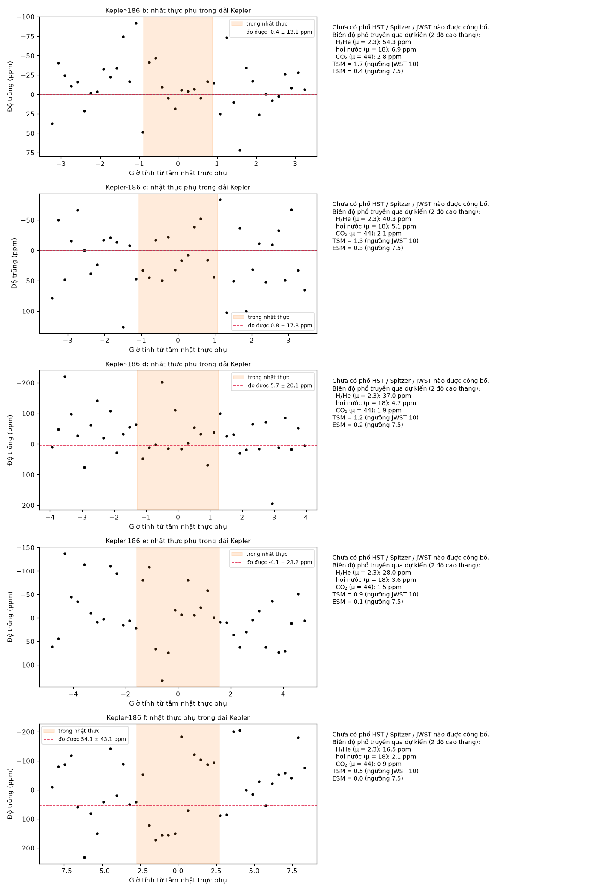

# Khí quyển các hành tinh của Kepler-186

Sao mẹ: Teff = 3755 K, Rs = 0.475 R☉, cấp sao J = 12.473, K = 11.605. Kepler chỉ có 1 dải màu nên **không tự đo được phổ**; phổ theo bước sóng lấy từ các bài báo đã công bố (NASA Exoplanet Archive, bảng `transitspec`, `emissionspec`, `spectra`).

| Thông số | Kepler-186 b | Kepler-186 c | Kepler-186 d | Kepler-186 e | Kepler-186 f |
|---|---|---|---|---|---|
| Bán kính / khối lượng dùng | 1.05 R⊕ / 1.2 M⊕ (ước tính) | 1.23 R⊕ / 2.0 M⊕ (ước tính) | 1.35 R⊕ / 2.4 M⊕ (ước tính) | 1.20 R⊕ / 1.9 M⊕ (ước tính) | 1.09 R⊕ / 1.3 M⊕ (ước tính) |
| Nhiệt độ cân bằng (albedo 0) / phía ngày (K) | 638 / 702 | 518 / 570 | 423 / 465 | 356 / 392 | 198 / 218 |
| Trọng lực bề mặt (m/s²) | 10.3 | 13.2 | 12.9 | 12.8 | 11.0 |
| Độ cao thang H, H/He (μ = 2.3) (km) | 221 | 141 | 118 | 100 | 65 |
| Độ cao thang H, hơi nước (μ = 18) (km) | 28 | 18 | 15 | 13 | 8 |
| Độ cao thang H, CO₂ (μ = 44) (km) | 12 | 7 | 6 | 5 | 3 |
| Biên độ phổ truyền qua, H/He (μ = 2.3) (ppm) | 54.3 | 40.3 | 37.0 | 28.0 | 16.5 |
| Biên độ phổ truyền qua, hơi nước (μ = 18) (ppm) | 6.9 | 5.1 | 4.7 | 3.6 | 2.1 |
| Biên độ phổ truyền qua, CO₂ (μ = 44) (ppm) | 2.8 | 2.1 | 1.9 | 1.5 | 0.9 |
| **TSM** (JWST, phổ truyền qua) | 1.7 (ngưỡng 10) ❌ | 1.3 (ngưỡng 10) ❌ | 1.2 (ngưỡng 10) ❌ | 0.9 (ngưỡng 10) ❌ | 0.5 (ngưỡng 10) ❌ |
| **ESM** (JWST, phổ phát xạ 7.5 μm) | 0.4 (ngưỡng 7.5) ❌ | 0.3 (ngưỡng 7.5) ❌ | 0.2 (ngưỡng 7.5) ❌ | 0.1 (ngưỡng 7.5) ❌ | 0.0 (ngưỡng 7.5) ❌ |
| Nhật thực phụ Kepler (ppm) | -0.4 ± 13.1 (-0.0σ) | 0.8 ± 17.8 (0.0σ) | 5.7 ± 20.1 (0.3σ) | -4.1 ± 23.2 (-0.2σ) | 54.1 ± 43.1 (1.3σ) |
| Phần phát nhiệt dự kiến trong dải Kepler (ppm) | 0.00 | 0.00 | 0.00 | 0.00 | 0.00 |
| Albedo hình học Ag (cả độ sâu / trừ phần nhiệt) | -0.22 ± 7.44 / -0.22 | 0.89 ± 19.05 / 0.89 | 11.68 ± 40.95 / 11.68 | -19.90 ± 113.90 / -19.90 | 3490.05 ± 2776.53 / 3490.05 |
| Phổ đã công bố trên NASA | chưa có | chưa có | chưa có | chưa có | chưa có |

## Kepler-186 b

Chưa có phổ HST, Spitzer hay JWST nào được công bố cho hành tinh này.

**Nhật thực phụ Kepler**: -0.4 ± 13.1 ppm (-0.0σ, 1112 điểm trong, 2379 điểm ngoài). Chưa phát hiện (dưới 3σ): albedo hình học Ag < 22.33 (giới hạn 3σ).

## Kepler-186 c

Chưa có phổ HST, Spitzer hay JWST nào được công bố cho hành tinh này.

**Nhật thực phụ Kepler**: 0.8 ± 17.8 ppm (0.0σ, 714 điểm trong, 1303 điểm ngoài). Chưa phát hiện (dưới 3σ): albedo hình học Ag < 58.04 (giới hạn 3σ).

## Kepler-186 d

Chưa có phổ HST, Spitzer hay JWST nào được công bố cho hành tinh này.

**Nhật thực phụ Kepler**: 5.7 ± 20.1 ppm (0.3σ, 442 điểm trong, 723 điểm ngoài). Chưa phát hiện (dưới 3σ): albedo hình học Ag < 134.54 (giới hạn 3σ).

## Kepler-186 e

Chưa có phổ HST, Spitzer hay JWST nào được công bố cho hành tinh này.

**Nhật thực phụ Kepler**: -4.1 ± 23.2 ppm (-0.2σ, 358 điểm trong, 612 điểm ngoài). Chưa phát hiện (dưới 3σ): albedo hình học Ag < 341.69 (giới hạn 3σ).

## Kepler-186 f

Chưa có phổ HST, Spitzer hay JWST nào được công bố cho hành tinh này.

**Nhật thực phụ Kepler**: 54.1 ± 43.1 ppm (1.3σ, 102 điểm trong, 186 điểm ngoài). Chưa phát hiện (dưới 3σ): albedo hình học Ag < 11819.66 (giới hạn 3σ).

Ghi chú:
- **TSM / ESM** (Kempton et al. 2018): tín hiệu dự kiến khi chụp bằng JWST NIRISS (truyền qua) và MIRI 7.5 μm (phát xạ) trong 10 giờ. Ngưỡng đáng ưu tiên: TSM > 10 với hành tinh < 1.5 R⊕, > 90 với hành tinh lớn hơn; ESM > 7.5.
- Biên độ phổ truyền qua tính bằng 2 độ cao thang, khí quyển trong suốt không mây. Mây hoặc sương mù làm phổ phẳng đi.
- Nhật thực phụ giả định quỹ đạo tròn (pha 0.5). Quỹ đạo lệch tâm làm nhật thực lệch khỏi pha 0.5.
- Bước làm phẳng light curve (cửa sổ ~18 ngày) không ảnh hưởng nhật thực dài vài giờ, nhưng xóa mất biến thiên theo pha quỹ đạo (phase curve).
