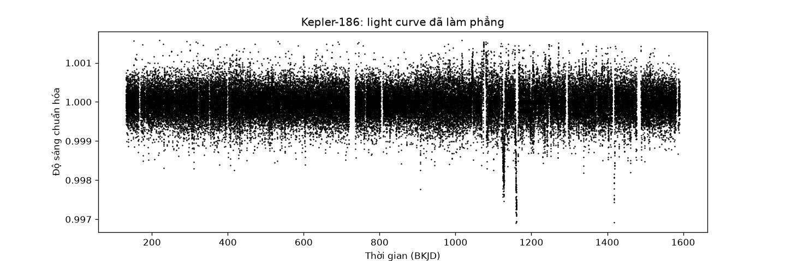
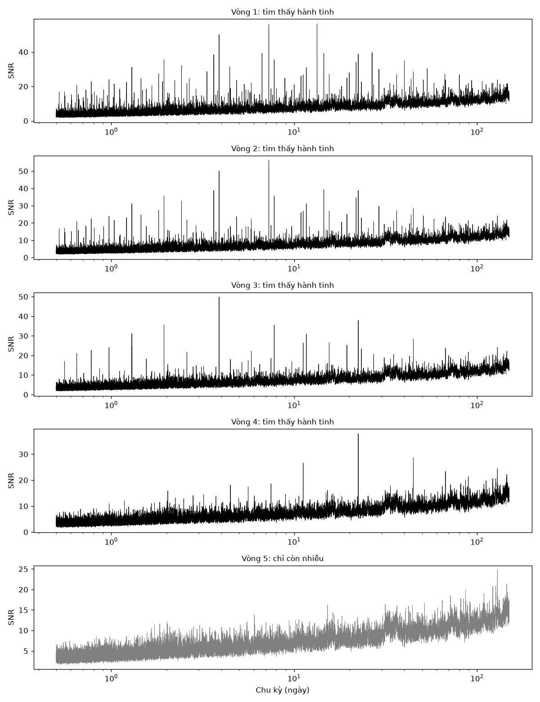
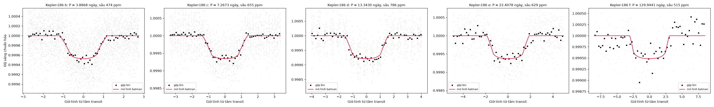
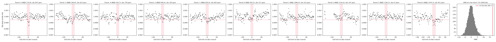

# Hệ hành tinh Kepler-186

Dữ liệu: 64437 điểm Kepler long cadence, dài 1459 ngày. **Tổng cộng 5 hành tinh**: 4 tự tìm thấy bằng transit, 1 BLS không tự tìm ra, kiểm chứng bằng P, T0 của NASA.

⚠️ **Kepler-186 f** quá yếu để BLS tự tìm (đỉnh periodogram mạnh nhất là nhiễu). Khi gấp pha đúng P, T0 đã công bố: SNR = 17.3, 10 transit. Phép thử báo động giả: **0.00%** trong 3000 lần chọn bừa P, T0 cũng cho SNR cao bằng. Xem `Kepler186_Kepler186f_transits.png`.

## Sao mẹ

| Thông số | Giá trị | NASA |
|---|---|---|
| Nhiệt độ bề mặt Teff (KIC) | 3755 K | 3788.0 |
| Loại phổ (suy từ Teff) | K |  |
| Bán kính Rs (KIC) | 0.475 R☉ | 0.472 |
| Khối lượng từ logg (KIC) | 0.493 M☉ | 0.478 |
| Khối lượng dùng cho tính toán | 0.493 M☉ (từ logg) | 0.478 |
| Độ sáng L | 0.04 L☉ |  |
| Hệ số tối rìa (u1, u2) dùng khi khớp | KOI DR25 (0.2405, 0.4418), tính cho Teff = 3751 K, logg = 4.80, [Fe/H] = -0.34 |  |
| Độ kim loại [Fe/H] (KIC) | -0.16 dex (kim loại gấp ~0.7 lần Mặt Trời) | -0.28 |
| Tuổi | 4.0 tỷ năm (NASA) |  |

## Khoảng cách từ Trái Đất

- **Thị sai Gaia DR3** (sao 2079000330051813504; lấy từ Gaia DR3 (file đệm, máy chủ Gaia không phản hồi)): 5.6336 ± 0.0169 mas, RUWE = 0.99 (< 1.4 là đáng tin) → **177.5 ± 0.5 pc ≈ 579 năm ánh sáng**
- Ước tính bằng độ sáng (M = 8.22, Kp = 14.62): ~191 pc (thô, không tính bụi)
- NASA Exoplanet Archive: 178 pc
- Khoảng cách tới từng hành tinh = khoảng cách tới sao ± a. Quỹ đạo rộng nhất (0.397 AU) chỉ bằng 1.1e-08 lần khoảng cách nên coi như **bằng nhau**.

## Thông số các hành tinh

| Thông số | Kepler-186 b | Kepler-186 c | Kepler-186 d | Kepler-186 e | Kepler-186 f |
|---|---|---|---|---|---|
| *Số trong ngoặc: giá trị NASA* | | | | | |
| Phát hiện bằng | Transit (tự tìm) | Transit (tự tìm) | Transit (tự tìm) | Transit (tự tìm) | Transit (kiểm chứng theo P, T0 NASA) |
| Chu kỳ P (ngày) | 3.88680 (3.88679) | 7.26727 (7.26730) | 13.34301 (13.34300) | 22.40776 (22.40770) | 129.94410 (129.94410) |
| SNR / số transit thấy được | 50 / 341 | 56 / 179 | 56 / 100 | 38 / 61 | 17 / 10 |
| Độ sâu transit (ppm) | 474 | 655 | 786 | 629 | 515 |
| Thời lượng T14 (giờ) | 1.84 (1.81) | 2.24 (2.27) | 2.70 (2.90) | 3.29 (3.32) | 5.67 (5.62) |
| Rp / Rs | 0.0203 (0.0208) | 0.0237 (0.0242) | 0.0260 (0.0272) | 0.0232 (0.0246) | 0.0210 (0.0205) |
| Tham số va chạm b | 0.38 (0.30) | 0.26 (0.28) | 0.30 (0.36) | 0.27 (0.31) | 0.33 (0.13) |
| a / Rs | 15.28 ± 12.03 (16.71) | 24.50 ± 14.51 (25.03) | 37.05 ± 21.43 (17.80) | 51.35 ± 38.53 (52.75) | 168.92 ± 273.05 (178.00) |
| Khối lượng sao suy từ transit (M☉) | 0.34 ± 0.80 | 0.40 ± 0.71 | 0.41 ± 0.71 | 0.39 ± 0.87 | 0.41 ± 1.99 |
| Độ nghiêng i (độ) | 88.56 (89.60) | 89.39 (89.90) | 89.53 (89.10) | 89.70 (89.84) | 89.89 (89.96) |
| Bán kính (R⊕) | 1.05 (1.07) | 1.23 (1.25) | 1.35 (1.40) | 1.20 (1.27) | 1.09 (1.17) |
| Bán kính (R♃) | 0.094 (0.095) | 0.109 (0.112) | 0.120 (0.125) | 0.107 (0.113) | 0.097 (0.104) |
| Khối lượng (M⊕) | — (1.2) | — (2.1) | — (2.5) | — (2.1) | — (1.7) |
| Khối lượng (M♃) | — | — | — | — | — |
| Nguồn khối lượng | Chưa đo; ước tính từ bán kính ~1.2 M⊕ | Chưa đo; ước tính từ bán kính ~2.0 M⊕ | Chưa đo; ước tính từ bán kính ~2.4 M⊕ | Chưa đo; ước tính từ bán kính ~1.9 M⊕ | Chưa đo; ước tính từ bán kính ~1.3 M⊕ |
| Mật độ (g/cm³) | — | — | — | — | — |
| Trọng lực bề mặt (× Trái Đất) | — | — | — | — | — |
| Bán trục lớn a (AU) | 0.0382 (0.0343) | 0.0580 (0.0451) | 0.0870 (0.0781) | 0.1229 (0.1100) | 0.3968 (0.4320) |
| Độ lệch tâm e | giả định 0 (0.00) | giả định 0 (0.00) | giả định 0 (0.00) | giả định 0 (0.00) | giả định 0 (0.04) |
| Vận tốc quỹ đạo (km/s) | 107 | 87 | 71 | 60 | 33 |
| Nhiệt độ cân bằng Teq (K) | 584 (571) | 474 (464) | 387 (379) | 326 (319) | 181 (177) |
| Bức xạ nhận được (× Trái Đất) | 28 (37) | 12 (14) | 5 (7) | 3 (4) | 0 (0) |
| Xác suất có transit Rs/a (%) | 5.8 | 3.8 | 2.5 | 1.8 | 0.6 |
| Loại theo bán kính | Hành tinh đá | Hành tinh đá | Hành tinh đá | Hành tinh đá | Hành tinh đá |
| **Thành phần** | Hành tinh đá (chỉ theo bán kính) | Hành tinh đá (chỉ theo bán kính) | Hành tinh đá (chỉ theo bán kính) | Hành tinh đá (chỉ theo bán kính) | Hành tinh đá (chỉ theo bán kính) |

## Thành phần từng hành tinh

- **Kepler-186 b**: Chưa có khối lượng nên chỉ phân loại được theo bán kính.
- **Kepler-186 c**: Chưa có khối lượng nên chỉ phân loại được theo bán kính.
- **Kepler-186 d**: Chưa có khối lượng nên chỉ phân loại được theo bán kính.
- **Kepler-186 e**: Chưa có khối lượng nên chỉ phân loại được theo bán kính.
- **Kepler-186 f**: Chưa có khối lượng nên chỉ phân loại được theo bán kính.

Thành phần ở đây là **suy đoán từ mật độ** (khối lượng / thể tích) so với mô hình lý thuyết. Muốn biết thành phần khí quyển thật (H₂O, CO₂, CH₄...) phải chụp phổ truyền qua bằng JWST/HST.

## Đối chiếu với danh sách ứng viên Kepler (KOI DR25)

| KOI | Tên | Kết luận | Chu kỳ (ngày) | Bán kính (R⊕) | Script tìm thấy? |
|---|---|---|---|---|---|
| K00571.01 | Kepler-186 c | CONFIRMED | 7.2673 | 1.14 | ✅ |
| K00571.02 | Kepler-186 d | CONFIRMED | 13.3430 | 1.29 | ✅ |
| K00571.03 | Kepler-186 b | CONFIRMED | 3.8868 | 0.97 | ✅ |
| K00571.04 | Kepler-186 e | CONFIRMED | 22.4078 | 1.15 | ✅ |
| K00571.05 | Kepler-186 f | CONFIRMED | 129.9454 | 1.18 | 🔍 chỉ kiểm chứng |

## Hình ảnh

### Light curve đã làm phẳng (mọi quý)

### Periodogram BLS từng vòng tìm kiếm

### Transit gấp pha và mô hình batman của từng hành tinh

### Kepler-186 f: từng transit riêng lẻ và phép thử báo động giả

### Sơ đồ hệ (bước 3, `03_diagram.py`)

### Tìm vệ tinh: O − C và vùng vai OSE (bước 4, `04_moons.py`, chi tiết trong `Kepler186_moons.md`)

### Khí quyển: nhật thực phụ Kepler và phổ đã công bố (bước 5, `05_atmosphere.py`, chi tiết trong `Kepler186_atmosphere.md`)

