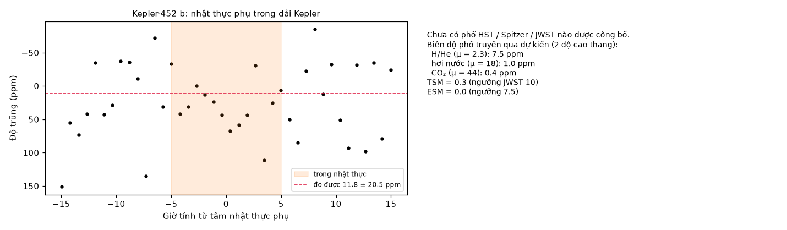

# Khí quyển các hành tinh của Kepler-452

Sao mẹ: Teff = 5578 K, Rs = 0.794 R☉, cấp sao J = 12.263, K = 11.852. Kepler chỉ có 1 dải màu nên **không tự đo được phổ**; phổ theo bước sóng lấy từ các bài báo đã công bố (NASA Exoplanet Archive, bảng `transitspec`, `emissionspec`, `spectra`).

| Thông số | Kepler-452 b |
|---|---|
| Bán kính / khối lượng dùng | 1.02 R⊕ / 1.1 M⊕ (ước tính) |
| Nhiệt độ cân bằng (albedo 0) / phía ngày (K) | 241 / 265 |
| Trọng lực bề mặt (m/s²) | 9.9 |
| Độ cao thang H, H/He (μ = 2.3) (km) | 87 |
| Độ cao thang H, hơi nước (μ = 18) (km) | 11 |
| Độ cao thang H, CO₂ (μ = 44) (km) | 5 |
| Biên độ phổ truyền qua, H/He (μ = 2.3) (ppm) | 7.5 |
| Biên độ phổ truyền qua, hơi nước (μ = 18) (ppm) | 1.0 |
| Biên độ phổ truyền qua, CO₂ (μ = 44) (ppm) | 0.4 |
| **TSM** (JWST, phổ truyền qua) | 0.3 (ngưỡng 10) ❌ |
| **ESM** (JWST, phổ phát xạ 7.5 μm) | 0.0 (ngưỡng 7.5) ❌ |
| Nhật thực phụ Kepler (ppm) | 11.8 ± 20.5 (0.6σ) |
| Phần phát nhiệt dự kiến trong dải Kepler (ppm) | 0.00 |
| Albedo hình học Ag (cả độ sâu / trừ phần nhiệt) | 6823.56 ± 11873.41 / 6823.56 |
| Phổ đã công bố trên NASA | chưa có |

## Kepler-452 b

Chưa có phổ HST, Spitzer hay JWST nào được công bố cho hành tinh này.

**Nhật thực phụ Kepler**: 11.8 ± 20.5 ppm (0.6σ, 81 điểm trong, 157 điểm ngoài). Chưa phát hiện (dưới 3σ): albedo hình học Ag < 42443.78 (giới hạn 3σ).

Ghi chú:
- **TSM / ESM** (Kempton et al. 2018): tín hiệu dự kiến khi chụp bằng JWST NIRISS (truyền qua) và MIRI 7.5 μm (phát xạ) trong 10 giờ. Ngưỡng đáng ưu tiên: TSM > 10 với hành tinh < 1.5 R⊕, > 90 với hành tinh lớn hơn; ESM > 7.5.
- Biên độ phổ truyền qua tính bằng 2 độ cao thang, khí quyển trong suốt không mây. Mây hoặc sương mù làm phổ phẳng đi.
- Nhật thực phụ giả định quỹ đạo tròn (pha 0.5). Quỹ đạo lệch tâm làm nhật thực lệch khỏi pha 0.5.
- Bước làm phẳng light curve (cửa sổ ~18 ngày) không ảnh hưởng nhật thực dài vài giờ, nhưng xóa mất biến thiên theo pha quỹ đạo (phase curve).
