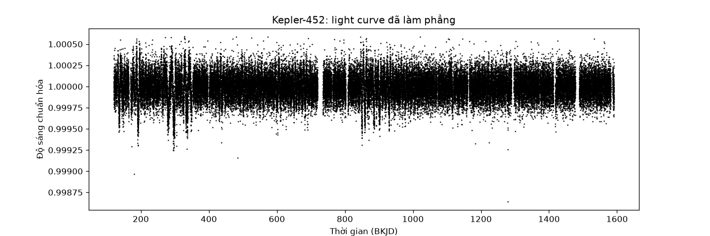
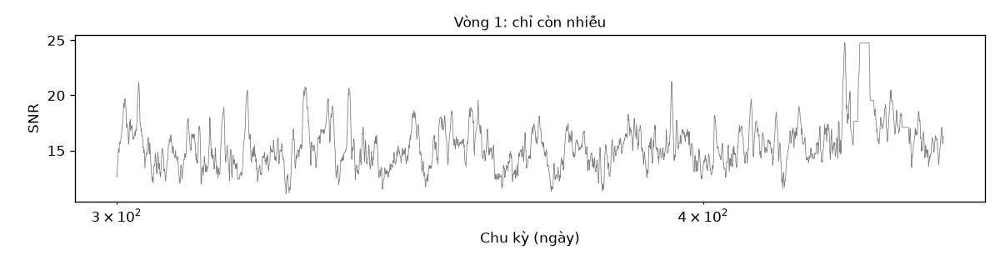
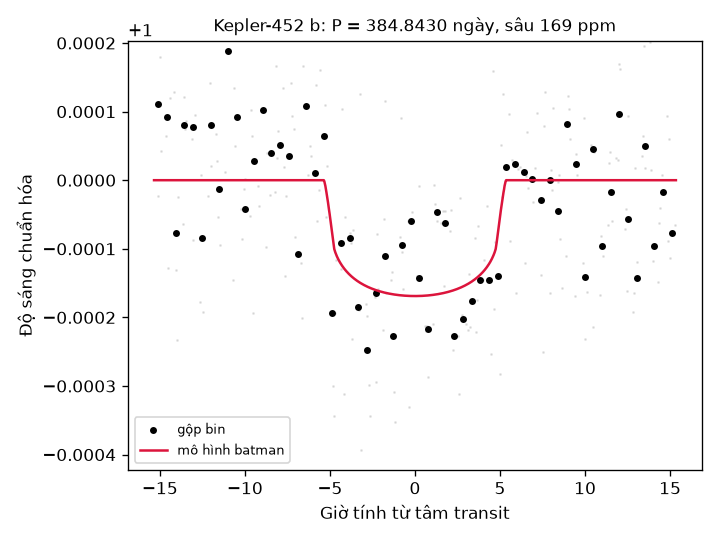
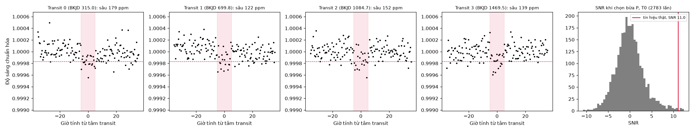

# Hệ hành tinh Kepler-452

Dữ liệu: 65156 điểm Kepler long cadence, dài 1470 ngày. **Tổng cộng 1 hành tinh**: 0 tự tìm thấy bằng transit, 1 BLS không tự tìm ra, kiểm chứng bằng P, T0 của NASA.

⚠️ **Kepler-452 b** quá yếu để BLS tự tìm (đỉnh periodogram mạnh nhất là nhiễu). Khi gấp pha đúng P, T0 đã công bố: SNR = 11.0, 4 transit. Phép thử báo động giả: **0.40%** trong 2783 lần chọn bừa P, T0 cũng cho SNR cao bằng. Xem `Kepler452_Kepler452b_transits.png`.

## Sao mẹ

| Thông số | Giá trị | NASA |
|---|---|---|
| Nhiệt độ bề mặt Teff (KIC) | 5578 K | 5757.0 |
| Loại phổ (suy từ Teff) | G |  |
| Bán kính Rs (KIC) | 0.794 R☉ | 1.11 |
| Khối lượng từ logg (KIC) | 0.870 M☉ | 1.037 |
| Khối lượng dùng cho tính toán | 0.870 M☉ (từ logg) | 1.037 |
| Độ sáng L | 0.55 L☉ |  |
| Hệ số tối rìa (u1, u2) dùng khi khớp | KOI DR25 (0.4341, 0.2434), tính cho Teff = 5579 K, logg = 4.58, [Fe/H] = -0.22 |  |
| Độ kim loại [Fe/H] (KIC) | -0.24 dex (kim loại gấp ~0.6 lần Mặt Trời) | 0.21 |
| Tuổi | 6.0 tỷ năm (NASA) |  |

## Khoảng cách từ Trái Đất

- **Thị sai Gaia DR3** (sao 2079597124345617280; lấy từ Gaia DR3 (file đệm, máy chủ Gaia không phản hồi)): 1.8053 ± 0.0103 mas, RUWE = 1.01 (< 1.4 là đáng tin) → **553.9 ± 3.2 pc ≈ 1807 năm ánh sáng**
- Ước tính bằng độ sáng (M = 5.39, Kp = 13.43): ~405 pc (thô, không tính bụi)
- NASA Exoplanet Archive: 552 pc
- Khoảng cách tới từng hành tinh = khoảng cách tới sao ± a. Quỹ đạo rộng nhất (0.988 AU) chỉ bằng 8.7e-09 lần khoảng cách nên coi như **bằng nhau**.

## Thông số các hành tinh

| Thông số | Kepler-452 b |
|---|---|
| *Số trong ngoặc: giá trị NASA* | |
| Phát hiện bằng | Transit (kiểm chứng theo P, T0 NASA) |
| Chu kỳ P (ngày) | 384.84300 (384.84300) |
| SNR / số transit thấy được | 11 / 4 |
| Độ sâu transit (ppm) | 169 |
| Thời lượng T14 (giờ) | 10.23 (10.63) |
| Rp / Rs | 0.0118 (0.0128) |
| Tham số va chạm b | 0.22 (0.69) |
| a / Rs | 283.82 ± 1693.96 (281.60) |
| Khối lượng sao suy từ transit (M☉) | 1.04 ± 18.56 |
| Độ nghiêng i (độ) | 89.96 (89.81) |
| Bán kính (R⊕) | 1.02 (1.63) |
| Bán kính (R♃) | 0.091 (0.145) |
| Khối lượng (M⊕) | — (3.3) |
| Khối lượng (M♃) | — |
| Nguồn khối lượng | Chưa đo; ước tính từ bán kính ~1.1 M⊕ |
| Mật độ (g/cm³) | — |
| Trọng lực bề mặt (× Trái Đất) | — |
| Bán trục lớn a (AU) | 0.9885 (1.0460) |
| Độ lệch tâm e | giả định 0 (0.00) |
| Vận tốc quỹ đạo (km/s) | 28 |
| Nhiệt độ cân bằng Teq (K) | 220 (265) |
| Bức xạ nhận được (× Trái Đất) | 1 (1) |
| Xác suất có transit Rs/a (%) | 0.4 |
| Loại theo bán kính | Hành tinh đá |
| **Thành phần** | Hành tinh đá (chỉ theo bán kính) |

## Thành phần từng hành tinh

- **Kepler-452 b**: Chưa có khối lượng nên chỉ phân loại được theo bán kính.

Thành phần ở đây là **suy đoán từ mật độ** (khối lượng / thể tích) so với mô hình lý thuyết. Muốn biết thành phần khí quyển thật (H₂O, CO₂, CH₄...) phải chụp phổ truyền qua bằng JWST/HST.

## Đối chiếu với danh sách ứng viên Kepler (KOI DR25)

| KOI | Tên | Kết luận | Chu kỳ (ngày) | Bán kính (R⊕) | Script tìm thấy? |
|---|---|---|---|---|---|
| K07016.01 | Kepler-452 b | CONFIRMED | 384.8476 | 1.09 | 🔍 chỉ kiểm chứng |

## Hình ảnh

### Light curve đã làm phẳng (mọi quý)

### Periodogram BLS từng vòng tìm kiếm

### Transit gấp pha và mô hình batman của từng hành tinh

### Kepler-452 b: từng transit riêng lẻ và phép thử báo động giả

### Sơ đồ hệ (bước 3, `03_diagram.py`)

### Tìm vệ tinh: O − C và vùng vai OSE (bước 4, `04_moons.py`, chi tiết trong `Kepler452_moons.md`)

### Khí quyển: nhật thực phụ Kepler và phổ đã công bố (bước 5, `05_atmosphere.py`, chi tiết trong `Kepler452_atmosphere.md`)

