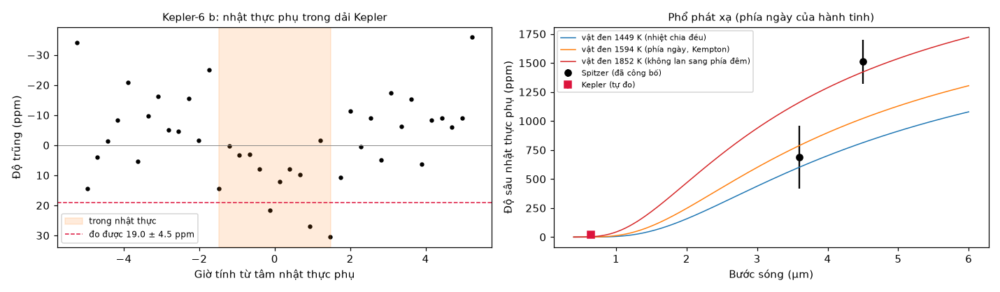

# Khí quyển các hành tinh của Kepler-6

Sao mẹ: Teff = 5640 K, Rs = 1.291 R☉, cấp sao J = 12.001, K = 11.634. Kepler chỉ có 1 dải màu nên **không tự đo được phổ**; phổ theo bước sóng lấy từ các bài báo đã công bố (NASA Exoplanet Archive, bảng `transitspec`, `emissionspec`, `spectra`).

| Thông số | Kepler-6 b |
|---|---|
| Bán kính / khối lượng dùng | 13.08 R⊕ / 210.9 M⊕ |
| Nhiệt độ cân bằng (albedo 0) / phía ngày (K) | 1449 / 1594 |
| Trọng lực bề mặt (m/s²) | 12.1 |
| Độ cao thang H, H/He (μ = 2.3) (km) | 430 |
| Độ cao thang H, hơi nước (μ = 18) (km) | 55 |
| Độ cao thang H, CO₂ (μ = 44) (km) | 22 |
| Biên độ phổ truyền qua, H/He (μ = 2.3) (ppm) | 177.6 |
| Biên độ phổ truyền qua, hơi nước (μ = 18) (ppm) | 22.7 |
| Biên độ phổ truyền qua, CO₂ (μ = 44) (ppm) | 9.3 |
| **TSM** (JWST, phổ truyền qua) | 42.2 (ngưỡng 90) ❌ |
| **ESM** (JWST, phổ phát xạ 7.5 μm) | 30.3 (ngưỡng 7.5) ✅ |
| Nhật thực phụ Kepler (ppm) | 19.0 ± 4.5 (4.2σ) |
| Phần phát nhiệt dự kiến trong dải Kepler (ppm) | 0.34 |
| Albedo hình học Ag (cả độ sâu / trừ phần nhiệt) | 0.13 ± 0.03 / 0.12 |
| Phổ đã công bố trên NASA | 5 bộ |

## Kepler-6 b

**Phổ đã công bố** (bảng `spectra`):

| Loại | Kính / thiết bị | Bước sóng (μm) | Số điểm | Tác giả | bibcode |
|---|---|---|---|---|---|
| Eclipse | Spitzer Space Telescope satellite / Infrared Array Camera (IRAC) | 3.6–4.5 | 2 | Désert et al. 2011 | 2011ApJS..197...11D |
| Eclipse | Spitzer Space Telescope satellite / Infrared Array Camera (IRAC) | 3.6–3.6 | 1 | Deming et al. 2023 | 2023AJ....165..104D |
| Eclipse | Spitzer Space Telescope satellite / Infrared Array Camera (IRAC) | 3.6–3.6 | 1 | Deming et al. 2023 | 2023AJ....165..104D |
| Eclipse | Spitzer Space Telescope satellite / Infrared Array Camera (IRAC) | 4.5–4.5 | 1 | Deming et al. 2023 | 2023AJ....165..104D |
| Eclipse | Spitzer Space Telescope satellite / Infrared Array Camera (IRAC) | 4.5–4.5 | 1 | Deming et al. 2023 | 2023AJ....165..104D |

**Phổ phát xạ** (độ sâu nhật thực phụ theo bước sóng). Nhiệt độ độ sáng tự tính coi sao là vật đen nên lệch chút so với bài báo (dùng mô hình phổ sao):

| Bước sóng (μm) | Độ sâu (ppm) | T độ sáng tự tính (K) | T độ sáng công bố (K) | Nguồn |
|---|---|---|---|---|
| 3.6 | 690 ± 270 | 1520 | 1320 ± 250 | [Désert et al. 2011](https://ui.adsabs.harvard.edu/abs/2011ApJS..197...11D/abstract) |
| 4.5 | 1510 ± 190 | 1906 | 1700 ± 120 | [Désert et al. 2011](https://ui.adsabs.harvard.edu/abs/2011ApJS..197...11D/abstract) |

So sánh: nhiệt độ cân bằng (albedo 0, phân bố đều) 1449 K; phía ngày không phân bố lại nhiệt có thể tới ~1852 K. Nhiệt độ độ sáng cao hơn nhiệt độ cân bằng nghĩa là nhiệt **không kịp lan sang phía đêm** hoặc albedo rất thấp.

**Nhật thực phụ Kepler**: 19.0 ± 4.5 ppm (4.2σ, 2006 điểm trong, 4165 điểm ngoài). Albedo hình học Ag = 0.13 ± 0.03; trừ phần phát nhiệt dự kiến (0.3 ppm) còn 0.12.

Ghi chú:
- **TSM / ESM** (Kempton et al. 2018): tín hiệu dự kiến khi chụp bằng JWST NIRISS (truyền qua) và MIRI 7.5 μm (phát xạ) trong 10 giờ. Ngưỡng đáng ưu tiên: TSM > 10 với hành tinh < 1.5 R⊕, > 90 với hành tinh lớn hơn; ESM > 7.5.
- Biên độ phổ truyền qua tính bằng 2 độ cao thang, khí quyển trong suốt không mây. Mây hoặc sương mù làm phổ phẳng đi.
- Nhật thực phụ giả định quỹ đạo tròn (pha 0.5). Quỹ đạo lệch tâm làm nhật thực lệch khỏi pha 0.5.
- Bước làm phẳng light curve (cửa sổ ~18 ngày) không ảnh hưởng nhật thực dài vài giờ, nhưng xóa mất biến thiên theo pha quỹ đạo (phase curve).
