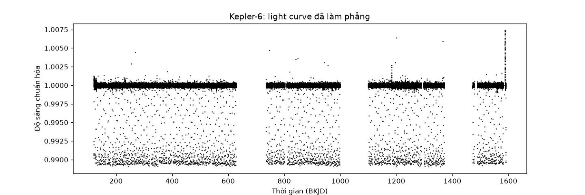
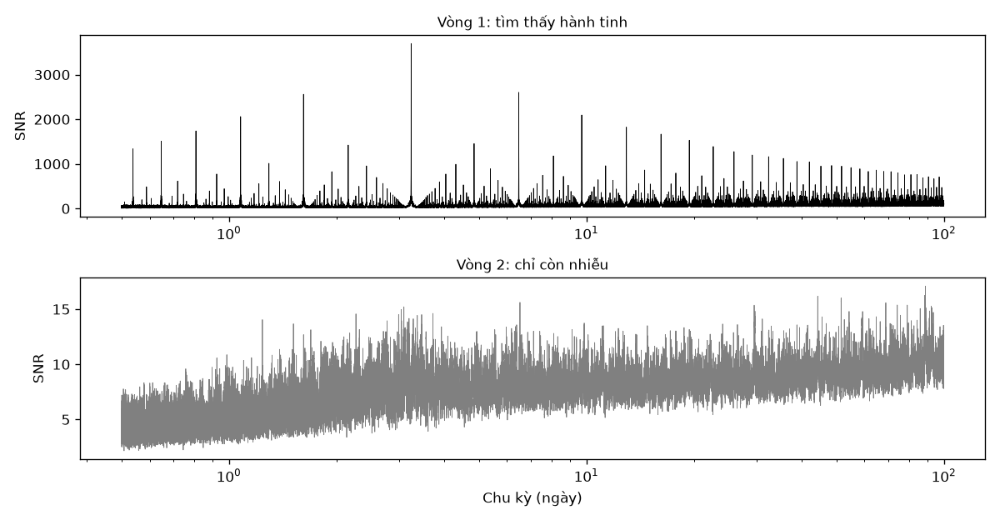
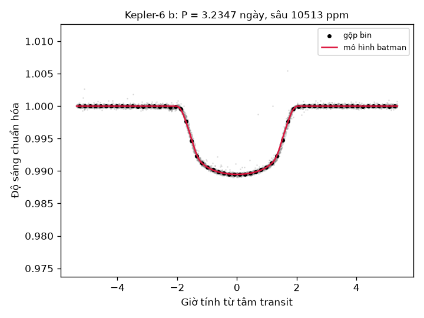

# Hệ hành tinh Kepler-6

Dữ liệu: 52187 điểm Kepler long cadence, dài 1470 ngày. **Tổng cộng 1 hành tinh**: 1 tự tìm thấy bằng transit.

## Sao mẹ

| Thông số | Giá trị | NASA |
|---|---|---|
| Nhiệt độ bề mặt Teff (KIC) | 5640 K | 5647.0 |
| Loại phổ (suy từ Teff) | G |  |
| Bán kính Rs (KIC) | 1.291 R☉ | 1.391 |
| Khối lượng từ logg (KIC) | 1.046 M☉ | 1.209 |
| Khối lượng dùng cho tính toán | 1.197 ± 0.002 M☉ (từ mật độ transit) | 1.209 |
| Độ sáng L | 1.52 L☉ |  |
| Hệ số tối rìa (u1, u2) dùng khi khớp | KOI DR25 (0.4213, 0.2570), tính cho Teff = 5640 K, logg = 4.24, [Fe/H] = +0.34 |  |
| Độ kim loại [Fe/H] (KIC) | 0.34 dex (kim loại gấp ~2.2 lần Mặt Trời) | 0.34 |
| Tuổi | 3.8 tỷ năm (NASA) |  |

## Khoảng cách từ Trái Đất

- **Thị sai Gaia DR3** (sao 2086636884980514304; lấy từ Gaia DR3 (file đệm, máy chủ Gaia không phản hồi)): 1.7108 ± 0.0102 mas, RUWE = 0.96 (< 1.4 là đáng tin) → **584.5 ± 3.5 pc ≈ 1906 năm ánh sáng**
- Ước tính bằng độ sáng (M = 4.29, Kp = 13.30): ~636 pc (thô, không tính bụi)
- NASA Exoplanet Archive: 587 pc
- Khoảng cách tới từng hành tinh = khoảng cách tới sao ± a. Quỹ đạo rộng nhất (0.045 AU) chỉ bằng 3.8e-10 lần khoảng cách nên coi như **bằng nhau**.

## Thông số các hành tinh

| Thông số | Kepler-6 b |
|---|---|
| *Số trong ngoặc: giá trị NASA* | |
| Phát hiện bằng | Transit (tự tìm) |
| Chu kỳ P (ngày) | 3.23469 (3.23470) |
| SNR / số transit thấy được | 3696 / 339 |
| Độ sâu transit (ppm) | 10513 |
| Thời lượng T14 (giờ) | 3.58 (3.59) |
| Rp / Rs | 0.0928 (0.0942) |
| Tham số va chạm b | 0.00 (0.14) |
| a / Rs | 7.57 ± 0.00 (7.50) |
| Khối lượng sao suy từ transit (M☉) | 1.20 ± 0.00 |
| Độ nghiêng i (độ) | 90.00 (88.93) |
| Bán kính (R⊕) | 13.08 (14.62) |
| Bán kính (R♃) | 1.166 (1.304) |
| Khối lượng (M⊕) | 210.9 (212.3) |
| Khối lượng (M♃) | 0.6637 |
| Nguồn khối lượng | RV (K = 80.9 m/s đã công bố, Ms và i tự tính) |
| Mật độ (g/cm³) | 0.52 |
| Trọng lực bề mặt (× Trái Đất) | 1.23 |
| Bán trục lớn a (AU) | 0.0454 (0.0485) |
| Độ lệch tâm e | giả định 0 (0.00) |
| Vận tốc quỹ đạo (km/s) | 153 |
| Nhiệt độ cân bằng Teq (K) | 1326 (1460) |
| Bức xạ nhận được (× Trái Đất) | 736 (792) |
| Xác suất có transit Rs/a (%) | 13.2 |
| Loại theo bán kính | Khí khổng lồ |
| **Thành phần** | Khí khổng lồ H/He, ~21% nguyên tố nặng |

## Thành phần từng hành tinh

- **Kepler-6 b**: Khí khổng lồ, mật độ 0.52 g/cm³. Chủ yếu là hydro + heli; nguyên tố nặng (đá, băng, kim loại) ước tính ~45 M⊕ (~21% khối lượng). Xốp hơn Sao Thổ: hành tinh bị **phồng** (hay gặp ở hot Jupiter bị sao mẹ sưởi nóng).

Thành phần ở đây là **suy đoán từ mật độ** (khối lượng / thể tích) so với mô hình lý thuyết. Muốn biết thành phần khí quyển thật (H₂O, CO₂, CH₄...) phải chụp phổ truyền qua bằng JWST/HST.

## Đối chiếu với danh sách ứng viên Kepler (KOI DR25)

| KOI | Tên | Kết luận | Chu kỳ (ngày) | Bán kính (R⊕) | Script tìm thấy? |
|---|---|---|---|---|---|
| K00017.01 | Kepler-6 b | CONFIRMED | 3.2347 | 13.06 | ✅ |

## Hình ảnh

### Light curve đã làm phẳng (mọi quý)

### Periodogram BLS từng vòng tìm kiếm

### Transit gấp pha và mô hình batman của từng hành tinh

### Sơ đồ hệ (bước 3, `03_diagram.py`)

### Tìm vệ tinh: O − C và vùng vai OSE (bước 4, `04_moons.py`, chi tiết trong `Kepler6_moons.md`)

### Khí quyển: nhật thực phụ Kepler và phổ đã công bố (bước 5, `05_atmosphere.py`, chi tiết trong `Kepler6_atmosphere.md`)

