# Phổ JWST / HST của các hành tinh bị tranh cãi: tự kiểm tra lại

Tạo bởi `scripts/06_disputed_spectra.py`. Số liệu: NASA Exoplanet Archive, bảng `transitspec`, `emissionspec` (điểm phổ, tải qua TAP) và `spectra` (danh mục mọi phổ đã công bố). Bối cảnh từng hệ: `docs/khi-quyen-va-tuong-lai.md`, mục 3.

**Đọc kết quả thế nào:**
- *Khác phẳng bao nhiêu σ*: phép thử χ² so với đường nằm ngang. Đá trần hoặc mây dày cho phổ phẳng (≈ 0σ). Số σ cao chỉ nói phổ **có cấu trúc**, không nói cấu trúc đó do khí quyển: vết trên sao, lỗi hệ thống của pipeline, hoặc sai số công bố bị đánh giá thấp đều làm σ tăng. Ngược lại χ²_red < 1 rõ rệt nghĩa là sai số công bố có thể bị đánh giá cao.
- *So với biên độ dự kiến*: nếu hành tinh có khí quyển loại đó (trong, không mây), bộ phổ lẽ ra phải lệch phẳng ≥ 3σ (ước tính: đặc trưng cao 2 độ cao thang, coi như dao động hình sin phủ dải bước sóng). "Không đủ nhạy" = sai số quá lớn để nói gì. "Loại" = đủ nhạy mà phổ vẫn phẳng, nên khí quyển trong loại đó bị loại (mây dày vẫn có thể giấu nó). "Khớp được" = đủ nhạy và phổ có cấu trúc, nhưng chưa chắc cấu trúc do khí quyển.
- *Các bộ phổ có khớp nhau không*: cùng một hành tinh mà 2 nhóm / 2 pipeline / 2 lần quan sát cho kết quả lệch nhau quá sai số thì mọi kết luận dựa trên chỉ một bộ đều đáng ngờ.

**Giới hạn:** các phổ JWST mới nhất của K2-18 b (2023, 2025), TRAPPIST-1 e/f, LHS 1140 b, 55 Cnc e, GJ 1132 b có trong danh mục `spectra` nhưng số liệu không tải được qua TAP, nên chưa được kiểm tra ở đây (đánh dấu — trong bảng danh mục). Ứng viên vệ tinh Kepler-1625 b-i dựa trên 1 transit HST năm 2017 (quang trắc, không phải phổ), không nằm trong các bảng này.

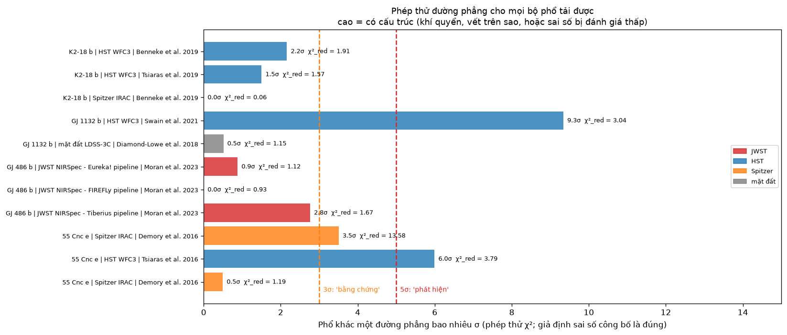

## K2-18 b

Bán kính 2.37 R⊕, khối lượng 8.92 M⊕, Teq 284.0 K, sao 0.411 R☉ / 3457.0 K, cách 38.0266 pc (NASA `pscomppars`).

Biên độ đặc trưng phổ truyền qua dự kiến (2 độ cao thang, khí quyển trong không mây): H/He (μ = 2.3) **48 ppm**, hơi nước (μ = 18) **6 ppm**, CO₂ (μ = 44) **3 ppm**.

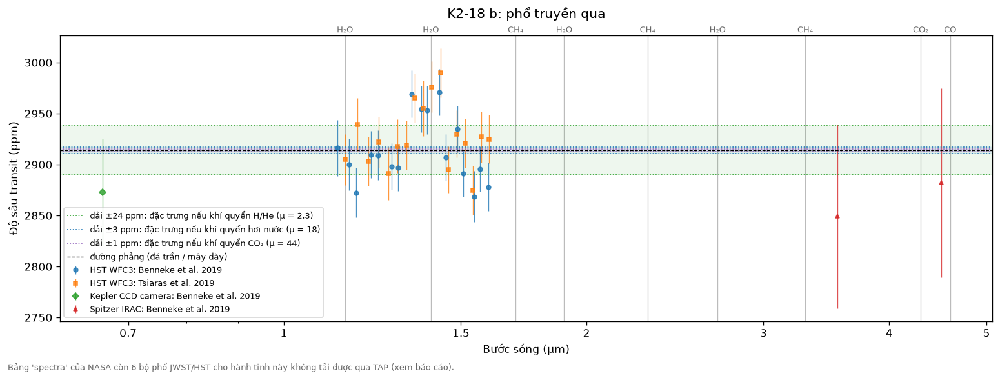

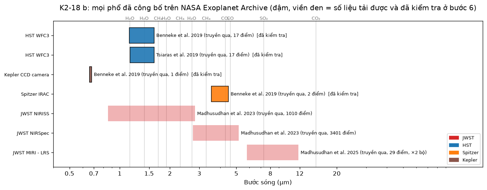

**Phép thử đường phẳng** (từng bộ phổ tải được qua TAP):

| Loại | Kính / thiết bị | Nguồn | Số điểm | Bước sóng (μm) | Sai số trung vị (ppm) | χ²_red | p | Khác phẳng | So với biên độ dự kiến |
|---|---|---|---|---|---|---|---|---|---|
| truyền qua | HST WFC3 | [Benneke et al. 2019](https://ui.adsabs.harvard.edu/abs/2019ApJ...887L..14B/abstract) | 17 | 1.14–1.61 | 23 | 1.91 | 0.015 | 2.2σ | H/He: không đủ nhạy; hơi nước: không đủ nhạy; CO₂: không đủ nhạy |
| truyền qua | HST WFC3 | [Tsiaras et al. 2019](https://ui.adsabs.harvard.edu/abs/2019NatAs...3.1086T/abstract) | 17 | 1.16–1.61 | 24 | 1.57 | 0.066 | 1.5σ | H/He: không đủ nhạy; hơi nước: không đủ nhạy; CO₂: không đủ nhạy |
| truyền qua | Kepler CCD camera | [Benneke et al. 2019](https://ui.adsabs.harvard.edu/abs/2019ApJ...887L..14B/abstract) | 1 | 0.66–0.66 | 52 | — | — | — |  |
| truyền qua | Spitzer IRAC | [Benneke et al. 2019](https://ui.adsabs.harvard.edu/abs/2019ApJ...887L..14B/abstract) | 2 | 3.54–4.49 | 91 | 0.06 | 0.8 | 0.0σ |  |

**Các bộ phổ có khớp nhau không?** (bin chung 0.1 μm trên vùng chồng nhau, đã bỏ chênh lệch mức trung bình):

| Bộ A | Bộ B | Vùng chồng (μm) | Số bin | Chênh mức trung bình (ppm) | χ²_red | p | Kết luận |
|---|---|---|---|---|---|---|---|
| HST WFC3, Benneke et al. 2019 | HST WFC3, Tsiaras et al. 2019 | 1.16–1.61 | 5 | -10 | 1.13 | 0.34 | khớp trong sai số (0.4σ) |

**Mọi phổ đã công bố trong bảng `spectra` của NASA** (✅ = có số liệu tải được qua TAP và đã dùng ở trên):

| Loại | Kính / thiết bị | Bước sóng (μm) | Số điểm | Tác giả | bibcode | Dùng? |
|---|---|---|---|---|---|---|
| Transmission | Spitzer IRAC | 3.54–4.49 | 2 | Benneke et al. 2019 | [2019ApJ...887L..14B](https://ui.adsabs.harvard.edu/abs/2019ApJ...887L..14B) | ✅ |
| Transmission | Kepler CCD camera | 0.66–0.66 | 1 | Benneke et al. 2019 | [2019ApJ...887L..14B](https://ui.adsabs.harvard.edu/abs/2019ApJ...887L..14B) | ✅ |
| Transmission | HST WFC3 | 1.14–1.61 | 17 | Benneke et al. 2019 | [2019ApJ...887L..14B](https://ui.adsabs.harvard.edu/abs/2019ApJ...887L..14B) | ✅ |
| Transmission | HST WFC3 | 1.16–1.61 | 17 | Tsiaras et al. 2019 | [2019NatAs...3.1086T](https://ui.adsabs.harvard.edu/abs/2019NatAs...3.1086T) | ✅ |
| Transmission | JWST NIRISS | 0.85–2.83 | 1010 | Madhusudhan et al. 2023 | [2023ApJ...956L..13M](https://ui.adsabs.harvard.edu/abs/2023ApJ...956L..13M) | — |
| Transmission | JWST NIRSpec | 2.74–5.17 | 3401 | Madhusudhan et al. 2023 | [2023ApJ...956L..13M](https://ui.adsabs.harvard.edu/abs/2023ApJ...956L..13M) | — |
| Transmission | JWST MIRI - LRS | 5.78–11.79 | 29 | Madhusudhan et al. 2025 | [2025ApJ...983L..40M](https://ui.adsabs.harvard.edu/abs/2025ApJ...983L..40M) | — |
| Transmission | JWST MIRI - LRS | 5.78–11.79 | 29 | Madhusudhan et al. 2025 | [2025ApJ...983L..40M](https://ui.adsabs.harvard.edu/abs/2025ApJ...983L..40M) | — |

## GJ 1132 b

Bán kính 1.19151465 R⊕, khối lượng 1.83704819 M⊕, Teq 583.8 K, sao 0.2211 R☉ / 3229.0 K, cách 12.613 pc (NASA `pscomppars`).

Biên độ đặc trưng phổ truyền qua dự kiến (2 độ cao thang, khí quyển trong không mây): H/He (μ = 2.3) **212 ppm**, hơi nước (μ = 18) **27 ppm**, CO₂ (μ = 44) **11 ppm**.

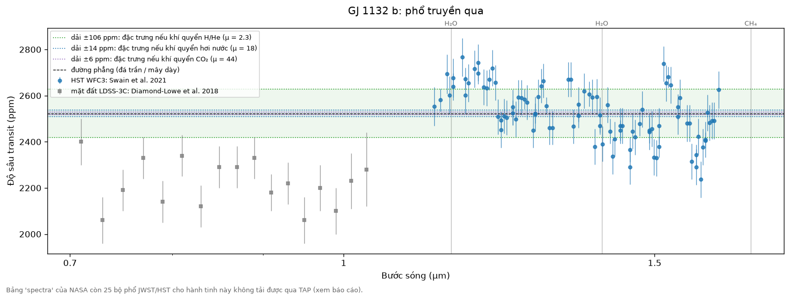

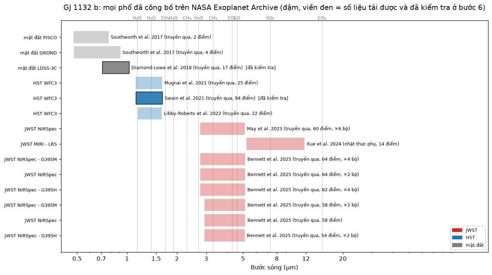

**Phép thử đường phẳng** (từng bộ phổ tải được qua TAP):

| Loại | Kính / thiết bị | Nguồn | Số điểm | Bước sóng (μm) | Sai số trung vị (ppm) | χ²_red | p | Khác phẳng | So với biên độ dự kiến |
|---|---|---|---|---|---|---|---|---|---|
| truyền qua | HST WFC3 | [Swain et al. 2021](https://ui.adsabs.harvard.edu/abs/2021arXiv210305657S/abstract) | 94 | 1.13–1.64 | 76 | 3.04 | 4.8e-21 | **9.3σ** | H/He: khớp được; hơi nước: không đủ nhạy; CO₂: không đủ nhạy |
| truyền qua | mặt đất LDSS-3C | [Diamond-Lowe et al. 2018](https://ui.adsabs.harvard.edu/abs/2018AJ....156...42D/abstract) | 17 | 0.71–1.03 | 90 | 1.15 | 0.3 | 0.5σ | H/He: **loại** (nếu không mây); hơi nước: không đủ nhạy; CO₂: không đủ nhạy |

**Mọi phổ đã công bố trong bảng `spectra` của NASA** (✅ = có số liệu tải được qua TAP và đã dùng ở trên):

| Loại | Kính / thiết bị | Bước sóng (μm) | Số điểm | Tác giả | bibcode | Dùng? |
|---|---|---|---|---|---|---|
| Transmission | mặt đất GROND | 0.48–0.91 | 4 | Southworth et al. 2017 | [2017AJ....153..191S](https://ui.adsabs.harvard.edu/abs/2017AJ....153..191S) | — |
| Transmission | mặt đất PISCO | 0.47–0.78 | 2 | Southworth et al. 2017 | [2017AJ....153..191S](https://ui.adsabs.harvard.edu/abs/2017AJ....153..191S) | — |
| Transmission | mặt đất LDSS-3C | 0.71–1.03 | 17 | Diamond-Lowe et al. 2018 | [2018AJ....156...42D](https://ui.adsabs.harvard.edu/abs/2018AJ....156...42D) | ✅ |
| Transmission | HST WFC3 | 1.13–1.64 | 94 | Swain et al. 2021 | [2021AJ....161..213S](https://ui.adsabs.harvard.edu/abs/2021AJ....161..213S) | ✅ |
| Transmission | HST WFC3 | 1.13–1.63 | 25 | Mugnai et al. 2021 | [2021AJ....161..284M](https://ui.adsabs.harvard.edu/abs/2021AJ....161..284M) | — |
| Transmission | HST WFC3 | 1.16–1.62 | 22 | Libby-Roberts et al. 2022 | [2022AJ....164...59L](https://ui.adsabs.harvard.edu/abs/2022AJ....164...59L) | — |
| Transmission | JWST NIRSpec | 2.77–5.13 | 60 | May et al. 2023 | [2023ApJ...959L...9M](https://ui.adsabs.harvard.edu/abs/2023ApJ...959L...9M) | — |
| Transmission | JWST NIRSpec | 2.77–5.13 | 60 | May et al. 2023 | [2023ApJ...959L...9M](https://ui.adsabs.harvard.edu/abs/2023ApJ...959L...9M) | — |
| Transmission | JWST NIRSpec | 2.79–5.13 | 59 | May et al. 2023 | [2023ApJ...959L...9M](https://ui.adsabs.harvard.edu/abs/2023ApJ...959L...9M) | — |
| Transmission | JWST NIRSpec | 2.79–5.13 | 59 | May et al. 2023 | [2023ApJ...959L...9M](https://ui.adsabs.harvard.edu/abs/2023ApJ...959L...9M) | — |
| Transmission | JWST NIRSpec | 2.77–5.13 | 60 | May et al. 2023 | [2023ApJ...959L...9M](https://ui.adsabs.harvard.edu/abs/2023ApJ...959L...9M) | — |
| Transmission | JWST NIRSpec | 2.77–5.13 | 60 | May et al. 2023 | [2023ApJ...959L...9M](https://ui.adsabs.harvard.edu/abs/2023ApJ...959L...9M) | — |
| Eclipse | JWST MIRI - LRS | 5.25–11.75 | 14 | Xue et al. 2024 | [2024ApJ...973L...8X](https://ui.adsabs.harvard.edu/abs/2024ApJ...973L...8X) | — |
| Transmission | JWST NIRSpec | 2.77–5.16 | 64 | Bennett et al. 2025 | [2025AJ....170..205B](https://ui.adsabs.harvard.edu/abs/2025AJ....170..205B) | — |
| Transmission | JWST NIRSpec | 2.93–5.16 | 58 | Bennett et al. 2025 | [2025AJ....170..205B](https://ui.adsabs.harvard.edu/abs/2025AJ....170..205B) | — |
| Transmission | JWST NIRSpec | 2.77–5.16 | 64 | Bennett et al. 2025 | [2025AJ....170..205B](https://ui.adsabs.harvard.edu/abs/2025AJ....170..205B) | — |
| Transmission | JWST NIRSpec - G395H | 2.77–5.16 | 62 | Bennett et al. 2025 | [2025AJ....170..205B](https://ui.adsabs.harvard.edu/abs/2025AJ....170..205B) | — |
| Transmission | JWST NIRSpec - G395H | 2.77–5.16 | 62 | Bennett et al. 2025 | [2025AJ....170..205B](https://ui.adsabs.harvard.edu/abs/2025AJ....170..205B) | — |
| Transmission | JWST NIRSpec - G395H | 2.93–5.12 | 54 | Bennett et al. 2025 | [2025AJ....170..205B](https://ui.adsabs.harvard.edu/abs/2025AJ....170..205B) | — |
| Transmission | JWST NIRSpec - G395H | 2.93–5.12 | 54 | Bennett et al. 2025 | [2025AJ....170..205B](https://ui.adsabs.harvard.edu/abs/2025AJ....170..205B) | — |
| Transmission | JWST NIRSpec - G395H | 2.77–5.16 | 62 | Bennett et al. 2025 | [2025AJ....170..205B](https://ui.adsabs.harvard.edu/abs/2025AJ....170..205B) | — |
| Transmission | JWST NIRSpec - G395H | 2.77–5.16 | 62 | Bennett et al. 2025 | [2025AJ....170..205B](https://ui.adsabs.harvard.edu/abs/2025AJ....170..205B) | — |
| Transmission | JWST NIRSpec - G395M | 2.77–5.16 | 64 | Bennett et al. 2025 | [2025AJ....170..205B](https://ui.adsabs.harvard.edu/abs/2025AJ....170..205B) | — |
| Transmission | JWST NIRSpec - G395M | 2.77–5.16 | 64 | Bennett et al. 2025 | [2025AJ....170..205B](https://ui.adsabs.harvard.edu/abs/2025AJ....170..205B) | — |
| Transmission | JWST NIRSpec - G395M | 2.93–5.16 | 58 | Bennett et al. 2025 | [2025AJ....170..205B](https://ui.adsabs.harvard.edu/abs/2025AJ....170..205B) | — |
| Transmission | JWST NIRSpec - G395M | 2.93–5.16 | 58 | Bennett et al. 2025 | [2025AJ....170..205B](https://ui.adsabs.harvard.edu/abs/2025AJ....170..205B) | — |
| Transmission | JWST NIRSpec - G395M | 2.77–5.16 | 64 | Bennett et al. 2025 | [2025AJ....170..205B](https://ui.adsabs.harvard.edu/abs/2025AJ....170..205B) | — |
| Transmission | JWST NIRSpec - G395M | 2.77–5.16 | 64 | Bennett et al. 2025 | [2025AJ....170..205B](https://ui.adsabs.harvard.edu/abs/2025AJ....170..205B) | — |

## GJ 486 b

Bán kính 1.289 R⊕, khối lượng 2.77 M⊕, Teq 696.3 K, sao 0.3243 R☉ / 3317.0 K, cách 8.07426 pc (NASA `pscomppars`).

Biên độ đặc trưng phổ truyền qua dự kiến (2 độ cao thang, khí quyển trong không mây): H/He (μ = 2.3) **98 ppm**, hơi nước (μ = 18) **13 ppm**, CO₂ (μ = 44) **5 ppm**.

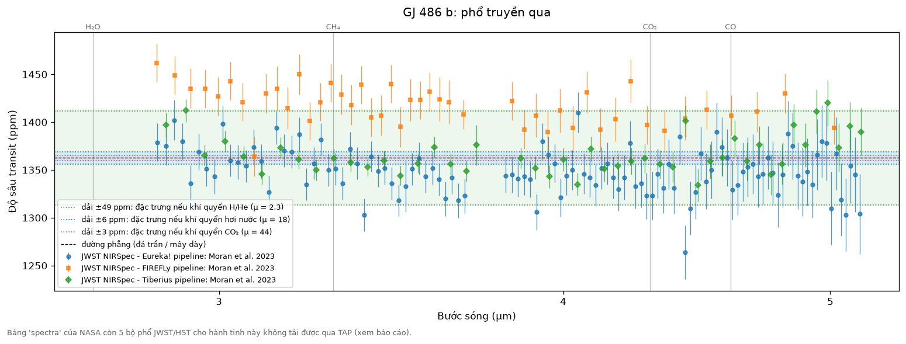

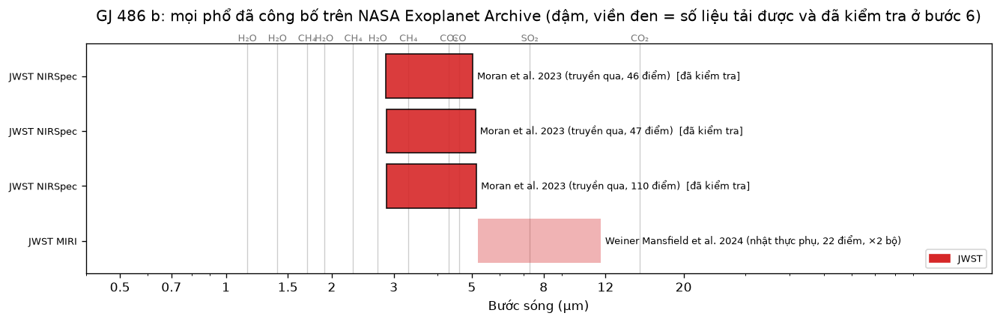

**Phép thử đường phẳng** (từng bộ phổ tải được qua TAP):

| Loại | Kính / thiết bị | Nguồn | Số điểm | Bước sóng (μm) | Sai số trung vị (ppm) | χ²_red | p | Khác phẳng | So với biên độ dự kiến |
|---|---|---|---|---|---|---|---|---|---|
| truyền qua | JWST NIRSpec - Eureka! pipeline | [Moran et al. 2023](https://ui.adsabs.harvard.edu/abs/2023arXiv230500868M/abstract) | 110 | 2.87–5.16 | 21 | 1.12 | 0.19 | 0.9σ | H/He: **loại** (nếu không mây); hơi nước: không đủ nhạy; CO₂: không đủ nhạy |
| truyền qua | JWST NIRSpec - FIREFLy pipeline | [Moran et al. 2023](https://ui.adsabs.harvard.edu/abs/2023arXiv230500868M/abstract) | 46 | 2.85–5.03 | 21 | 0.93 | 0.6 | 0.0σ | H/He: **loại** (nếu không mây); hơi nước: không đủ nhạy; CO₂: không đủ nhạy |
| truyền qua | JWST NIRSpec - Tiberius pipeline | [Moran et al. 2023](https://ui.adsabs.harvard.edu/abs/2023arXiv230500868M/abstract) | 47 | 2.87–5.12 | 13 | 1.67 | 0.0028 | 2.8σ | H/He: **loại** (nếu không mây); hơi nước: không đủ nhạy; CO₂: không đủ nhạy |

**Các bộ phổ có khớp nhau không?** (bin chung 0.1 μm trên vùng chồng nhau, đã bỏ chênh lệch mức trung bình):

| Bộ A | Bộ B | Vùng chồng (μm) | Số bin | Chênh mức trung bình (ppm) | χ²_red | p | Kết luận |
|---|---|---|---|---|---|---|---|
| JWST NIRSpec - Eureka! pipeline, Moran et al. 2023 | JWST NIRSpec - FIREFLy pipeline, Moran et al. 2023 | 2.87–5.03 | 21 | -66 | 0.54 | 0.95 | khớp trong sai số (0.0σ) |
| JWST NIRSpec - Eureka! pipeline, Moran et al. 2023 | JWST NIRSpec - Tiberius pipeline, Moran et al. 2023 | 2.87–5.12 | 23 | -12 | 1.08 | 0.36 | khớp trong sai số (0.3σ) |
| JWST NIRSpec - FIREFLy pipeline, Moran et al. 2023 | JWST NIRSpec - Tiberius pipeline, Moran et al. 2023 | 2.87–5.03 | 21 | +56 | 0.66 | 0.87 | khớp trong sai số (0.0σ) |

**Mọi phổ đã công bố trong bảng `spectra` của NASA** (✅ = có số liệu tải được qua TAP và đã dùng ở trên):

| Loại | Kính / thiết bị | Bước sóng (μm) | Số điểm | Tác giả | bibcode | Dùng? |
|---|---|---|---|---|---|---|
| Transmission | JWST NIRSpec | 2.87–5.16 | 110 | Moran et al. 2023 | [2023ApJ...948L..11M](https://ui.adsabs.harvard.edu/abs/2023ApJ...948L..11M) | ✅ |
| Transmission | JWST NIRSpec | 2.85–5.03 | 46 | Moran et al. 2023 | [2023ApJ...948L..11M](https://ui.adsabs.harvard.edu/abs/2023ApJ...948L..11M) | ✅ |
| Transmission | JWST NIRSpec | 2.87–5.12 | 47 | Moran et al. 2023 | [2023ApJ...948L..11M](https://ui.adsabs.harvard.edu/abs/2023ApJ...948L..11M) | ✅ |
| Eclipse | JWST MIRI | 5.21–11.62 | 22 | Weiner Mansfield et al. 2024 | [2024arXiv240815123W](https://ui.adsabs.harvard.edu/abs/2024arXiv240815123W) | — |
| Eclipse | JWST MIRI | 5.21–11.62 | 22 | Weiner Mansfield et al. 2024 | [2024arXiv240815123W](https://ui.adsabs.harvard.edu/abs/2024arXiv240815123W) | — |

## 55 Cnc e

Bán kính 1.875 R⊕, khối lượng 7.99 M⊕, Teq 1958.0 K, sao 0.943 R☉ / 5172.0 K, cách 12.5855 pc (NASA `pscomppars`).

Biên độ đặc trưng phổ truyền qua dự kiến (2 độ cao thang, khí quyển trong không mây): H/He (μ = 2.3) **35 ppm**, hơi nước (μ = 18) **4 ppm**, CO₂ (μ = 44) **2 ppm**.

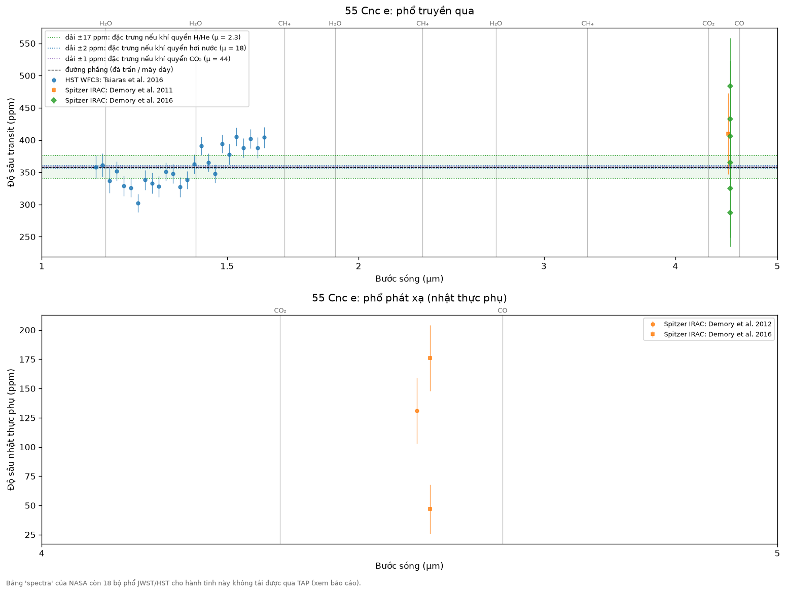

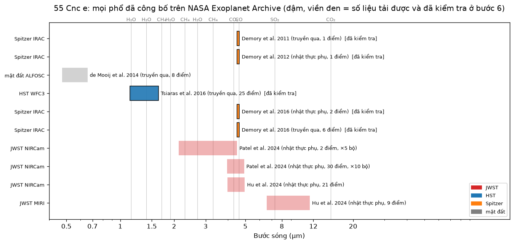

**Phép thử đường phẳng** (từng bộ phổ tải được qua TAP):

| Loại | Kính / thiết bị | Nguồn | Số điểm | Bước sóng (μm) | Sai số trung vị (ppm) | χ²_red | p | Khác phẳng | So với biên độ dự kiến |
|---|---|---|---|---|---|---|---|---|---|
| nhật thực phụ | Spitzer IRAC | [Demory et al. 2012](https://ui.adsabs.harvard.edu/abs/2012ApJ...751L..28D/abstract) | 1 | 4.50–4.50 | 28 | — | — | — |  |
| nhật thực phụ | Spitzer IRAC | [Demory et al. 2016](https://ui.adsabs.harvard.edu/abs/2016MNRAS.455.2018D/abstract) | 2 | 4.50–4.50 | 24 | 13.58 | 0.00023 | **3.5σ** |  |
| truyền qua | HST WFC3 | [Tsiaras et al. 2016](https://ui.adsabs.harvard.edu/abs/2016ApJ...820...99T/abstract) | 25 | 1.13–1.64 | 15 | 3.79 | 1e-09 | **6.0σ** | H/He: khớp được; hơi nước: không đủ nhạy; CO₂: không đủ nhạy |
| truyền qua | Spitzer IRAC | [Demory et al. 2011](https://ui.adsabs.harvard.edu/abs/2011A&A...533A.114D/abstract) | 1 | 4.50–4.50 | 63 | — | — | — |  |
| truyền qua | Spitzer IRAC | [Demory et al. 2016](https://ui.adsabs.harvard.edu/abs/2016MNRAS.455.2018D/abstract) | 6 | 4.50–4.50 | 75 | 1.19 | 0.31 | 0.5σ | H/He: không đủ nhạy; hơi nước: không đủ nhạy; CO₂: không đủ nhạy |

**Mọi phổ đã công bố trong bảng `spectra` của NASA** (✅ = có số liệu tải được qua TAP và đã dùng ở trên):

| Loại | Kính / thiết bị | Bước sóng (μm) | Số điểm | Tác giả | bibcode | Dùng? |
|---|---|---|---|---|---|---|
| Transmission | Spitzer IRAC | 4.50–4.50 | 1 | Demory et al. 2011 | [2011A&A...533A.114D](https://ui.adsabs.harvard.edu/abs/2011A&A...533A.114D) | ✅ |
| Eclipse | Spitzer IRAC | 4.50–4.50 | 1 | Demory et al. 2012 | [2012ApJ...751L..28D](https://ui.adsabs.harvard.edu/abs/2012ApJ...751L..28D) | ✅ |
| Transmission | mặt đất ALFOSC | 0.47–0.66 | 8 | de Mooij et al. 2014 | [2014ApJ...797L..21D](https://ui.adsabs.harvard.edu/abs/2014ApJ...797L..21D) | — |
| Transmission | HST WFC3 | 1.13–1.64 | 25 | Tsiaras et al. 2016 | [2016ApJ...820...99T](https://ui.adsabs.harvard.edu/abs/2016ApJ...820...99T) | ✅ |
| Eclipse | Spitzer IRAC | 4.50–4.50 | 2 | Demory et al. 2016 | [2016MNRAS.455.2018D](https://ui.adsabs.harvard.edu/abs/2016MNRAS.455.2018D) | ✅ |
| Transmission | Spitzer IRAC | 4.50–4.50 | 6 | Demory et al. 2016 | [2016MNRAS.455.2018D](https://ui.adsabs.harvard.edu/abs/2016MNRAS.455.2018D) | ✅ |
| Eclipse | JWST NIRCam | 3.95–4.92 | 30 | Patel et al. 2024 | [2024A&A...690A.159P](https://ui.adsabs.harvard.edu/abs/2024A&A...690A.159P) | — |
| Eclipse | JWST NIRCam | 3.95–4.91 | 30 | Patel et al. 2024 | [2024A&A...690A.159P](https://ui.adsabs.harvard.edu/abs/2024A&A...690A.159P) | — |
| Eclipse | JWST NIRCam | 3.95–4.92 | 30 | Patel et al. 2024 | [2024A&A...690A.159P](https://ui.adsabs.harvard.edu/abs/2024A&A...690A.159P) | — |
| Eclipse | JWST NIRCam | 3.95–4.91 | 30 | Patel et al. 2024 | [2024A&A...690A.159P](https://ui.adsabs.harvard.edu/abs/2024A&A...690A.159P) | — |
| Eclipse | JWST NIRCam | 3.95–4.92 | 30 | Patel et al. 2024 | [2024A&A...690A.159P](https://ui.adsabs.harvard.edu/abs/2024A&A...690A.159P) | — |
| Eclipse | JWST NIRCam | 3.95–4.91 | 30 | Patel et al. 2024 | [2024A&A...690A.159P](https://ui.adsabs.harvard.edu/abs/2024A&A...690A.159P) | — |
| Eclipse | JWST NIRCam | 3.95–4.92 | 30 | Patel et al. 2024 | [2024A&A...690A.159P](https://ui.adsabs.harvard.edu/abs/2024A&A...690A.159P) | — |
| Eclipse | JWST NIRCam | 3.95–4.91 | 30 | Patel et al. 2024 | [2024A&A...690A.159P](https://ui.adsabs.harvard.edu/abs/2024A&A...690A.159P) | — |
| Eclipse | JWST NIRCam | 3.95–4.92 | 30 | Patel et al. 2024 | [2024A&A...690A.159P](https://ui.adsabs.harvard.edu/abs/2024A&A...690A.159P) | — |
| Eclipse | JWST NIRCam | 3.95–4.91 | 30 | Patel et al. 2024 | [2024A&A...690A.159P](https://ui.adsabs.harvard.edu/abs/2024A&A...690A.159P) | — |
| Eclipse | JWST NIRCam | 2.12–4.50 | 2 | Patel et al. 2024 | [2024A&A...690A.159P](https://ui.adsabs.harvard.edu/abs/2024A&A...690A.159P) | — |
| Eclipse | JWST NIRCam | 2.12–4.50 | 2 | Patel et al. 2024 | [2024A&A...690A.159P](https://ui.adsabs.harvard.edu/abs/2024A&A...690A.159P) | — |
| Eclipse | JWST NIRCam | 2.12–4.50 | 2 | Patel et al. 2024 | [2024A&A...690A.159P](https://ui.adsabs.harvard.edu/abs/2024A&A...690A.159P) | — |
| Eclipse | JWST NIRCam | 2.12–4.50 | 2 | Patel et al. 2024 | [2024A&A...690A.159P](https://ui.adsabs.harvard.edu/abs/2024A&A...690A.159P) | — |
| Eclipse | JWST NIRCam | 2.12–4.50 | 2 | Patel et al. 2024 | [2024A&A...690A.159P](https://ui.adsabs.harvard.edu/abs/2024A&A...690A.159P) | — |
| Eclipse | JWST MIRI | 6.58–11.45 | 9 | Hu et al. 2024 | [2024Natur.630..609H](https://ui.adsabs.harvard.edu/abs/2024Natur.630..609H) | — |
| Eclipse | JWST NIRCam | 3.96–4.96 | 21 | Hu et al. 2024 | [2024Natur.630..609H](https://ui.adsabs.harvard.edu/abs/2024Natur.630..609H) | — |

## TRAPPIST-1 e

Bán kính 0.92 R⊕, khối lượng 0.692 M⊕, Teq 249.7 K, sao 0.1192 R☉ / 2566.0 K, cách 12.42988881 pc (NASA `pscomppars`).

Biên độ đặc trưng phổ truyền qua dự kiến (2 độ cao thang, khí quyển trong không mây): H/He (μ = 2.3) **380 ppm**, hơi nước (μ = 18) **49 ppm**, CO₂ (μ = 44) **20 ppm**.

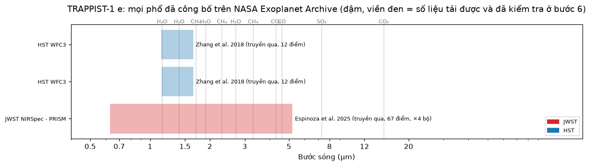

Không có điểm phổ nào tải được qua TAP (bảng `transitspec`, `emissionspec`).

**Mọi phổ đã công bố trong bảng `spectra` của NASA** (✅ = có số liệu tải được qua TAP và đã dùng ở trên):

| Loại | Kính / thiết bị | Bước sóng (μm) | Số điểm | Tác giả | bibcode | Dùng? |
|---|---|---|---|---|---|---|
| Transmission | HST WFC3 | 1.14–1.65 | 12 | Zhang et al. 2018 | [2018AJ....156..178Z](https://ui.adsabs.harvard.edu/abs/2018AJ....156..178Z) | — |
| Transmission | HST WFC3 | 1.14–1.66 | 12 | Zhang et al. 2018 | [2018AJ....156..178Z](https://ui.adsabs.harvard.edu/abs/2018AJ....156..178Z) | — |
| Transmission | JWST NIRSpec - PRISM | 0.63–5.21 | 67 | Espinoza et al. 2025 | [2025ApJ...990L..52E](https://ui.adsabs.harvard.edu/abs/2025ApJ...990L..52E) | — |
| Transmission | JWST NIRSpec - PRISM | 0.63–5.21 | 67 | Espinoza et al. 2025 | [2025ApJ...990L..52E](https://ui.adsabs.harvard.edu/abs/2025ApJ...990L..52E) | — |
| Transmission | JWST NIRSpec - PRISM | 0.63–5.21 | 67 | Espinoza et al. 2025 | [2025ApJ...990L..52E](https://ui.adsabs.harvard.edu/abs/2025ApJ...990L..52E) | — |
| Transmission | JWST NIRSpec - PRISM | 0.63–5.21 | 67 | Espinoza et al. 2025 | [2025ApJ...990L..52E](https://ui.adsabs.harvard.edu/abs/2025ApJ...990L..52E) | — |

## TRAPPIST-1 f

Bán kính 1.045 R⊕, khối lượng 1.039 M⊕, Teq 217.7 K, sao 0.1192 R☉ / 2566.0 K, cách 12.42988881 pc (NASA `pscomppars`).

Biên độ đặc trưng phổ truyền qua dự kiến (2 độ cao thang, khí quyển trong không mây): H/He (μ = 2.3) **324 ppm**, hơi nước (μ = 18) **41 ppm**, CO₂ (μ = 44) **17 ppm**.

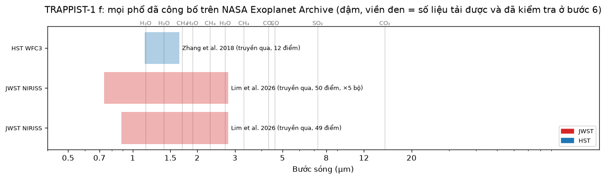

Không có điểm phổ nào tải được qua TAP (bảng `transitspec`, `emissionspec`).

**Mọi phổ đã công bố trong bảng `spectra` của NASA** (✅ = có số liệu tải được qua TAP và đã dùng ở trên):

| Loại | Kính / thiết bị | Bước sóng (μm) | Số điểm | Tác giả | bibcode | Dùng? |
|---|---|---|---|---|---|---|
| Transmission | HST WFC3 | 1.14–1.65 | 12 | Zhang et al. 2018 | [2018AJ....156..178Z](https://ui.adsabs.harvard.edu/abs/2018AJ....156..178Z) | — |
| Transmission | JWST NIRISS | 0.89–2.80 | 49 | Lim et al. 2026 | [2026AJ....172..200L](https://ui.adsabs.harvard.edu/abs/2026AJ....172..200L) | — |
| Transmission | JWST NIRISS | 0.73–2.80 | 50 | Lim et al. 2026 | [2026AJ....172..200L](https://ui.adsabs.harvard.edu/abs/2026AJ....172..200L) | — |
| Transmission | JWST NIRISS | 0.73–2.80 | 50 | Lim et al. 2026 | [2026AJ....172..200L](https://ui.adsabs.harvard.edu/abs/2026AJ....172..200L) | — |
| Transmission | JWST NIRISS | 0.73–2.80 | 50 | Lim et al. 2026 | [2026AJ....172..200L](https://ui.adsabs.harvard.edu/abs/2026AJ....172..200L) | — |
| Transmission | JWST NIRISS | 0.73–2.80 | 50 | Lim et al. 2026 | [2026AJ....172..200L](https://ui.adsabs.harvard.edu/abs/2026AJ....172..200L) | — |
| Transmission | JWST NIRISS | 0.73–2.80 | 50 | Lim et al. 2026 | [2026AJ....172..200L](https://ui.adsabs.harvard.edu/abs/2026AJ....172..200L) | — |

## LHS 1140 b

Bán kính 1.73 R⊕, khối lượng 5.6 M⊕, Teq 226.0 K, sao 0.2159 R☉ / 3096.0 K, cách 14.9861 pc (NASA `pscomppars`).

Biên độ đặc trưng phổ truyền qua dự kiến (2 độ cao thang, khí quyển trong không mây): H/He (μ = 2.3) **86 ppm**, hơi nước (μ = 18) **11 ppm**, CO₂ (μ = 44) **5 ppm**.

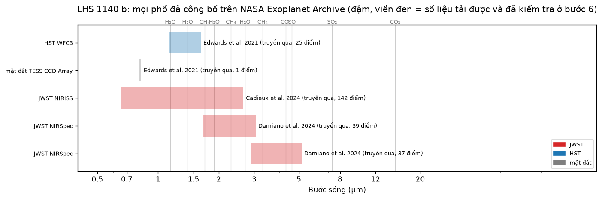

Không có điểm phổ nào tải được qua TAP (bảng `transitspec`, `emissionspec`).

**Mọi phổ đã công bố trong bảng `spectra` của NASA** (✅ = có số liệu tải được qua TAP và đã dùng ở trên):

| Loại | Kính / thiết bị | Bước sóng (μm) | Số điểm | Tác giả | bibcode | Dùng? |
|---|---|---|---|---|---|---|
| Transmission | mặt đất TESS CCD Array | 0.80–0.80 | 1 | Edwards et al. 2021 | [2021AJ....161...44E](https://ui.adsabs.harvard.edu/abs/2021AJ....161...44E) | — |
| Transmission | HST WFC3 | 1.13–1.63 | 25 | Edwards et al. 2021 | [2021AJ....161...44E](https://ui.adsabs.harvard.edu/abs/2021AJ....161...44E) | — |
| Transmission | JWST NIRSpec | 1.68–3.05 | 39 | Damiano et al. 2024 | [2024ApJ...968L..22D](https://ui.adsabs.harvard.edu/abs/2024ApJ...968L..22D) | — |
| Transmission | JWST NIRSpec | 2.90–5.15 | 37 | Damiano et al. 2024 | [2024ApJ...968L..22D](https://ui.adsabs.harvard.edu/abs/2024ApJ...968L..22D) | — |
| Transmission | JWST NIRISS | 0.65–2.65 | 142 | Cadieux et al. 2024 | [2024ApJ...970L...2C](https://ui.adsabs.harvard.edu/abs/2024ApJ...970L...2C) | — |
