# Sơ đồ các hệ bị tranh cãi

Tạo bởi `scripts/07_disputed_systems.py` (dùng hàm vẽ của bước 3). Hành tinh đã xác nhận lấy từ NASA Exoplanet Archive (`pscomppars`); hành tinh **bị bác (✗, xám chấm chấm)** và **ứng viên (?, gạch chấm)** lấy thông số từ bài đã công bố chúng. Bán kính của hành tinh chỉ có khối lượng là ước tính (vẽ mờ). Bối cảnh: `docs/khi-quyen-va-tuong-lai.md`, mục 3.5. Vị trí hành tinh vẽ cho ngày 16/11/2026.

## GJ 581

- ✗ d (Udry 2007), g, f (Vogt 2010): Robertson et al. 2014 cho thấy d và g là tín hiệu do hoạt động của sao (sao tự quay 130 ngày; d ≈ P_rot/2); f không được dữ liệu HARPS xác nhận. b, c, e vẫn là hành tinh thật.

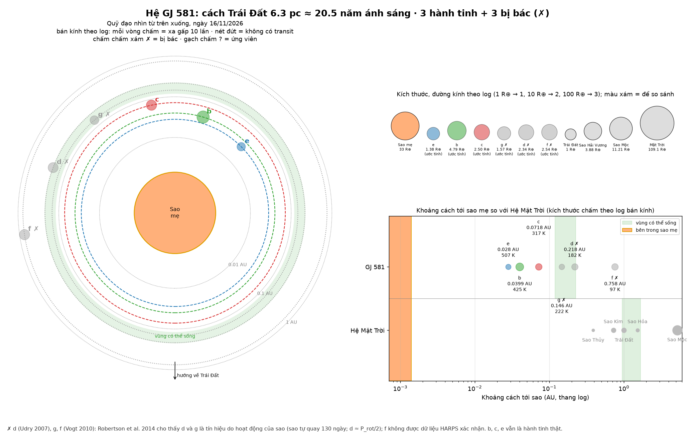

## Kapteyn's star

- ✗ b (trong vùng có thể sống) và c (Anglada-Escudé et al. 2014): Robertson et al. 2015 và Bortle et al. 2021 cho thấy cả hai là tín hiệu do hoạt động của sao. NASA vẫn còn liệt kê Kapteyn c.

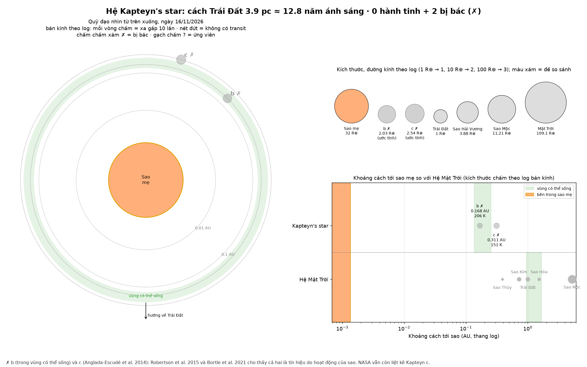

## Barnard's star

- ✗ 'b 2018' (Ribas et al. 2018, siêu Trái Đất lạnh 233 ngày): Lubin et al. 2021, do hoạt động sao + alias 1 năm.
- b, c, d, e (González Hernández et al. 2024; Basant et al. 2025): 4 hành tinh rất nhỏ, quá nóng, đã xác nhận.

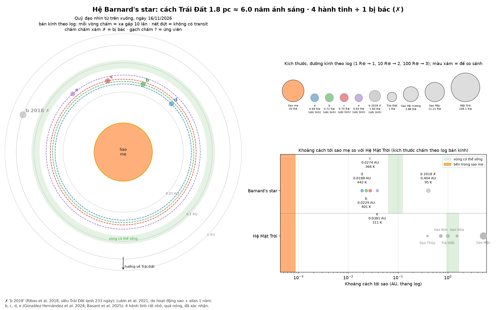

## Proxima Centauri

- ? c (Damasso et al. 2020, chu kỳ ~5 năm): tín hiệu RV yếu, chu kỳ gần bằng thời gian quan sát, chưa được nhóm độc lập xác nhận.

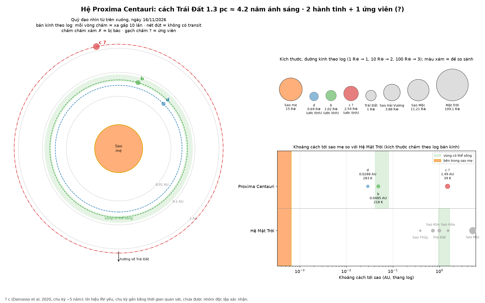

## Alpha Centauri A

- ? S1 (Sanghi, Beichman et al. 2025): chấm sáng JWST MIRI 8/2024, chưa thấy lại (2/2025, 4/2025). Quỹ đạo e ≈ 0,4, chu kỳ 2–3 năm, cỡ khí khổng lồ: a và bán kính ở đây là giá trị minh họa trong khoảng bài báo đưa ra.

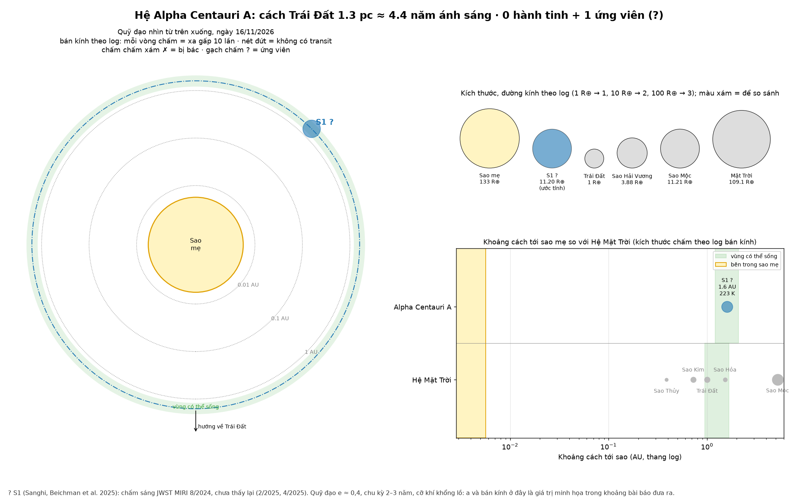

## Alpha Centauri B

- ✗ Bb (Dumusque et al. 2012, Nature): Rajpaul et al. 2016 cho thấy tín hiệu sinh ra từ lịch quan sát (window function). Hiện không có hành tinh nào được xác nhận quanh α Cen B.

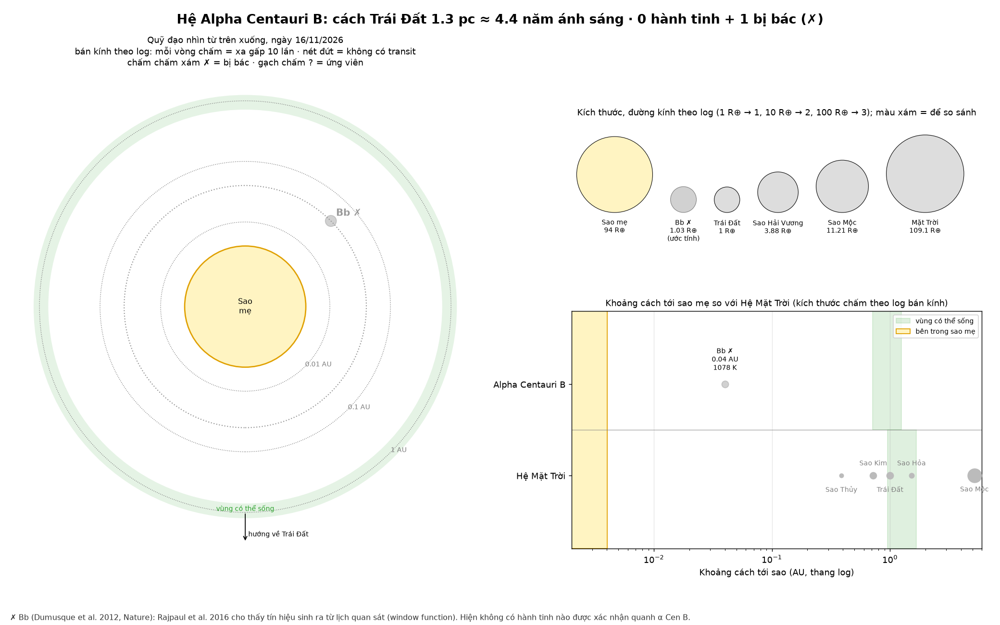

## Fomalhaut

- ✗ b (Kalas et al. 2008, ảnh HST): Gáspár & Rieke 2020: chấm sáng nở to và mờ dần, là đám bụi từ va chạm, không phải hành tinh. Vùng có thể sống tính theo công thức cho sao ≤ 7200 K nên chỉ là gần đúng (Fomalhaut 8590 K).

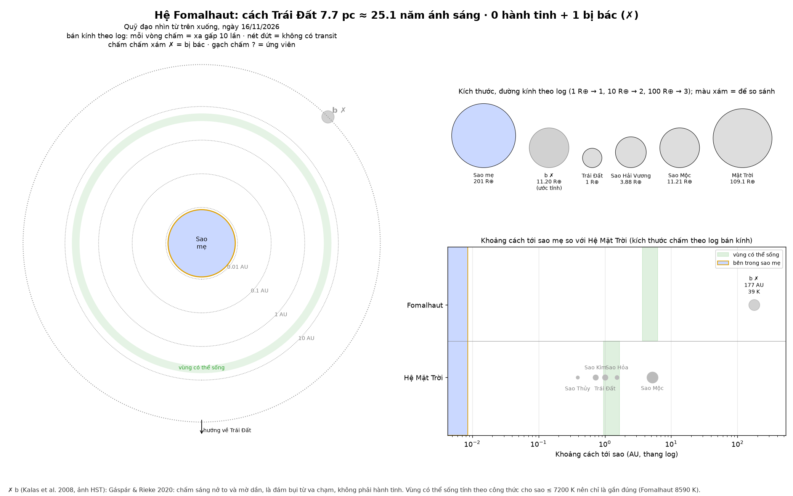

## K2-18

- b: sub-Neptune 8,6–8,9 M⊕ trong vùng có thể sống. CH₄, CO₂ (JWST 2023) khá vững; DMS/DMDS 'dấu hiệu sự sống' (~3σ, 2025) bị nhiều phân tích độc lập bác là không đủ bằng chứng. Phổ: outputs/disputed/K218b_spectra.png.

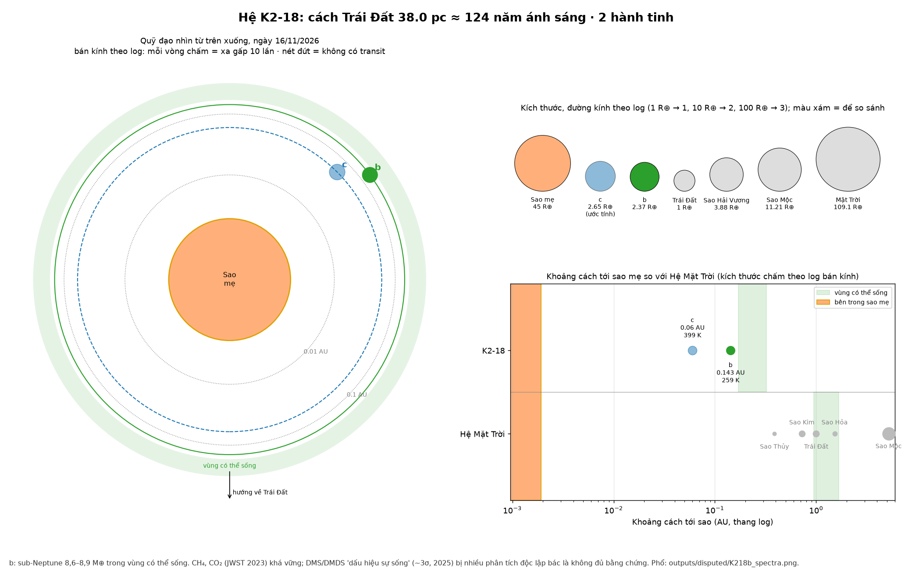

## TRAPPIST-1

- e, f (vùng có thể sống): JWST loại khí quyển giàu H₂ (e: 2025, f: 2026); khí quyển N₂ kiểu Trái Đất hay đá trần vẫn chưa phân biệt được. Chương trình JWST 15 transit của e: tới 11/2026 chưa công bố kết quả.

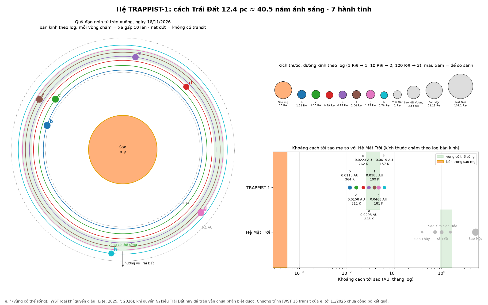

## LHS 1140

- b: siêu Trái Đất trong vùng có thể sống. JWST 2024 (Cadieux et al.) loại khí quyển H₂ dày, gợi ý tạm thời có N₂; chưa xác nhận.

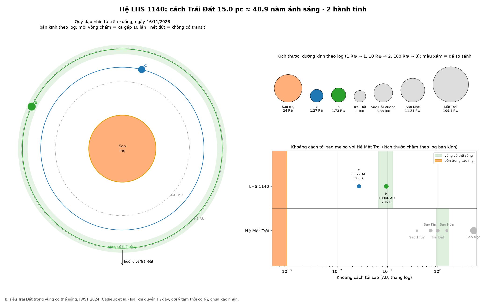

## GJ 1132

- b: HST 2021 (Swain et al.) tuyên bố khí quyển núi lửa; nhóm khác cùng dữ liệu ra phổ phẳng; JWST 2023: 2 lần transit cho 2 kết quả khác nhau; 2025: nhiều khả năng đá trần. Phổ: outputs/disputed/GJ1132b_spectra.png.

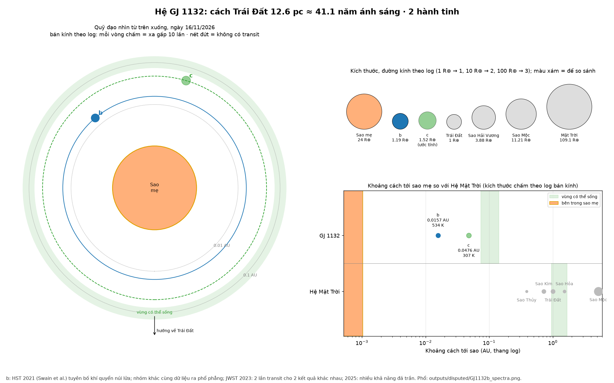

## GJ 486

- b: JWST 2023 (Moran et al.) thấy tín hiệu hơi nước, nhưng có thể do vết lạnh trên sao. Phổ: outputs/disputed/GJ486b_spectra.png.

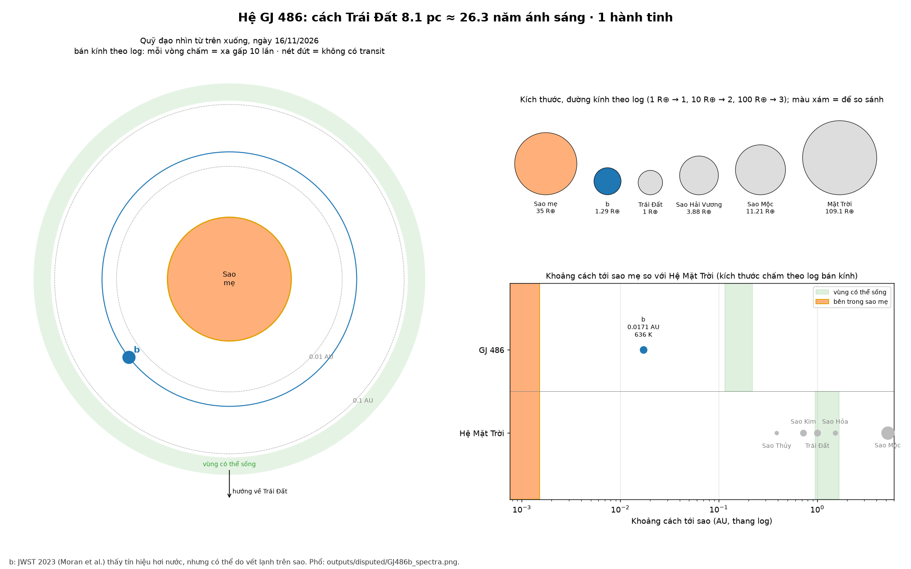

## 55 Cancri

- e: hành tinh dung nham ~2.000 °C. JWST 2024 (Hu et al.) có dấu hiệu khí quyển thứ cấp CO/CO₂; độ sâu nhật thực thay đổi giữa các lần đo. Hoàn toàn không thể có sự sống. Phổ: outputs/disputed/55Cnce_spectra.png.

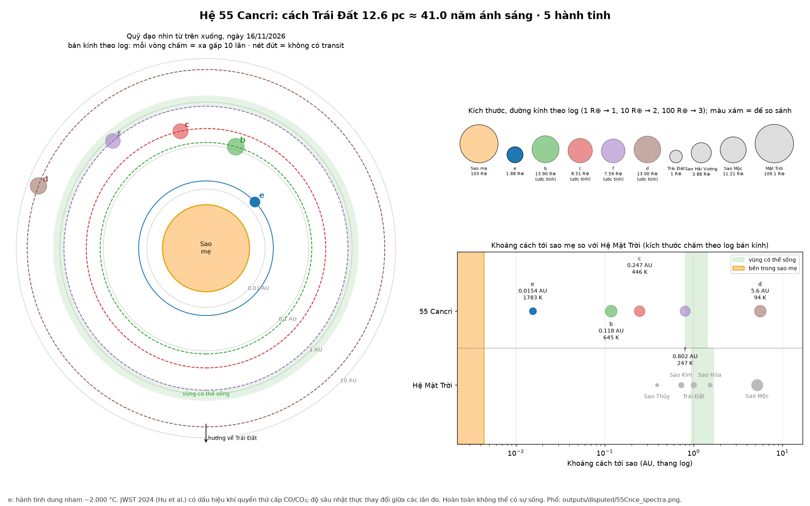

## Kepler-1625

- b: ứng viên vệ tinh cỡ Sao Hải Vương Kepler-1625 b-i (Teachey & Kipping 2018), đang tranh cãi (Heller & Hippke 2024). Pipeline repo: outputs/Kepler1625_report.md, _moons.md.

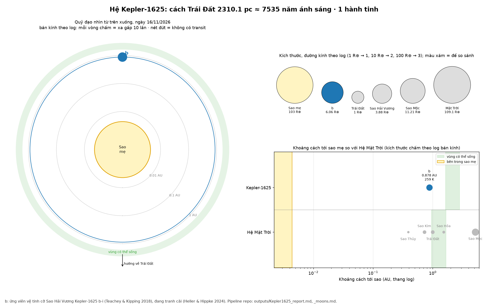

## Kepler-1708

- b: ứng viên vệ tinh ~2,6 R⊕ Kepler-1708 b-i (Kipping et al. 2022), đang tranh cãi. Pipeline repo: outputs/Kepler1708_report.md, _moons.md.

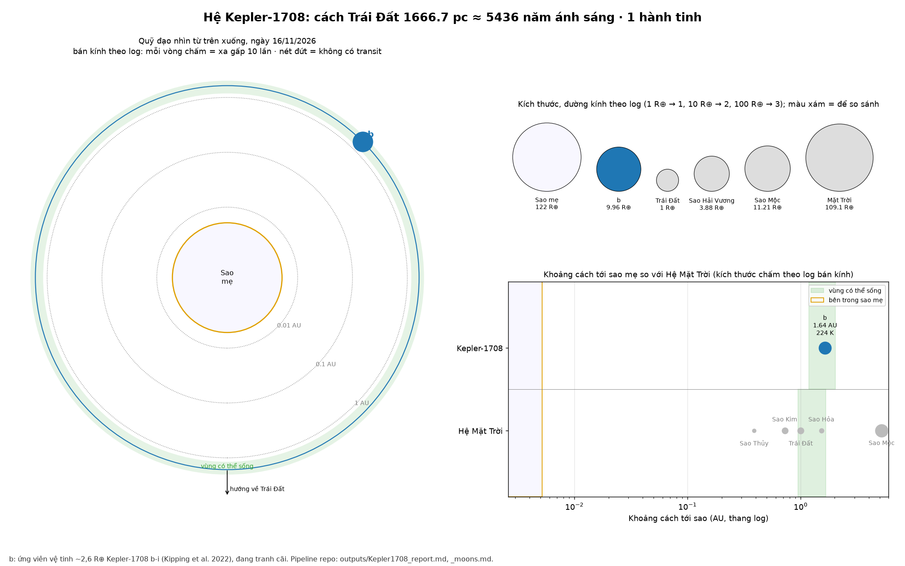
